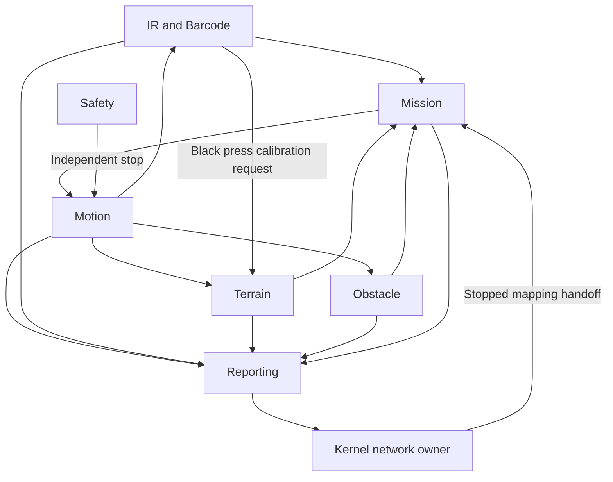

# System architecture

The robot uses micro T-Kernel 3.0. One Mission controller coordinates the five subsystem services; independent Safety and GP21 can stop Motion. [TEAM](TEAM.md) owns pins/resources and priorities. [GUIDE](../GUIDE.md) owns operation; [PROJECT_SPECS](donotsubmit/PROJECT_SPECS.md) owns requirements and pending course/measurement decisions.

## Subsystems

| Guide | Responsibilities |
| --- | --- |
| [Subsystem 1](architecture/SUBSYSTEM1.md) | Actual snapshots, bounded MQTT reporting, read-only requests and stopped mapping transport |
| [Subsystem 2](architecture/SUBSYSTEM2.md) | Sole motor writer, encoders, wheel PID, leased actions and stop/reset acknowledgement |
| [Subsystem 3](architecture/SUBSYSTEM3.md) | IR/barcode sensing, combined calibration coordination, Mission and Safety |
| [Subsystem 4](architecture/SUBSYSTEM4.md) | Task-owned IMU calibration, movement observations, reference-calibrated humps and history |
| [Subsystem 5](architecture/SUBSYSTEM5.md) | Bounded Echo acquisition, stationary coarse/fine scanning and profiles |

## States and arbitration

Boot is braked. First black press starts black+IMU calibration, then white capture and stopped mapping/configuration/health qualification permit READY. A separate fresh GP20 press begins FollowLine. Mission transitions through Navigation, Scan, Bypass and Reacquire; confirmed finish enters Complete. GP21/fault latches stop; reset and restart are separate.

Arbitration is stop/fault, required-data health, obstacles, navigation, then line guidance. Obstacles cancel pending navigation; nested obstacles during bypass/recovery stop after inspection rather than inventing another original route. Short last-direction recovery is bounded to 500 ms and needs current-run direction evidence. Junction/finish confirmation requires distinct consecutive acquisitions and travel context.

## Shared contracts

| Interface | Contract |
| --- | --- |
| `s3_ir_copy` | Coherent fresh/valid calibrated observation; original acquisition time and sequence |
| Barcode APIs | Bounded edge ring and command FIFO; copied events with mapping/scanner/encoder identity; report history survives capture reset |
| `s2_command` / feedback / ack | Signed speed/distance/turn, action/run identity, 60 ms lease and immutable absolute deadline; retained completion |
| S2 stop/reset/health | Independent persistent stop; brake acknowledgement; reset invalidates old actions |
| S4 calibration request/cancel | Core-1 bounded handoff; stopped raw-count stationarity; explicit request ID/status/sample count |
| S4 reset/snapshot | Task-owned state; new-run epoch/height/history reset is coherent, stop retains accepted results |
| S5 snapshot/scan/cancel | Separate forward/profile timestamps; stationary scan with absolute deadline; cancel retained through center restoration |
| Mission snapshot/mapping | One bounded cross-core configuration handoff, revalidated while braked/stationary |
| S1 snapshots/history | Nonblocking optional copies; reporting never authorizes movement or supplies watchdog progress |

Core-1 priorities are Safety 12, Motion 13, Mission 14, Line/Barcode 15, Terrain 16, Obstacle 17 and Reporting 20. Kernel WiFi/MQTT stays on core 0. One bounded micro T-Kernel GPIO dispatcher services encoder edges before barcode/Echo. Only claimed edges are acknowledged.

Use kernel millisecond time for freshness/control and hardware TIMER microseconds for barcode/Echo. Keep clock domains explicit; unsigned elapsed arithmetic handles wrap. Storage, acquisitions, actions, scans and retries are bounded. No floating-point formatting/allocation/blocking in interrupts.

## Safety and acceptance

Required IR/Motion freshness is 60 ms; Terrain/forward sonar freshness is 250 ms. Normal firmware supervises local progress with a 250 ms watchdog after services qualify. TEST always inhibits motors and does not enable that watchdog. Networking is excluded from local health.

GP21's latched local-stop reason dominates later faults. Mission rechecks inhibition around acknowledged Motion reset and serializes state updates with Safety; an arriving stop cannot become READY, moving or COMPLETE through that transition. Releasing GP21 alone never clears the latch.

After a completed obstacle scan, Mission rechecks required IR/Motion/Terrain health, measured stationarity and brake acknowledgement before releasing Motion. A healthy scan cannot compensate for another producer becoming stale or uncalibrated during scanning. Shared polling-lock scheduling is owned by [TEAM](TEAM.md#5-interfaces-between-subsystems).

The dogleg uses measured sonar offsets, pivot envelope and braking headroom, supported side clearance (left on a tie), confirmed depth/departure bounds and encoder actions. Reacquisition needs expected pose/heading/corridor and two fresh visible observations. Sensor geometry, slip and between-ray clearance require physical/course acceptance.

Optional raised-wheel commissioning is locally selected, limited to two seconds and excludes mission readiness. Power policy and release steps are in GUIDE. [Fresh test records](../testing/README.md) distinguish source/build checks, executed fixtures and physical results.

## Available-hardware verification

The explicit `TEST=1 IR_ONLY_TEST=1` image permits IR calibration without Terrain and remains motor inhibited and excluded from mission readiness. Normal black capture still requires joint IMU calibration. Stopped MQTT replacement uses fresh, fault-free raw encoder quiet time and brake acknowledgement, independent of unaccepted metric/PID calibration (INT-28).

Core-1 SysTick is disabled by the SMP kernel. Sonar trigger delays therefore use the shared hardware TIMER through a bounded microsecond helper, with interrupts enabled and TRIG restored low on failure. INT-29 and advancing live S5/reporting snapshots cover the former starvation defect; actual Echo/servo acceptance remains pending. S1 refreshes its internal provider every 20 ms; MQTT publication remains every 500 ms and required-data freshness stays 60 ms.
