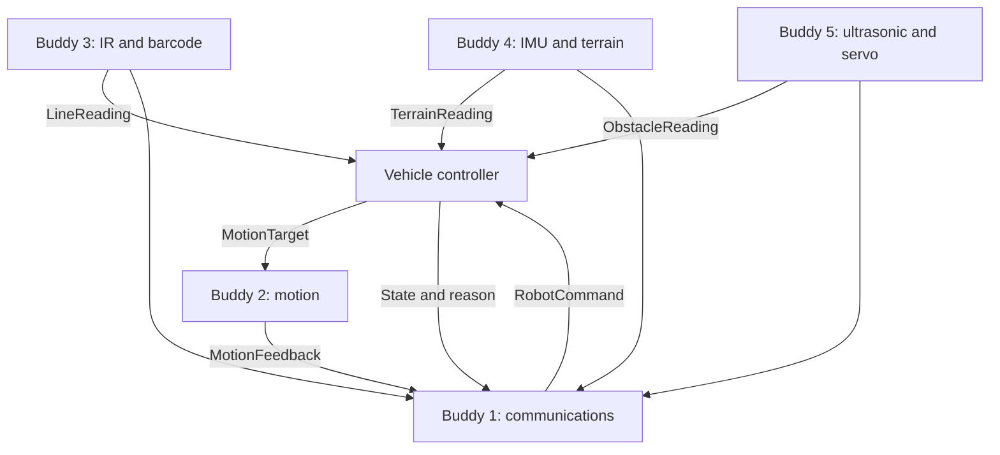
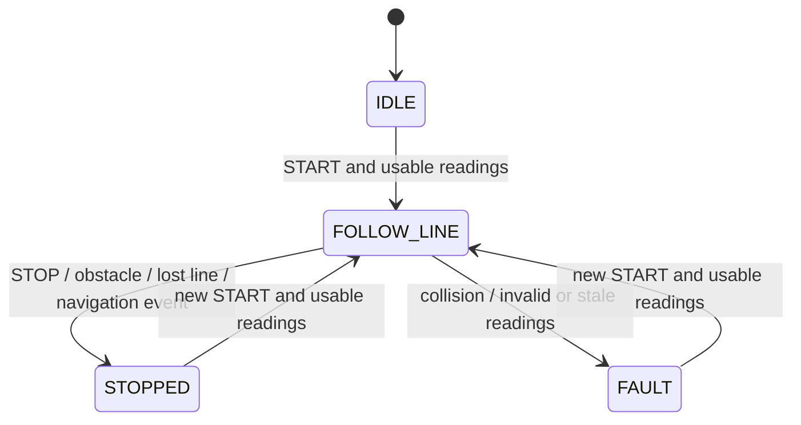

# Architecture and shared contracts

This diagram is the intended data flow. The USB telemetry stub currently reports
controller state, reason and requested speeds; its API already accepts sensor
and motion readings for later telemetry expansion.

## Source ownership

| Owner | File | Responsibility |
| --- | --- | --- |
| Integration owner | `src/controller.c`, `src/main_pico.c` | Decide mission state; coordinate calls and priorities |
| Buddy 1 | `src/subsystems/comms.c` | Connection, command validation, telemetry, heartbeat/reconnect |
| Buddy 2 | `src/subsystems/motion.c` | Exclusive motor-output ownership, encoders, PID, bounded turns |
| Buddy 3 | `src/subsystems/line_barcode.c` | Three IR readings, calibration, line/junction/barcode interpretation |
| Buddy 4 | `src/subsystems/terrain.c` | IMU calibration, orientation, humps/height, collision/motion events |
| Buddy 5 | `src/subsystems/obstacle.c` | Servo/ultrasonic acquisition, profile and avoidance proposals |
| Whole team | `include/robot/` | Review changes to shared structures and function contracts |

Sensor modules report observations or proposals. They never drive motors.
Extend the controller to arbitrate Buddy 5's avoidance proposal versus Buddy 3's
navigation event. Do not add a second path to motor GPIO writes.

## Data rules

- Distances/heights: metres. Wheel speeds: metres/second, positive forward.
- Angles: degrees. Turn rate: degrees/second. Document IMU axes after mounting.
- Line error: -1 on the left, +1 on the right. A positive error requests a faster
  left wheel and slower right wheel, assuming a two-wheel differential drive.
- Time: monotonic unsigned 32-bit milliseconds. Set `sampled_ms` when the reading
  is acquired, not when a cached reading is returned.
- `valid=false` means unavailable, failed or uncalibrated. A numeric zero is not
  a substitute for validity. Optional height/profile values have separate flags.
- `ObstacleReading.status` describes the latest **forward** clearance. Refreshing
  side scans must not make old forward clearance appear fresh.
- Navigation and remote commands are consumed once. Clear them to `NAV_NONE` or
  `COMMAND_NONE` on the next poll. A held/replayed start must not restart a stop.
- Calls currently run on one core in a cooperative loop. Future interrupt/DMA
  producers must supply coherent snapshots; `volatile` alone is not a queue.
- Updates must be bounded. Spread servo settling, echo capture and WiFi reconnect
  across updates. Do not block the controller while waiting for a whole scan.

## Starter behavior

The diagram shows the main paths. A start with unusable data also enters FAULT
from IDLE or STOPPED. STOP has first priority in every state; it zeroes targets
without depending on sensor health. `main_pico.c` calls `motion_stop()` whenever
the controller is not following the line. Implementing the physical stop remains
Buddy 2's responsibility.

The current proportional steering is an outer loop that requests wheel speeds;
it is not encoder PID. Buddy 2 must close each wheel's speed loop. Motion feedback
is not yet a controller interlock: add driver-ready/fault and stall checks before
enabling real autonomous driving. Also add a hardware watchdog and a bounded
motor-command timeout when real outputs are introduced.

Future states should include turn execution, obstacle scanning/bypass and line
reacquisition, each with completion conditions and timeouts. Hump measurement
can initially run alongside navigation. Do not estimate height as a bare double
integral of uncorrected acceleration; define and validate the measurement method.

## Proposed MQTT contract (not implemented)

| Topic | Direction | Purpose |
| --- | --- | --- |
| `robot/car01/telemetry` | Car to broker | State, reason, measured speed/distance, sensor values and validity |
| `robot/car01/heartbeat` | Car to broker | Uptime and connection health |
| `robot/car01/command` | Broker to car | Start/stop requests |

Example command: `{"id":42,"command":"stop"}`.
Reject unknown commands, bound payload size, consume commands once, and avoid
retained start messages or re-executing duplicates after reconnection. Define
session/sequence handling and expiration before enabling remote start. Keep
credentials out of source control. Start with a bench broker and record message
examples plus reconnect behavior in Buddy 1's MQTT documentation.

## Initial scheduling proposal

`main_pico.c` polls modules once per loop, then sleeps 20 ms. Each module should
internally schedule its acquisition at a rate supported by the chosen hardware.
The effective loop period includes execution time and is not a guaranteed 50 Hz.
USB status is requested every 500 ms. Measure timing, bound telemetry work, and
introduce deadline scheduling before tuning control loops; add an RTOS only if
your course or measured timing needs justify it.
