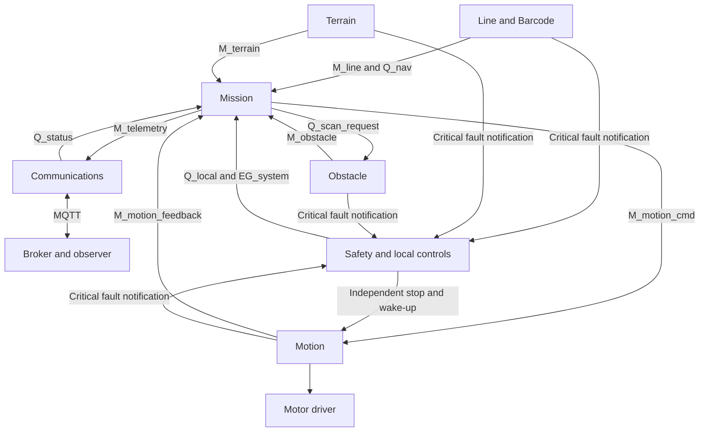
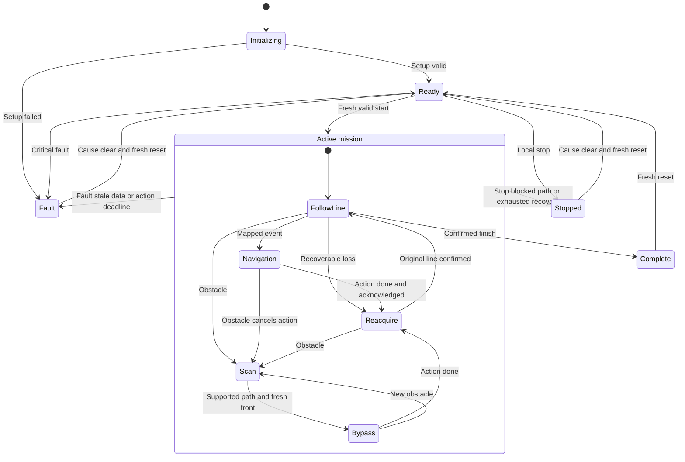

# System architecture

The intended robot separates sensing, Mission decisions, Motion actuation, Safety and reporting. [PROJECT_SPECS](PROJECT_SPECS.md) owns required outcomes; [TEAM](TEAM.md) owns pins, priorities and resources. The full design below is proposed. [GETTING_STARTED](GETTING_STARTED.md#current-capabilities) identifies the implemented bench and remaining work.

## Data flow

Drivers acquire bounded samples. Processing modules publish coherent observations; Mission selects behavior and issues leased Motion actions. Motion alone writes motor PWM and uses encoder feedback. Safety stops Motion independently of Mission queues. Reporting cannot authorize movement.

## Subsystem boundaries

| Guide | Responsibility |
| --- | --- |
| [Line Tracking](architecture/LINE_TRACKING.md) | Calibrated P guidance, visibility classification and bounded short line-loss recovery |
| [Barcode](architecture/BARCODE.md) | Ordered bar/space capture, frame validation and one-shot navigation events |
| [Motion](architecture/MOTION.md) | Motor ownership, planned wheel PID, encoder actions, leases and completion |
| [Obstacle](architecture/OBSTACLE.md) | Fresh forward clearance, stationary coarse/fine scanning and profiles |
| [Terrain](architecture/TERRAIN.md) | Motion classification, impact reporting and validated maximum hump height |
| [Communications](architecture/COMMUNICATIONS.md) | Kernel-owned networking, telemetry and proposed status requests |

## Shared contracts

These are logical full-robot contracts, not already allocated RTOS objects. Micro T-Kernel mailboxes pass linked pointers; they do not provide copied length-one overwrite semantics. Use mutex copies for snapshots and bounded message buffers or explicitly pooled messages for FIFO events.

| Object | Contract |
| --- | --- |
| `M_line`, `M_terrain`, `M_obstacle`, `M_motion_feedback`, `M_telemetry` | Latest coherent mutex-protected value: validity, acquisition timestamp, sequence, units and status. Separate validity/age for optional height/profile values. |
| `M_motion_cmd` | Action ID, mode/target, issue/expiry time and context. Renew the same action's lease without restarting its absolute deadline. Expiry brakes locally; reset invalidates earlier commands. |
| `Q_nav` | Bounded FIFO of copied event ID, symbol, mapped action and acquisition time. Consume once in permitted context; never overwrite events. Overflow/capture loss faults explicitly; purge obsolete events on reset/action completion. |
| `Q_scan_request` | Scan ID, region/mode and absolute deadline. Require fresh measured stationarity; ignore duplicates, cancel on stop and report queue-full failure. |
| `S_echo` | Wake-up from bounded echo-edge ISR; processing occurs outside ISR. |
| `EG_system`, independent stop path | Persistent stop/fault state plus direct Motion notification/wake-up; independent of diagnostic queue capacity. |
| `Q_fault_safety`, `Q_fault_mission` | Separate fault diagnostics; inability to enqueue does not suppress the safety action. |
| `Q_local`, `Q_status` | Fresh local controls and bounded/rate-limited validated reporting requests. Status requests cannot drive, start, stop or clear a latch. |
| Health snapshots / heartbeats | Advance only after meaningful bounded work; frozen/expired required progress faults while moving. Expected stationary-scan gaps use the scan deadline. |

Use monotonic acquisition time and unsigned wrap-safe age calculations. Copying or publishing cached data never refreshes its time. Distances/heights are metres, speeds metres/second, angles degrees; line error/steering is negative left and positive right. Use deadline-based periodic releases, skipping missed releases rather than replaying a backlog. Bound storage, waits, retries and event processing; sonar settling and network reconnection must not block control.

The implemented bench uses a narrower `MotionRequest`/`MotionHealth` contract. Its IF-01/02/03 behavior remains in the [IR handoff](architecture/IR_MOTION_HANDOFF.md#current-interface-contract); IF-04 is typed `IrTrackingOutput` in [Line Tracking](architecture/LINE_TRACKING.md#modules-and-drivers), and IF-05 is the [S1 snapshot](architecture/COMMUNICATIONS.md#modules-and-drivers). Requested duty and a stop latch are not measured speed/stationarity.

## System state diagram

Active mission is a visual grouping of the existing operating states, not an additional firmware state. This is the integrated proposal. Complete has no usable entry guard until the finish decision in [PROJECT_SPECS](PROJECT_SPECS.md#pending-decisions) is resolved. Critical faults and local stop inhibit movement in every state, including initialization and Ready.

## Mission and Safety responses

| State / event | Response |
| --- | --- |
| Initializing / Ready | Brake, create objects, validate required sensing; reset alone never moves |
| FollowLine | Use calibrated P guidance through Motion; monitor obstacles, barcodes and terrain concurrently |
| Navigation | Execute one encoder action ID; preserve absolute timeout on lease renewal; retain completion until acknowledged |
| Scan | Request stop, wait for fresh measured stationarity, request bounded profile; restore center and fresh forward range before bypass |
| Bypass | Bounded permitted route inside course envelope; maintain forward clearance; new obstacle returns to Scan |
| Reacquire | Bounded low-speed search with valid IR and forward range; require the original line, not an unrelated crossing |
| Stopped / Fault / Complete | Brake and retain run maximum; reset requires cleared cause and fresh local input; a later fresh start begins the next run |

Arbitration: local stop/critical fault → required-data validity → obstacle handling → barcode/navigation → normal line guidance. Obstacle preemption cancels earlier navigation. Barcode reads during bypass/recovery may be logged but cannot redirect movement. Hump monitoring and telemetry run alongside control. Clear the retained hump maximum only on a fresh run, not on a stop.

Design targets and unresolved limits are centralized in [PROJECT_SPECS](PROJECT_SPECS.md#design-targets-and-team-constraints). Record physical acceptance in [testing](../testing/README.md); proposed states, builds and software self-checks do not establish an operational mission.
