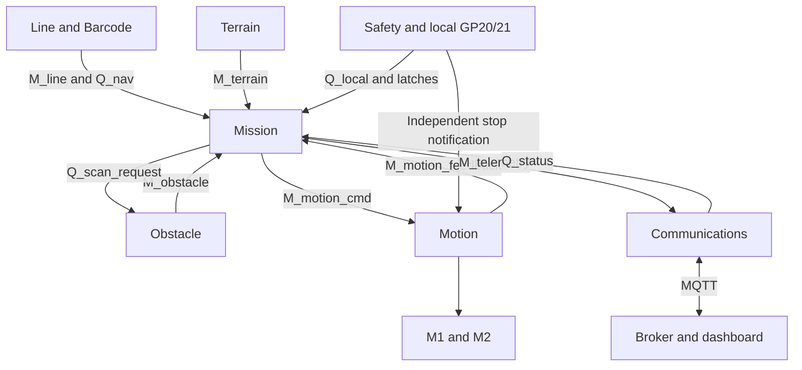

# Autonomous robotic car — system architecture

## Scope and status

This is the **target design** for the team car, based on the mission requirements below, [hardware evidence](HARDWARE.md), and the [design review](<../../CSC01 Design Review.docx>). The car must autonomously follow a black line, decode navigation barcodes, execute left/right/straight/U-turn actions, detect and estimate the highest hump, profile and bypass obstacles, reacquire the original line, and report telemetry over WiFi/MQTT. It is a Pico WH on a Cytron Robo Pico carrier. On 5 October 2026 Nicholas requested swapping the IR Grove ports: right IR is now Grove 6 / GP27, left IR Grove 5 / GP26; the Word design is preserved as submitted. The active setup uses the later bench IR swap; [HARDWARE.md](HARDWARE.md) also preserves the review’s original right/left allocation. The documented connections do not prove installed electrical verification.

## Authority and implementation status

The [CSC01 Design Review](<../../CSC01 Design Review.docx>) is the primary integrated design reference. The mission requirements and source audit below preserve assignment/design evidence. [Hardware](HARDWARE.md) retains datasheet facts and submitted versus current bench wiring.

The review is a **proposed FreeRTOS design**, not implemented task scheduling or hardware-test evidence. The current `right_ir_follow_mqtt` application is a cooperative single-loop bench follower: right IR GP27/ADC1, M1/M2 PWM, local GP20/21, MQTT calibration/status and telemetry. It disables servo, omits IMU/sonar/encoders, and has no barcode, obstacle or hump mission. `robot_car` is the full-mission scaffold; the optional `sensor_bench_mqtt` is a stationary acquisition application. These are alternative firmware targets, not simultaneous programs on the robot.

## System data flow

This is the proposed integrated task flow; the cooperative bench does not implement these RTOS objects. Critical producers also notify Safety through the independent fault path described below.

## Target task boundaries and data flow

| Task / owner | Priority | Nominal release | Responsibility |
| --- | ---: | --- | --- |
| Safety / Nicholas | 5 | 10 ms and events | Local GP20/21; persistent stop/fault; independent wake-up of Motion |
| Motion / Mahesha | 4 | 20 ms and stop notification | Sole GP8–GP11 writer; encoder PID; action IDs, completion, command expiry and brake |
| Mission / Nicholas | 3 | 20 ms and bounded events | Mission arbitration; motion commands; scan requests; telemetry aggregation |
| Line/Barcode / Nicholas | 3 | ADC 20 ms; barcode IRQ | GP26/27 line observations; GP16 bar/space captures; one-shot navigation |
| Terrain / Darrius | 2 | 20 ms fresh polling | GY-511/I2C0; classification, impact and validated maximum hump height |
| Obstacle / Jia Jing | 2 | Bounded acquisition states | GP2 echo, GP3 trigger, GP12 servo; independent front/profile freshness |
| Communications / Shaun | 1 | Network events; 500 ms telemetry | WiFi/MQTT, status validation, bounded reconnection |

This allocation comes from review Sections 3–4. The current bench main directly owns motor GPIO; that is a limited bring-up implementation, not the proposed RTOS ownership split. The shared `include/robot/` interfaces still need action IDs, leases, U-turn and full RTOS contracts before mission integration.

Latest-value mailboxes `M_line`, `M_terrain`, `M_obstacle`, `M_motion_feedback` and `M_telemetry` hold coherent timestamped observations. `M_motion_cmd` carries ID-bound leased commands. FIFO `Q_nav` preserves one-shot events; `Q_scan_request` carries bounded scan requests. `Q_local` carries fresh local controls, `Q_status` requests reporting, `S_echo` wakes echo processing and `EG_system` carries Safety latches. Critical producer faults notify Safety independently of diagnostic queues. Snapshot overwrites must never erase navigation events or action completion; command expiry brakes locally. Queues, stack sizes, deadlines and lease bounds require measurement.

## Detailed subsystem designs

| Document | Responsibility |
| --- | --- |
| [Line following](architecture/LINE_FOLLOWING.md) | IR calibration, steering, motion/encoder contract and current bench tuning |
| [Communications](architecture/COMMUNICATIONS.md) | WiFi/MQTT connection, payloads, validation, dashboard and recovery |
| [Obstacle](architecture/OBSTACLE.md) | Sonar/servo acquisition, stationary scans, bypass and recovery |
| [Terrain](architecture/TERRAIN.md) | GY-511 data, movement classification and validated hump height |
| [Barcode](architecture/BARCODE.md) | Edge capture, bar/space widths, frame validation and navigation events |

Full wiring/electrical references are in [HARDWARE.md](HARDWARE.md). Setup and the implementation plan are in [GETTINGS_STARTED.md](GETTINGS_STARTED.md).

## Mission arbitration

The target state machine is **idle/ready → follow line → execute navigation or scan/bypass → reacquire line → follow line**, with stopped/fault states and a finish state only after the course end rule is defined. Hump monitoring and telemetry run alongside motion. The controller gives physical stop/fault conditions first priority, then stale/invalid sensor or motion feedback, then obstacle handling, then barcode/junction actions, then ordinary line steering. Each maneuver needs entry criteria, completion evidence, timeout, and a safe exit. No network message may override a safety stop. The review permits validated status requests only and rejects drive/start/stop. The current bench additionally permits stopped black/white calibration as a user-requested implementation extension. The `s`/`x` USB commands are bench-only scaffold controls.

Use a monotonic timestamp at acquisition, an explicit validity flag, and separate status for optional profile/height values. Distances and heights are metres, speed metres/second, angles degrees, and line error is negative left/positive right. Treat navigation events as one-shot. Updates should finish promptly: sonar waits, servo settling, and WiFi reconnection must not block motor control. The target uses deadline scheduling: Safety 10 ms, Motion/Mission/line/Terrain 20 ms, required-sample age initially 250 ms, and commanded brake within 50 ms. These are design targets requiring timing measurements. The bench samples ADC every 20 ms and services networking in a loop sleeping 1 ms; it does not establish RTOS deadlines. `code/include/robot/config.h` contains demonstration values, not calibrated limits.

## Telemetry and verification boundaries

The intended MQTT publication covers mission state/reason, measured wheel speed/counts/distance, line/barcode status, hump events and highest valid height, forward and side obstacle data, plus validity/age and heartbeat/connection health. The review requires healthy local autonomy to continue through WiFi/MQTT loss. The bench uses `robot/car01/{telemetry,heartbeat,command,status}`, 500 ms telemetry, 1 s heartbeat, and a session/ID/age-validated command envelope. Credentials are in the ignored local header. These configured implementation details are not all fixed by the review. USB logs can support early bench tests but do not satisfy MQTT. Keep credentials out of source control and prevent stale or replayed subscribed messages from taking effect.

Before calling this architecture operational, show repeatable subsystem measurements, a physically verified stop, bounded turns, known-barcode trials, known-height hump trials, obstacle bypass with line reacquisition, and a full mission with telemetry. Log firmware revision, setup, expected and actual results, units, and evidence in [`code/docs/test-log.csv`](test-log.csv). The review defines planned T01–T16 trials and candidate timing/electrical targets, while course-level accuracy/pass thresholds still require agreement. No planned trial is a passed result.

## Mission requirements

| ID | Required outcome | What the write-up says |
| --- | --- | --- |
| M1 | Follow the track | Follow the black line autonomously using IR sensing; tolerate minor lighting changes, small track imperfections, and speed changes. |
| M2 | Read navigation barcodes | Detect and decode barcodes placed at selected course locations. |
| M3 | Act on barcode commands | Execute **left**, **right**, **straight**, and **U-turn** commands accurately using encoder-based motion control. |
| M4 | Detect humps | Recognize one or more humps from IMU data. |
| M5 | Measure peak hump | Estimate hump height using IMU data and report the highest hump peak experienced during the run. |
| M6 | Detect obstacles | Detect objects on or near the line. |
| M7 | Profile obstacles | Use ultrasonic sensing to estimate obstacle shape/position, width, closest point, and left/right clearance. |
| M8 | Bypass safely | Stop or slow, select a safe maneuver, avoid collision, and minimize departure from the intended route. |
| M9 | Recover route | Find and reacquire the original line after bypassing the obstacle, then continue normal navigation. |
| M10 | Report telemetry | Send robot and mission data over WiFi; the buddy brief specifically calls for MQTT communication and command subscription. |

### Expected mission flow

1. Start an autonomous run with the robot ready to sense and move. The source does not define the exact start trigger.
2. Track the black line continuously. Detect any adjacent or crossing barcode and turn it into a navigation command.
3. Execute the command through controlled motor movement and encoder feedback, then resume line tracking.
4. While traversing the course, detect humps and keep the maximum valid peak measurement for reporting.
5. On obstacle detection, slow or stop, scan, estimate available clearance, choose a bypass or reverse/retry action, and avoid contact.
6. Search for the original line after a bypass and return control to normal line following.
7. Send meaningful status and measurements through WiFi during the run and demonstrate the integrated outcome.

This sequence summarizes the stated behaviors; exact state transitions, timeout values, stop rules, retry limits, and end-of-course behavior still need team decisions.

## Assessment and evidence

The write-up lists mission completion, navigation accuracy, obstacle avoidance, barcode reliability, hump measurement, robustness, software design, resource efficiency, integration, and demonstration performance. The briefing groups assessment under mission, navigation, perception, robustness, engineering, integration, and demonstration. No weights or numerical pass marks are provided.

The briefing explicitly calls for: defined inputs/outputs/owners; repeatable subsystem tests; recorded measurements and calibration; early integration using stable APIs; and practice for a **Week 10 demonstration**. It does not supply a dated schedule or a Week 10 marking sheet.

## Firmware targets

| Target | Entry point | Status |
| --- | --- | --- |
| `right_ir_follow_mqtt` | `src/main_right_ir_follow.c` | Active cooperative bench: actual GP27 ADC, M1/M2 PWM, local buttons, calibration/status MQTT |
| `sensor_bench_mqtt` | `src/main_sensor_bench.c` | Optional stationary IR/GY-511/servo-sonar acquisition; disabled by default |
| `robot_car` | `src/main_pico.c` | Full-mission controller scaffold with invalid/no-op sensor/motor drivers and WiFi backend when enabled |

Each target has its own `main`; only the flashed target runs. Do not flash the scaffold expecting the bench motor follower.

## Remaining structure

`include/robot/` contains shared types/contracts; `src/subsystems/` contains mission modules and networking. `tests/` provides pure control/protocol checks and fake-SDK driver/network tests. `config/network_config.h` is ignored private configuration; `wifi/include/lwipopts.h` configures lwIP. `scripts/` contains build/check and monitoring tools. Project and technical Markdown lives in this directory.

The teammate `wifi_telemetry` branch supplied WiFi/MQTT connection, retries, heartbeat and legacy start/stop tools. This branch is rebased onto it and changes the subscription policy to match the design’s local motion controls, with user-requested stopped calibration added. [WiFi guide](architecture/COMMUNICATIONS.md) documents the reconciled current transport contract.

## Verification boundary

Real SDK firmware builds, host steering/protocol/controller checks and fake-SDK driver/network checks passed after integration. Actual Pico MQTT telemetry and right-IR raw readings were observed during the current bench session. Physical speed, polarity/braking response, repeatable line tracking, encoder PID, RTOS scheduling, barcode, hump height, obstacle bypass and full mission acceptance are not established by those checks. The review’s T01–T16 are planned trials, not passed results.

## Source consistency and unresolved differences

| Difference | Review authority / resolution |
| --- | --- |
| Root architecture versus code architecture | Consolidated into `ARCHITECTURE.md`: review target, proposed tasks/contracts and separate current implementation status |
| Maker Pi Pico versus Robo Pico | Review Section 2 and wiring figure identify Robo Pico; hardware/machine/getting-started corrected |
| Cooperative loop presented as final architecture | Review Section 3 proposes FreeRTOS Safety P5, Motion P4, Mission/Line P3, Terrain/Obstacle P2, Communications P1. Cooperative bench remains an implementation distinction |
| Integration owner unassigned / Shawn spelling | Review ownership table assigns Nicholas integration/Safety/Mission; communications owner is Shaun |
| MQTT start/stop, default stop on disconnect | Review FR12 and Section 4.3 permit status only; reject drive/start/stop; healthy local autonomy continues on loss. Current bench’s stopped calibration is a later user-requested extension |
| Right/left IR ports differ | Review Section 2: right GP26/Grove 5, left GP27/Grove 6. Current user-requested bench swap: right GP27/Grove 6, left GP26/Grove 5. Both recorded; firmware unchanged |
| Review labels GP27 ADC0 | Physical GP27 is ADC1; technical/firmware mapping uses ADC1, while documenting the submitted typo |
| Stale TBD hardware table | Updated reported GY-511, HC-SR04P, SG90, motor GPIO and local buttons; exact variants/measurements remain unverified |
| Fixed A/B/C/D mapping in MACHINE.MD | Review assumptions leave final course mapping unresolved; A/B/C/D is an assignment example; supplied samples A/Z do not prove final commands |
| Review trials and timing targets mistaken for implementation | T01–T16 remain planned; Safety 10 ms, control/sensing 20 ms, initial age 250 ms and commanded brake ≤50 ms are design targets requiring measurements |
| Current follower presented as full mission | Explicitly limited to right IR + M1/M2; no encoder speed, barcode, terrain/obstacle mission or RTOS tasks |

### Unresolved source issues

The review repeats NFR1/NFR2 as NFR12/NFR13. Preserve the source numbering and avoid treating duplicates as additional independent requirements. Its status example `{"request":"status"}` is illustrative; the implemented command envelope uses session, ID, issued uptime and command. Final mission schema, barcode mapping/finish rule, measured geometry, electrical/timing/resource limits and calibration-dependent pass thresholds require agreement/evidence.

Submitted design authority does not overwrite later explicitly requested bench wiring or turn proposals into tested implementation. Datasheet electrical/ADC facts retain their physical authority. No Word or firmware changes were made by this documentation audit.

## Embedded C coding reference

[barr_c_coding_standard_2018.pdf](../../document/barr_c_coding_standard_2018.pdf) is a **coding-style and reliability reference**, not a hardware datasheet and not explicitly mandatory in either assignment PDF. It specifies **C99** as its language baseline and calls for minimizing compiler extensions, pragmas and assembly, particularly by isolating necessary hardware-specific code in driver modules. If the team chooses a different compiler language version, record that as a team decision rather than attributing it to this PDF. The following is a working summary of its enforceable rules and preferred practices, organized by the original document sections. [Barr pp. 20–27]

| Topic | Rules and implications for this firmware | PDF pages |
| --- | --- | --- |
| General formatting | Limit source lines to 80 characters. Always brace `if`, `else`, `switch`, `while`, `do` and `for` bodies, including single or empty statements; put the opening brace on the following line. Add parentheses rather than relying on obscure precedence, including around compound operands of `&&`/`\|\|`. Keep a version-controlled abbreviation list. Add a comment justifying the valid value range whenever a cast is used. | 21–25 |
| Keywords and storage | Do not use `auto` or `register`; avoid `goto` and `continue` where possible. Use `static` for items private to a module, `const` for immutable data and parameters, and `volatile` where appropriate for ISR/shared or memory-mapped state. `volatile` does not itself provide synchronization. | 26–27 |
| Comments | `//` and `/* */` are acceptable; do not leave commented-out code. Guard debug-only output with `#ifndef NDEBUG`. Write useful, complete comments about algorithm steps and assumptions, cite external algorithm references, keep needed diagrams under version control, and document modules/functions in a form suitable for generated documentation. Avoid comments that merely restate a line of C. | 29–30 |
| Spacing and layout | Put spaces around binary and assignment operators, not between unary operators and their operands. Align related declarations and assignments. Use one statement per line and blank lines around natural code blocks. Indent in multiples of four spaces; use no tab characters. Prefer LF line endings. The reference also asks for an end-of-file comment and blank line. | 33–40 |
| Modules and headers | Use lowercase, numeric and underscore module names; corresponding `.c` and `.h` files share a root name and have unique first eight characters. Give each source file one responsibility. Keep one guarded header for each source file, exposing only needed types, constants and prototypes; avoid `extern` data in headers. Include a module's own header from its source, never `#include` a `.c` file or absolute path, and remove unused includes. Keep project header/source templates. | 41–44 |
| Types and integers | Name new types with lowercase words and `_t`; prefix public types with the module name. Use `uint8_t`, `int16_t`, etc. when width matters. Do not use `short` or `long`; reserve `char` for strings. Do not do bitwise operations on signed values or mix signed and unsigned in expressions/comparisons; add `u` to unsigned constants. Use `bool` and relational expressions for Boolean conversion. Check byte padding and bit-field order before mapping structs to device registers or wire data. | 45–51 |
| Floating point | Avoid it if integer or fixed-point arithmetic suffices. Where used, the PDF asks for `float32_t`/`float64_t`/`float128_t`, `f` suffix on single-precision constants, a check that required double precision exists, no direct floating-point equality test, and `isfinite()` checks for computed values. These named float typedefs are a convention of this reference, not built-in C99 types; define or replace them explicitly in a real project. | 48 |
| Functions and macros | Use descriptive lowercase function names with underscores, a module prefix for public functions, and names no longer than 31 characters. Aim for functions of no more than 100 lines; declare each public prototype in its header, mark private functions `static`, and name all parameters. A single return at the end is preferred when it improves readability. Prefer functions over function-like macros; if a macro is necessary, parenthesize body/parameters, evaluate parameters once and do not transfer control from it. | 52–56 |
| Tasks and interrupts | Suffix RTOS entry functions with `_thread`, `_task` or `_process`. Name interrupt handlers with `_isr`, use the target compiler/SDK's ISR declaration mechanism, avoid calling an ISR like a normal function, and provide a default handler for unexpected interrupt sources where the platform permits. The Pico SDK's actual callback/IRQ registration API still governs implementation. | 57–58 |
| Variables | Use descriptive lowercase underscore names between 3 and 31 characters. Prefix globals with `g`, pointer names with `p`, and pointer-to-pointer names with `pp`. Initialize variables before use, set unassigned pointers to `NULL`, declare locals near first use, and group any globals near the top of their source file. | 60–62 |
| Control flow | Declare one variable per statement. Keep nested `if`/`else` no deeper than two levels; do not assign in `if` tests; end `if`/`else if` chains with `else`. Every `switch` gets `default`, and intentional case fallthrough gets a comment. Use named constants for loop limits, avoid assignment in loop tests, spell an infinite loop `for (;;)`, and explain empty loops. Avoid `abort()`, `exit()`, `setjmp()` and `longjmp()`. When comparing with `==`, put the constant on the left. | 63–68 |

The appendices provide an accepted-abbreviation list, header/source templates and a CRC example, followed by a bibliography and index. They are **examples**, not an assignment requirement to implement CRC or copy Barr Group's template copyright. [Barr pp. 69–86] For this project, decide which formatting and static-analysis rules the team will enforce, document any exceptions, and apply them consistently across drivers and buddy modules. The current skeleton has not been certified against this standard.
