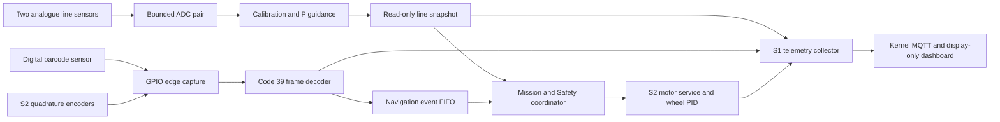
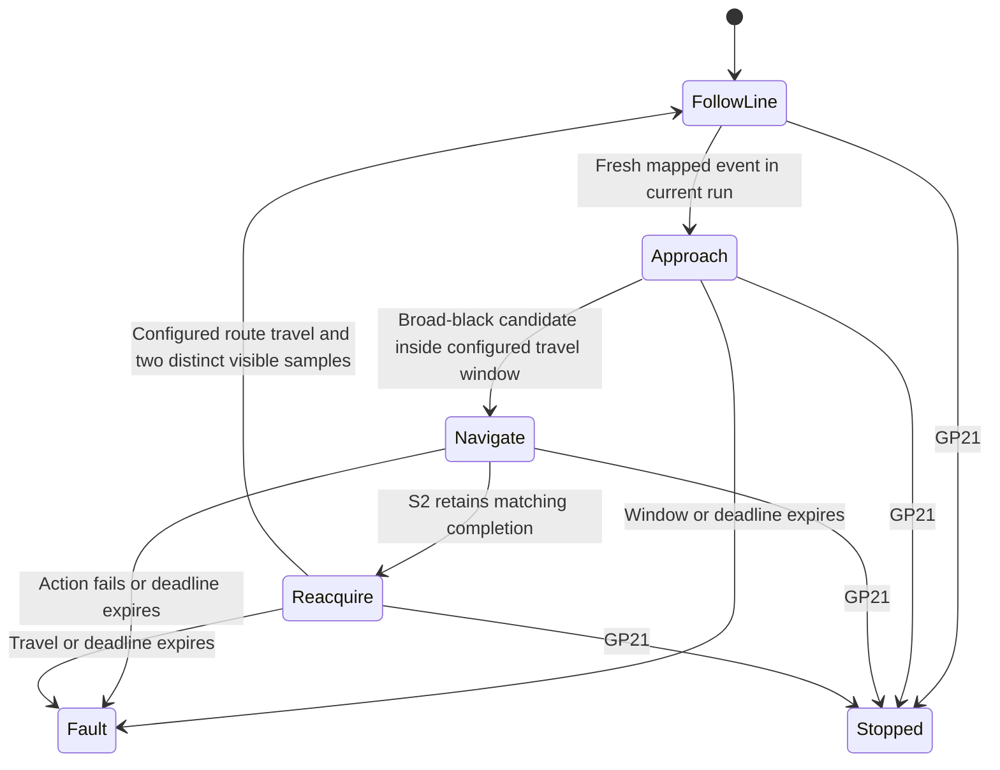

# Subsystem 3: learning, operation and integration

Nicholas owns S3's line sensors, barcode sensor, local-input hardware and feedback. This guide teaches the code on `feat/consolidating-s3`. Requirements and pending course decisions live in [Project specifications](PROJECT_SPECS.md), wiring in [Team](TEAM.md), and authoritative algorithms in [Line tracking](architecture/LINE_TRACKING.md) and [Barcode](architecture/BARCODE.md).

**Completion means implemented software with synthetic tests and firmware builds. No robot was available for this revision.** GPIO capture, electrical polarity, mounted calibration, wheel PID, turn accuracy, stopping, course recognition and timing remain unvalidated on hardware. Older Pico logs belong to older revisions.

## 1. Start with the physical picture

The two line sensors shine infrared light onto the floor. Their analogue outputs describe reflected light; they do not directly say “turn left.” The ADC converts each output into a number. Black/white calibration turns those numbers into comparable reflectance fractions. S3 then calculates a steering suggestion. Mission decides whether movement is permitted; S2 applies it to motors.

The third sensor is beside the line, over the adjacent barcode lane. Its comparator output changes between two digital levels as black bars and white spaces pass beneath it. The code captures changes rather than sampling this signal every 20 ms. Encoders describe wheel travel between changes, so bar width comes from distance rather than assuming constant speed.



A requested duty, a steering value, or a successful function call is not proof of physical movement. An electrical brake is not a measurement that the wheels have stopped.

## 2. The ownership boundary

| Owner | Owns | Does not infer |
| --- | --- | --- |
| S3 | Paired IR acquisition, references, classification, P guidance, capture requests, input GPIO, buzzer, barcode capture/decoding/events | Motor permission, network publication or complete-course meaning from a sensor pattern |
| Mission/Safety | GP20/GP21 policy, start/reset acknowledgements, bounded recovery, junction context, action requests and watchdog | Actual movement from requested PWM |
| S2 | Encoder capture, configured estimates, separate wheel PID, action lifetime and all motor writes | Geometry or calibration from connector colours |
| S1 | Snapshot mapping, bounded JSON, status-only MQTT and dashboard observations | Permission to start, drive, stop or recalibrate |

S3 provides data; it does not call S1 or actuate S2. Its barcode driver reads the S2 encoder observation interface. That dependency supplies capture context, not a motor-control path.

Terrain, obstacle bypass, finish detection and full-course Mission states remain deferred. The navigation profile has no obstacle sensing/avoidance capability and is not a full-course mission implementation.

## 3. Follow the source from bottom to top

Paths below are relative to the repository checkout.

| Module | Role and likely amendment point |
| --- | --- |
| `app_program/subsystem3/drv_ir.c/.h` | ADC setup, channel switch/discard/average, bounded complete-pair acquisition |
| `ir_tracking.c/.h` | Black/white capture, normalization, visibility and proportional guidance; change algorithm constants here |
| `ir_snapshot.c/.h` | Public observations and stale-data invalidation; change data meaning here |
| `drv_feedback.c/.h` | Button inputs and asynchronous buzzer PWM |
| `calibration_control.c/.h` | Capture-result chirps and retained debounce fixtures; live button policy belongs to Mission |
| `task_ir.c/.h` | Sample every nominal 20 ms and service capture/feedback every 10 ms |
| `barcode.h` | Portable configuration, states, edge observations, events and decoder API |
| `barcode_capture.c/.h` | Actual 256-entry single-producer/single-consumer ring; release/acquire publication |
| `barcode_decoder.c` | Pure width/frame validation, Code 39 table, one-shot encounter/rearm, four-event FIFO |
| `barcode_service.c` | GP16 ISR callback, task, private mutex, public barcode/status/context interfaces |
| `subsystem3.c/.h` | Lifecycle, public IR copy, bounded capture mailbox and external S3 APIs |
| `subsystem3_internal.h` | Private task-to-cache declarations; consumers should not use it |
| `app_program/gpio_capture.c/.h` | Shared micro T-Kernel GPIO dispatcher; encoder callback precedes barcode callback |
| `app_program/robot_control_policy.c/.h` | Debounced buttons, calibrated start, stop/reset and existing short line-loss recovery |
| `app_program/robot_navigation.c/.h` | Barcode context, approach window, action requests and expected-route reacquisition |
| `app_program/robot_navigation_config.c` | Loads explicit local configuration before tasks start |
| `app_program/robot_control_task.c` | Connects snapshots and policies to S2; owns watchdog and optional reporting snapshot |
| `app_program/subsystem2/encoder.c`, `encoder_policy.c`, `navigation.c/.h` | Encoder hardware, pure quadrature table, estimates, PID and Motion actions |
| `app_program/subsystem1/telemetry_adapter.c`, `telemetry.c/.h` | Map typed data into S1's JSON; no native-struct serialization |
| `app_program/app_main.c` | Startup composition; not a repeated sensor/control loop |

A header declares the contract. Its `.c` file implements it. A file is not automatically a task: S3 now has an IR task and a separate barcode task; Mission/Safety and Motion are separate tasks.

The live application tasks run on core 1 in SMP builds: coordinator priority 11 (10 ms inputs / 20 ms control), IR priority 12, Motion priority 13 and barcode priority 14. Lower numbers have higher priority. The GPIO dispatcher uses the owning core's interrupt enable bank, with encoder callbacks before barcode capture. Single-core builds use core 0. [Team](TEAM.md#4-task-priorities) owns the priority and object-budget tables.

## 4. How the line pipeline works

1. The driver switches to the left channel, discards one conversion and averages eight; it repeats this for the right channel.
2. The whole pair must fit the existing 2 ms budget and finite poll limit. A partial pair is never published as valid.
3. The tracker uses separately captured black and white references for each channel.
4. The snapshot preserves the original attempt time and sequence, including failed acquisitions.
5. A reader copies a coherent value without blocking and refreshes its validity using the current age.

The authoritative equations and bounds are in [Line tracking](architecture/LINE_TRACKING.md#normalization-classification-and-proportional-guidance). For intuition:

```c
black_fraction = clamp((raw - white) / (black - white), 0, 1);
normalized = 2 * black_fraction - 1;
error = right_black_fraction - left_black_fraction;
correction = clamp(0.10 * error, -0.10, +0.10);
```

White is −1 and black is +1 in the public snapshot. Normalization works with either analogue electrical polarity. Positive error suggests right; negative suggests left. The line calculation is proportional only, with no integral or derivative memory.

Both-white means LOST; both-black means BROAD_BLACK. Neither observation establishes a junction, finish or barcode. Only fresh calibrated VISIBLE data provides valid steering. Existing Mission recovery uses the last known direction, an absolute 100 ms bound and two distinct visible acquisitions; copying the same sample twice cannot satisfy that confirmation.

## 5. Local operation

Use the wiring and power procedure in [Getting started](GETTING_STARTED.md#power-and-flashing). This revision supplies software; the procedure still requires later hardware acceptance.

| Stage | What you do | Expected software response |
| --- | --- | --- |
| Boot | Power/reset with buttons released | Inhibited startup, READY, no calibration |
| Black | Put both line sensors over black; freshly press GP20 | Bounded capture; one chirp on completion |
| White | Release GP20, place on white, freshly press GP20 | Valid pair: two chirps; rejection: three |
| Start | Put sensors on a visible line, release/press GP20 | Start only after sensing and Motion acknowledgement qualify |
| Stop | Press GP21 | Persistent S2 stop and capture cancellation; navigation context invalidated |
| Reset | Clear the cause, release GP21, freshly press GP20 | Stop-generation reset acknowledgement, then READY; no automatic movement |
| Restart | Release/press GP20 again on a visible line | A separate new run |

The button debounce requires fresh stable release/press. Holding GP20 cannot repeatedly capture or restart. GP21 wins simultaneous inputs. Calibration survives ordinary stop/reset but not reboot. Chirps are asynchronous and the physical mute switch affects audibility.

## 6. How barcode decoding works

The supported production frame is one Code 39 character surrounded by `*`: for example `*A*`. Each character has nine alternating elements: five black bars and four white spaces, with three wide elements. Three characters plus two inter-character spaces produce 29 measured widths and 30 transitions.

The documented A/Z samples use the same start/stop mask, `nwnnwnwnn`. A's middle mask is `wnnnnwnnw`; Z's is `nwwnwnnnn`. Their equal bar counts cannot identify the symbol; the ordered widths can.

At each GPIO IRQ, the dispatcher captures levels and a hardware microsecond time. It processes encoder changes first, then records the barcode edge with coherent encoder counts, context and epoch. This is bounded capture context, not proof of exact physical edge timing. Simultaneously pending rising/falling bits indicate lost ordering and fault.

The barcode task drains at most 64 edges per nominal 5 ms release. It validates leading white travel, alternation, widths, framing, inter-character spaces and trailing white travel. A pending GPIO edge or undrained ring prevents quiet-zone confirmation from overtaking captured data.

Within each character, six narrow and three wide widths must form the configured clusters. Encoder-distance measurement tolerates speed changes without a fixed time-to-width assumption. Invalid/missing encoder context, backward wheel travel, zero widths, partial/unknown frames or timeout produce rejection. Capture/FIFO overflow produces a latched fault.

For each nine-element character, sort a temporary copy of the widths. The smallest six must meet narrow bounds and `largest_narrow <= smallest_narrow * narrow_variation`. Their mean is the narrow reference. The largest three must lie between that mean times `wide_ratio_min` and `wide_ratio_max`. Build the nine-bit mask from the original element order, then compare it with the Code 39 table. Inter-character spaces must fit the adjacent narrow references. Quiet zones are white encoder travel before the first and after the last black bar; their measured minimum comes from configuration.

**Count units are the sum of signed-forward travel from both wheels: twice the average decoded quadrature counts.** Narrow, quiet and rearm settings use these units. They are not motor-shaft PPR or milliseconds. Current geometry assumes a common wheel diameter and decoded counts per revolution for both wheels; that assumption must match measured hardware before configuration is accepted.

`allow_reverse` permits reversed printed element ordering while travelling forward. It does not enable decoding while the car drives backwards. Reverse ordering is rejected by default.

A known mapped frame produces one event. The decoder waits for quiet-zone and rearm travel before another. Z is recognizable but unmapped in the example table, so it is reported without a navigation command. A/B/C/D mappings are provisional assignment examples, not confirmed course rules.

## 7. Configure navigation without inventing measurements

The default is `NAVIGATION=0`, the existing calibrated duty bench. `NAVIGATION=1` selects measured-speed following and barcode navigation, but refuses to start when required configuration is missing or invalid. Calibration and observations remain available.

Copy the tracked `config/navigation_config.example.h` to ignored `config/navigation_config.h`. Its zeros and `configured=false` are intentional. Populate all three structures with measured values and reviewed course decisions, then rebuild:

| Structure | Required information |
| --- | --- |
| `robot_motion_configuration` | Wheel diameter/track, decoded counts per revolution, encoder and motor polarities, independent left/right PID tuning, feedforward/integral limits, maximum speed, completion tolerance, stall duty/time |
| `robot_barcode_configuration` | Measured DOUT polarity, matching encoder polarities, narrow-count bounds, wide:narrow and narrow-variation bounds, quiet/rearm travel, frame timeout, event maximum age, orientation and symbol/action table |
| `robot_route_configuration` | Following/action/search speeds, barcode-exit-to-junction window, straight distance, turn/U-turn angles, approach/action/reacquisition deadlines and reacquisition travel window |

The `configured` flags record operator intent, not measured acceptance. Configuration validation checks representable values and relationships; it cannot verify the sensor wiring or course geometry. Counts/revolution include the chosen quadrature decoding and gearing. The route offset begins at the final black-to-white edge of the decoded frame, not its later publication time.

Each wheel has separate PID state and gains. The controller calculates speed from count changes and elapsed time, bounds output at the existing 0.35 duty limit, and uses conditional integration against saturation. A direction reversal inserts a braked release. Geometry, gains, target tolerances and stall limits require physical tuning.

Motion's estimates use `metres_per_count = pi * diameter_m / counts_per_rev`, `travel = signed_count_delta * metres_per_count`, `speed = travel / elapsed_seconds`, and `yaw_degrees = (right_metres - left_metres) * 180 / (pi * track_m)`. For each wheel, PID uses `error = target_speed - measured_speed`; output is `kp*error + ki*integral + kd*(error-previous_error)/dt + feedforward*target_speed`. The integral has its own limit and conditional update; these equations estimate motion from wheels and cannot measure slip. [Motion](architecture/MOTION.md) owns this contract.

Change a local header and rebuild; configuration is startup-only. `make` tracks the header dependency and includes NAVIGATION in its profile identity so incompatible objects are rebuilt.

Example profiles, using your actual SDK path:

```sh
# Inhibited firmware fixtures and line bench
make -C build_make -j8 PICO_SDK_PATH=/path/to/pico-sdk SMP=1 \
  CONSOLE=usb_cdc WIFI=cyw43 NET=none MQTT=0 CRASH_REPORT=0 TEST=1 NAVIGATION=0

# Opt-in navigation software; movement requires explicit configuration
make -C build_make -j8 PICO_SDK_PATH=/path/to/pico-sdk SMP=1 \
  CONSOLE=usb_cdc WIFI=cyw43 NET=lwip MQTT=1 CRASH_REPORT=0 TEST=0 NAVIGATION=1
```

Build profiles sequentially because they share their object directory. Image names end in `_nav0` or `_nav1`, with `_test` preceding that suffix for TEST images. TEST always brakes, including configured navigation.

## 8. What a barcode encounter asks Mission to do



The coordinator reads events only in permitted following context. It checks original age, epoch and run context. Events arriving during navigation/recovery cannot redirect an active action; they are discarded with context/staleness diagnostics. Stop/reset/action completion purges obsolete work.

Approach uses calibrated steering until an appropriate junction candidate is inside the configured distance window. A broad-black pattern outside that context cannot initiate a turn. Left/right/U-turn request configured angles; straight requests configured distance.

Motion receives its own monotonically increasing action ID, separate from a barcode encounter ID. Renewing a lease preserves the original action target and deadline. Completion remains retained and braked until acknowledged. Reusing or mutating an action cannot restart it. Stop generations invalidate earlier requests.

Reacquisition is a bounded expected-route search using configured distance/time and two distinct fresh visible observations. These guards do not prove that two sensors found the physical original line rather than another crossing. That remains a course/hardware acceptance case.

## 9. Use the public interfaces

Normal observers use coherent copies and check validity separately from function success:

```c
#include "subsystem3/subsystem3.h"

S3IrSnapshot ir;
if (s3_ir_copy(&ir) && ir.guidance_valid)
{
    /* ir.steering is a suggestion, not motor permission.
       Mission also checks context, health and the stop/reset generation. */
}

S3BarcodeSnapshot barcode;
if (s3_barcode_copy(&barcode))
{
    /* Interpret state/result and serviced_ms. A copied status may be stale. */
}
```

| API | Meaning and caller |
| --- | --- |
| `subsystem3_init/start()` | Startup lifecycle; initializes private objects, then starts IR/barcode tasks |
| `s3_ir_copy()` | Nonblocking coherent IR observation; task context only |
| `s3_local_inputs()` | Reads physical buttons; coordinator alone interprets runtime policy |
| `s3_capture_request(BLACK/WHITE)` | Bounded single pending capture; coordinator/task context |
| `s3_capture_cancel()` | Invalidates pending/active capture through cancellation generation |
| `s3_capture_allow()` | Coordinator permits capture only while its movement conditions allow |
| `s3_barcode_configure()` | Valid startup-only barcode setup |
| `s3_barcode_copy()` | Separate nonblocking barcode diagnostic snapshot |
| `s3_nav_take()` | Copies/removes one event; exactly one Mission consumer must own it |
| `s3_nav_discard()` | Records why a consumed event was discarded |
| `s3_barcode_context(context, purge)` | Coordinator-only context writer; changes epoch and invalidates pending work without clearing faults |
| `s3_barcode_reset()` | Fresh local reset permits clearing the latched barcode fault and purges obsolete work |

Never use these task/mutex APIs from an ISR. ISR code captures into the ring; it does not decode, allocate, print, publish MQTT or drive motors. Never let the dashboard or a second observer drain Mission's event FIFO.

A coordinator consumer follows this pattern (the production implementation is in `robot_control_task.c`):

```c
/* Mission only: observers must use s3_barcode_copy instead. */
S3NavEvent event;
if (following_permitted && s3_nav_take(&event))
{
    if (!robot_navigation_accept(&navigation, &event, barcode.generation,
            barcode_config.event_age_ms, now_ms))
    {
        /* A stale or old-run encounter must not redirect the car. */
        (void)s3_nav_discard((uint32_t)(now_ms - event.acquired_ms) >
            barcode_config.event_age_ms ? S3_BC_STALE : S3_BC_CONTEXT);
    }
    /* Accepted events enter approach; S2 still needs a permitted lease.
       GP21 and fresh sensor/encoder health are checked before publishing. */
}
```

## 10. What `app_main.c` should do

The implementation keeps repeated work out of `usermain()`:

1. Initialize the shared microsecond timebase without resetting hardware another owner may use.
2. Register the shared GPIO dispatcher and initialize S1–S5 objects, S3 capture buffers and coordinator configuration. S4/S5 remain inactive lifecycle hooks.
3. Start Motion and the existing lifecycle services. Production starts S3; TEST delays live S3 capture until the local test gate and fixtures complete.
4. Run firmware self-tests in TEST, then start IR/barcode. The barcode task establishes encoder context and enables GPIO capture on the application core through micro T-Kernel.
5. Start Mission/Safety. It enables the watchdog after startup/tests and requires fresh advancing IR and successful Motion progress; networking never counts as control progress.
6. Sleep permanently. Kernel/application tasks continue running. A required startup error requests stop and parks; TEST cannot energize motors.

Expect boot messages describing the selected mode, test gate/results in TEST, then READY observations. Missing navigation configuration produces an explicit refused start rather than guessed wheel targets. Pressing GP20 to release the TEST gate does not automatically calibrate or start; a fresh release/press is still required.

## 11. Read telemetry correctly

The display remains read-only. See [Communications](architecture/COMMUNICATIONS.md) for the authoritative schema and [Getting started](GETTING_STARTED.md#local-html-dashboard) for launch instructions.

- Line validity, reference validity and sample age are independent.
- `velocity_mode` distinguishes configured speed/action operation from the duty bench. Requested speed is separate from applied signed PWM; an action uses its target rather than pretending to be a direct speed request.
- Encoder counts are wrapping uint32 observations. Calibrated speed is an estimate with its own age and can be unavailable.
- Navigation reports action ID/state; 0=idle, 1=active, 2=done, 3=failed. Unavailable age is null.
- Barcode reports state, last result/symbol, service age, queue occupancy and accepted/rejected/discarded counters. A recognized symbol can remain unmapped.
- JSON capacity is bounded at 1536 bytes; the MQTT output ring is 2048 bytes. Encoding failure skips publication; it does not change control.
- A healthy heartbeat does not establish sensor validity, wheel motion or precise stop timing. Network loss does not override otherwise healthy local control.

## 12. Troubleshoot and amend safely

| Symptom | Inspect first |
| --- | --- |
| Calibration unavailable | Fresh paired acquisition, mounted contrast, capture status, button release and mute switch |
| Copied data but no guidance | `guidance_valid`, calibration, capture-active status, line classification and original sample age |
| Navigation refuses start | All three local configuration structures and matching encoder polarity |
| Recognizes Z but does nothing | Z is intentionally unmapped in the example table |
| Bad width/frame or partial | Ordered bar/space widths, count resolution, configured print/orientation/quiet bounds, frame deadline |
| Encoder/capture fault | Wiring, quadrature phase, missed IRQ transitions, GPIO edge ambiguity and buffer occupancy; lost encoder ordering requires a reboot after correcting the cause; a barcode overflow requires fresh local reset |
| Junction-window expiry | Measured offset from barcode exit and whether the course actually provides that line pattern |
| Action deadline/stall | Configured geometry/PID, encoder direction, power/mechanical load and original absolute deadline |
| Reacquisition expiry | Route context and distance/time bounds; do not remove guards to hide a wrong route |
| Dashboard unavailable/stale | Broker/collector availability and separate producer ages; do not use telemetry to authorize movement |

For a line algorithm change, edit `ir_tracking`; for barcode width/framing rules, edit `barcode_decoder`; for hardware capture, edit the driver/dispatcher; for movement choices, edit Mission policy; for physical output or PID, edit S2. Preserve ownership in separate commits and update the owning guide/test cases.

## 13. What has and has not been validated

Stable cases and saved results live in [Testing](../testing/README.md). New S3-U14–U19, S2-U14–U17, S1-U13 and INT-16–INT-20 exercise pure production algorithms using synthetic values. All 16 cases pass in the temporary laptop harness with strict warnings, address sanitizer and undefined-behaviour sanitizer. Twenty additional synthetic barcode cases pass with both scales/polarities, uneven wheel travel, width/time variation and wraps. Harnesses remain temporary; their source text and checksums are evidence, not runnable project tooling.

All nine requested firmware builds pass: both operating modes, offline/wireless normal/TEST variants, and a single-core TEST compatibility variant. A separate synthetic configured-header compile also passes and is recorded against its own source revision. Compiler stack frames and image/source hashes are saved separately. A compiler stack report is not a runtime stack high-water measurement or ISR WCET result.

No new Pico test, GPIO timing, real barcode traversal, motor/PID tuning, stop measurement or complete course run is claimed. Required later checks include mounted calibration, both barcode scales/speeds, malformed/reverse/duplicate frames, electrical release, encoder polarity/count resolution, raised-wheel signed output, all four navigation actions, stop/reset under load, junction context, expected-route reacquisition and physical accuracy.

Read the [validation report](../testing/integration/logs/2026-10-09_consolidating-validation.md) for exact software evidence, image/source checksums and memory limits.
