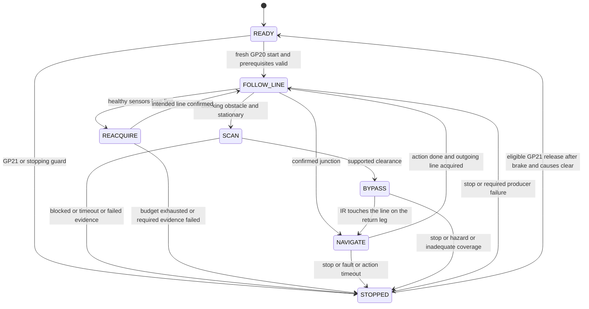

# System architecture

## Contents

- [DOUT navigation contract](#dout-navigation-contract)

- [Plan status and scope](#plan-status-and-scope)
- [Tasks](#tasks)
- [Core allocation implications](#core-allocation-implications)
- [Mission loop](#mission-loop)
  - [Startup and local controls](#startup-and-local-controls)
  - [Barcode and junction lifecycle](#barcode-and-junction-lifecycle)
  - [Recovery and encounter coordination](#recovery-and-encounter-coordination)
- [Source layout](#source-layout)
- [Implementation order and acceptance](#implementation-order-and-acceptance)
- [Authority](#authority)
- [Shared-data rules](#shared-data-rules)
  - [Fault bitmask](#fault-bitmask)
- [Motion command contract](#motion-command-contract)
- [Encoder contract](#encoder-contract)
- [Subsystem summaries](#subsystem-summaries)
  - [S1 Communications (comms)](#s1-communications-comms)
  - [S2 Motion (motion)](#s2-motion-motion)
  - [S3 Line, barcode and Mission (line_barcode)](#s3-line-barcode-and-mission-line_barcode)
  - [S4 Terrain (terrain)](#s4-terrain-terrain)
  - [S5 Obstacle and bypass (obstacle, with Mission)](#s5-obstacle-and-bypass-obstacle-with-mission)
- [Time](#time)
- [Post-Tribunal decisions](#post-tribunal-decisions)
- [Minimum-bit data representation](#minimum-bit-data-representation)
- [MQTT binary protocol, schema version 2](#mqtt-binary-protocol-schema-version-2)
  - [Telemetry and snapshot reply (23 bytes)](#telemetry-and-snapshot-reply-23-bytes)
  - [Wheel trace (15 bytes)](#wheel-trace-15-bytes)
  - [Terrain trace (8 bytes)](#terrain-trace-8-bytes)
  - [Line trace (17 bytes)](#line-trace-17-bytes)
  - [Event (11 bytes)](#event-11-bytes)
  - [Mapping, acknowledgement, snapshot request](#mapping-acknowledgement-snapshot-request)
  - [Golden vectors](#golden-vectors)
  - [Binary frame sizes](#binary-frame-sizes)

## Plan status and scope

[Issue #117](https://github.com/shauniee/Autonomous-Robotic-Car/issues/117) owns the live plan and completion status.
The implementation creates Motion, Mission and core-0 I/O only; software
checks do not establish physical calibration or acceptance. Requirements and
calibrated values are owned by [project-specs](project-specs.md); wiring by
[team](team.md).

Keep micro T-Kernel, C/Pico SDK, five subsystem modules and binary MQTT schema v2.
No core-number migration, generic event bus, new scheduler or watchdog framework.

## Tasks

Exactly three application tasks; kernel boot/WiFi/USB activities remain additional
RTOS tasks. Smaller numeric priority means higher scheduling priority.

| Target task | Core | Responsibilities | Scheduling decision |
| --- | --- | --- | --- |
| Motion | 1 (`TP_PRC2`) | Motor outputs, wheel-speed loop, encoder actions, independent GP21/stop/expiry checks | Higher priority than Mission |
| Mission | 1 (`TP_PRC2`) | Bounded line/barcode/sonar/servo steps, calibration controls, navigation, safety policy and mapping acceptance | Below Motion; bounded work then sleep |
| `io_task` | 0 (`TP_PRC1`) | Bounded Terrain acquisition/calibration and Reporting steps | Below existing critical kernel services; numeric choice pending |

WiFi/lwIP/MQTT service and USB stay on core 0 in their existing execution contexts.
Existing numeric periods/priorities/ages are retained as explicitly provisional
software defaults with user authorization on 2026-10-29. Physical WCET budgets,
freshness margins and acceptance are still [D13](project-specs.md#pending-decisions). Existing source
constants are recorded in [robot_config.h](../app_program/common/robot_config.h),
not silently promoted to target values. Skip missed releases rather than replay
an unbounded backlog; bound capture decoding, incoming requests and event draining.
Only Motion performs wheel control; Mission scheduling authority does not outrank
its braking deadlines. No separate Safety, Line, Obstacle, Terrain or Reporting task.

## Core allocation implications

Keep encoder/barcode/Echo capture under the existing core-1 GPIO dispatcher.
I/O consolidation moves Terrain/Reporting application work, not WiFi/USB services.
Never hold shared locks across I2C, servo settling, Echo wait, formatting or network
work. Use bounded peripheral steps, acquisition timestamps and coherent copies.
Measure network-load effects on IMU age and interrupt/control latency. Audit S1
multi-producer events and mapping installation across cores: DI/EI protects only
one core. The implemented event log uses a bounded cross-core mutex; its contention and
load margins still require on-target measurements.

## Mission loop

Seven states: READY=0, FOLLOW_LINE=1, NAVIGATE=2, SCAN=3, BYPASS=4,
REACQUIRE=5, STOPPED=6; code 7 is invalid and stops. The existing four-bit MQTT
state slot is unchanged. `scripts/mqtt_client.py` uses these new meanings;
recorded old-image state labels remain historical.
Calibration/mapping readiness belongs inside READY, not extra top-level states.
No automatic COMPLETE or finish-marker transition. A local stop or stopping guard
ends movement, while healthy operation continues around the course indefinitely.

GP21 and stopping guards apply in every state, including SCAN/READY. Scan/turn/
recovery phases issue a bounded step and return. Arbitration: local stop/stopping
fault, required-data freshness, obstacle hazards, active manoeuvre, junction
instruction, ordinary line following. Do not blindly resume an interrupted action.

### Startup and local controls

- Boot inhibited. Attempt stationary IMU calibration;
  complete or fail the attempt within a bound and expose its outcome. IMU failure
  is flagged and does not permanently prevent starting. Digital IR has no
  software calibration workflow.
- Start requires fresh functional line acquisition and valid digital guidance,
  functional Motion/encoder service, an installed four-letter mapping, WiFi and
  MQTT connected, no active stopping cause and a fresh local GP20 press.
- Connectivity is a readiness prerequisite, not remote motion authority. Mission
  observes connection state; network callbacks never call start/stop/motor APIs.
- GP21 press requests immediate persistent stop. Its debounced release may clear
  the latch only after Motion serviced braking and stopping causes cleared; it
  returns READY and never starts motion. A fault stop requires a deliberate fresh
  GP21 press/release after cause clearance. GP20 subsequently starts.
- Stop cancels active manoeuvres, scans and pending navigation; retain valid IR
  calibration, installed mapping and last barcode display. Do not replay commands.
  Operator repositions after a partial turn/bypass. Reboot still clears RAM-only
  calibration/mapping; no nonvolatile retention is added.
- Mapping replacement is accepted only while READY/STOPPED, installs atomically
  through Mission and clears pending movement. It never starts the robot.

### Barcode and junction lifecycle

Decode A-Z identically in either scan direction. Store one character/action from
the installed MQTT mapping and continue tracking until the next confirmed cross
junction; its distance from the barcode varies. Mark the action consumed when
navigation starts. Left/right first drive straight for the user-selected
70 mm of signed mean encoder travel, at normal tracking speed, then turn:
left uses left braked/right forward; right uses left forward/right braked. U-turn brakes, pauses about 200 ms from stationarity,
then rotates clockwise with left forward/right reverse. Navigation finishes
from the turning-side digital IR: left for left, right for right/U-turn.
Reset the IR edge history when rotation starts. If the turning-side IR is
already white after the approach, seek new black then white; otherwise ignore
the initial black until white exit before seeking new black/white. Require
distinct fresh acquisitions. Hold STOP on that final edge until
Motion reports IDLE, then enter FOLLOW_LINE; normal tracking resumes on the
next release. The hold ensures Motion services braking despite the faster
Mission period; it does not wait for measured stationarity. Left/right no longer
wait for encoder-DONE, a 60 mm clearance action or outgoing-line confirmation.
Straight navigation retains its 25 mm encoder segment and uses fresh visible
IR guidance during it, with the normal steering and curve-speed policy.
Broad black requests zero steering and clears correction history. The handoff
to FOLLOW_LINE preserves steering and its acquisition timestamp so correction
does not collapse or advance twice on the same sample. Turn commands use
the existing 360-degree/action-timeout bounds as failure ceilings, not successful
completion. The first eligible crossing is accepted; mounted path geometry and
pause reference/placement tolerance remain D02/D08. Never undo a turn.

Cross unqueued broad black with straight FOLLOW commands. With a queued instruction, consume it and enter navigation on the
first fresh both-black tracking sample, without travel qualification or waiting
for black exit. With no queued instruction, leave a qualified encounter and
follow the outgoing line during the requested encoder-measured straight
segment, then resume tracking without outgoing-line confirmation. There is no pre-turn
DISTANCE action or completion gate. See the [junction revision](project-specs.md#mission-day-barcode-rule).
No-command crossings retain tracking evidence plus travel/geometry qualification. A single black barcode-sensor reading neither
identifies a barcode nor proves a junction; barcode capture must not block junction
checks. Exact mounted evidence is D01/D02/D04.

Remove the two-second barcode blind delay. Use the decoder's bounded quiet-zone/
encounter lifecycle to prevent repeated actions from the same print. A new visit
may produce a new action. Incomplete/unknown captures do not guess a character;
no elaborate damaged-print recovery. Multiple different barcodes before a junction
remain a pending course/policy decision, not an invented queue of route choices.

### Recovery and encounter coordination

Fresh usable white/white must persist for the qualification interval in
[project specs](project-specs.md#pending-decisions) before ordinary tracking
enters REACQUIRE, brakes and cancels navigation, barcode, scan and side-watch
work. During qualification, hold the last tracking steering and its speed;
line visibility or broad black clears the pending loss. Cached acquisitions
cannot extend freshness, and gaps cannot qualify missing evidence.
Missing/stale acquisition still stops required movement. Standalone recovery
waits for encoder stationarity, then repeats left/right pivots through the
extent and safety budgets in [project specs](project-specs.md#pending-decisions).
It brakes before each reversal; endpoint and hard overshoot bounds are separate.
Either sensor finding a usable VISIBLE line brakes the sweep and returns to
tracking without a stationary confirmation streak; barcode capture restarts.
See the
[recovery handoff revision](project-specs.md#pending-decisions). Heading/travel evidence
is required after bypass to avoid accepting an unrelated crossing.

Humps remain concurrent with tracking and do not change the course speed. Only valid completed humps update count/maximum; report
measurements/events. Completed results persist across accepted starts/stops until
reboot, as recorded in [project specs](project-specs.md#pending-decisions).

For a blocking obstacle, brake and confirm stationarity before profiling. Bypass
selects supported measured clearance, departs the line, follows the side, confirms
rear-edge and full-car clearance and returns toward the original line. The first
black sensor on that leg ends it; Mission then advances and pivots as at a junction.
One servo sensor cannot look forward and sideways simultaneously: schedule fresh
coverage and bounded travel. Reverse needs a supported bounded path; no blind
rear-clearance assumption. A new hazard, unsupported route or exhausted action
budget brakes/stops. Exact rescan/reverse policy awaits D02/D05/D07.

## Source layout

Target: `app_program/mission/` holds coordinator and small policy helpers;
`app_program/common/` holds startup/shared contracts and I/O orchestration as
appropriate. Keep `comms/` through `obstacle/` for their reusable modules.
No separate Safety task. Move files/build/includes only with tested implementation
stages in [plan](https://github.com/shauniee/Autonomous-Robotic-Car/issues/117#remaining-plan). `mqtt_utk.c` stays in the kernel
library and only WiFi service context calls MQTT/lwIP.

## Implementation order and acceptance

[Issue #117](https://github.com/shauniee/Autonomous-Robotic-Car/issues/117) owns
the live work sequence and incorporates #129–#133. The Motion/Mission/I/O
refactor is implemented; remaining calibration, feature release and integrated
acceptance follow that issue and the physical procedures. No host/build result
is firmware execution or physical acceptance.

## Authority

- Motion alone writes motor PWM and owns the persistent motor stop latch.
- Mission alone chooses movement, accepts mappings and coordinates local reset.
- S3/S4/S5 supply evidence and helpers; they never independently drive motors.
- Small safety functions are called by Mission/Motion, not a separate task.
- Network work reports connectivity and transports configuration/diagnostics;
  it never starts, stops or writes motor outputs. Loss during a run is report-only.
  The user-authorized [junction testing exception](project-specs.md#mission-day-barcode-rule)
  transports one direction request to Mission, which alone accepts and executes it.

## Shared-data rules

One writer per storage unit; only that writer performs read-modify-write.

1. One aligned word snapshot: C11 release store/acquire load and field accessors.
2. Larger snapshot: short bounded mutex copy (use existing priority-inheritance
   primitives); never hold across I/O or formatting. Reporting skips busy data.
3. Bounded capture/bridge rings: explicit producer/consumer ownership and full
   policy. ISRs capture/signal/return; no blocking or allocation. Preserve sample
   acquisition time. Existing SPSC transport rings are retained provisionally;
   the professor's buffer diagram does not establish a required kernel primitive.

Same-core DI/EI is not cross-core synchronization. S1 events gain producers on
both cores, so select bounded mutex/spinlock copies or per-producer rings before
moving tasks. Mapping RX on core 0 must hand off to Mission on core 1 and wait
asynchronously for installation outcome before ACK. Do not call Mission's mutable
state from another task without the agreed copy/hand-off contract.

### Fault bitmask

Six existing owner bytes and positions remain wire-compatible. Owner denotes a
module, not necessarily a separate task. Target writers: Motion byte by Motion;
Line/Obstacle/Mission bytes by Mission; Terrain by I/O; Network by WiFi service.
This table owns target policy. `robot_data.c` now leaves IMU/calibration failure report-only. Mission checks
`comms_bridge_ready()` for local start; network loss does not stop an accepted run.

| Condition / detector | Start response | During run | Clear/reset |
| --- | --- | --- | --- |
| GP21 / Motion local input | Block | Latch brake | Eligible GP21 release after serviced brake; GP20 starts separately |
| Motion bit 0 stall / wheel controller (detection disabled in current trial; see [trial settings](project-specs.md#pending-decisions)) | Block while active | Latch stop | Cause cleared plus local reset; threshold uncalibrated D07 |
| Motion bit 1 encoder / sustained invalid edges (`ENC_FAULT_INVALID_SCORE`, INT-138) or failed capture | Block | Latch stop | Validated encoder recovery; existing 64-count rule is provisional D03 |
| Line bit 0 acquisition invalid / S3 | Block | Stop if required acquisition invalid/stale | Valid digital readings and local reset |
| Healthy line lost / Mission | No start on unusable line | Bounded REACQUIRE, then stop if exhausted | Line confirmed or operator reposition/reset |
| Line bits 1/2 barcode capture/event overflow | Report | Report; never guess/replay an action | Existing encounter/run clearing behavior audited during integration |
| Terrain bits 0/1 IMU acquisition/calibration failure | Flag, allow after bounded startup attempt | Flag; ordinary tracking continues | Successful reacquisition/calibration; no invented height |
| Terrain bit 2 detected impact | Block while active | Latch stop | Cause cleared plus deliberate local reset |
| Obstacle bit 0 no echo / S5 | Flag, not universal block | Flag; ordinary tracking continues; no inferred clear space | Fresh valid readings clear/report status |
| Required scan/bypass evidence unavailable / Mission | Not ordinary readiness input | Brake/stop unsupported manoeuvre | Local reset after safe reposition/cause clearance |
| Mission bit 0 recovery exhausted | Report historical reason | Already stopped | Clear on accepted new start |
| Network bits 0/1 WiFi/broker unavailable | Mission blocks start | Report-only; healthy local run continues | Successful reconnect; no remote restart |
| Expired command, failed required copy/progress or action deadline / Motion/Mission | Inhibit | Brake/stop | Fresh validated context plus local reset; no stale replay |
| Startup control initialization failure or TEST | Inhibit | No enabled output | Startup failure requires correction/reboot; TEST remains inhibited |

No new fault bit is invented without a data-contract review. Conditions lacking
wire bits must still be observable through existing state/reason diagnostics.

## Motion command contract

Mission is the only latest-command writer. Keep packed `MotionCommand`, action
ID and coherent feedback. Repeating a command does not restart its encoder action
or extend its absolute deadline. Preserve acquisition time; copying stale evidence
never makes it fresh. No lease/generation/acknowledgement framework is added.

FOLLOW steering boosts the outer wheel linearly up to 1.6 times base speed.
At |Q7 steering| <=64, the inner wheel retains base speed. From 64 to 127,
its target decreases linearly to zero, giving a stopped inner-wheel pivot
at full correction. Negative steering selects left as
inner; positive selects right. Zero requests base/base. These are wheel-speed
targets, not PWM duty ratios; Motion's wheel PID and duty cap still apply.
This shared mixing also applies to bypass FOLLOW guidance.
TURN interprets the command's steering slot as a style: 0 keeps the existing
opposite-wheel pivot used by recovery/bypass; 1 drives only the outer wheel
forward, with the inner wheel braked regardless of encoder drift. The moving
wheel travels the full track-width arc for the requested angle. Other TURN
styles fail closed. Sensor-ended navigation retains original IR acquisition
time in its command; all NAVIGATE phases require fresh usable IR.

Mission publishes the latest distinct usable digital steering target. Motion
slews its private applied steering at a provisional 800 Q7 units/s (16 units
per 20 ms release), then mixes wheel targets. Full entry/release takes eight
releases (160 ms); full reversal takes sixteen (320 ms), passing through zero.
A brief black/white alternation produces a small correction rather than full
wheel mixing. Mission adds no second steering ramp. These timings describe
software target changes, not measured physical response.
Tracking compensates its base request for requested outer boost: floor(90 /
(1 + 0.60 * |requested steering| / 127)) mm/s, then applies hump scaling.
At full correction the requested base is 56 mm/s and settled wheel targets
are 0/89.6 mm/s, or the reverse. Actual outer speed is not guaranteed constant
while the base and applied steering ramp independently. Straight navigation
uses the same guidance/speed policy on visible IR. The left/right pre-turn
approach retains zero requested steering and the tracking ceiling.
Motion slews the common FOLLOW base speed at a provisional 250 mm/s per
second (5 mm/s per 20 ms release), then mixes applied steering. Both ramps
permit one period at startup, none at duplicate timestamps and at most one
period after a late release. They use control-release time while command
freshness retains original sensor acquisition time; cached data cannot extend
expiry. Zero-speed FOLLOW, STOP, invalid/stale commands, reset and faults
brake immediately and clear both histories. Shared FOLLOW smoothing/mixing
also applies to bypass guidance. Discrete distance/turn endpoint control and
the turn encoder-progress speed ceiling remain unchanged. Stored units/ranges
are owned by [project specs](project-specs.md#pending-decisions). Physical
curve retention, acceleration and speed-loop tuning remain provisional D07.
FOLLOW wheel targets are nonnegative. When the wheel PID reduces speed, its
output is limited to forward power or zero, with integral anti-windup at both
output limits; overspeed must not command reverse power. Explicit DISTANCE and
TURN actions retain signed wheel control. Zero power and this software limit
do not prove physical stationarity or calibrated motor/encoder polarity.

| Movement | Required evidence | Not universally required |
| --- | --- | --- |
| FOLLOW_LINE / straight crossing | Mission progress, Motion/encoder health, fresh usable tracking acquisition | IMU/sonar/network availability mid-run |
| Encoder turn/distance | Fresh Mission progress and encoder service; bounded action deadline; line evidence for acquisition/completion | Visible line throughout an in-place turn |
| SCAN | Braked output plus measured stationarity; fresh scan samples/angles | Motion command implying stationarity |
| BYPASS | Fresh encoder/Mission progress and mode-specific supported clearance/coverage | Side sample masquerading as forward sample |
| REACQUIRE | Functional fresh IR, encoder/Mission progress, bounded heading/travel search | Visible line before search starts |

Implemented software uses Motion service sequence/time, fresh IR acquisition for
tracking/crossing/reacquisition and Mission release time for encoder-only actions.
Motion enforces command expiry and the original absolute action deadline. Copies
do not renew acquisition time. Existing age limits remain provisional D07/D13. Stop must not wait for the command mutex or diagnostics.
Runtime stop/reset stays on Motion's core; Terrain publishes impact evidence and
Motion/Mission observe it. Motion checks GP21 independently every release.
Reset invalidates old commands and never enables output itself. Brake service
acknowledgement is software progress; stationarity uses encoder evidence.
Checks require Motion to execute and do not protect against a hung Motion/kernel.
A watchdog tick setup alone is not a reset watchdog; further policy remains D15.

The wheel-speed controller bounds duty to the requested wheel direction:
overspeed produces braking, not opposite drive. The position controller may
still reverse the requested direction to correct positional overshoot; turns
retain opposite signed wheel targets. This is software policy, not physical
PID calibration or evidence of healthy encoders.

During a pivot TURN, each wheel remains braked after first entering the
existing angle tolerance, even if it drifts while its partner finishes. DONE
still requires both current positions within tolerance. Unresolved drift
reaches the existing action timeout and FAILED; a prior arrival cannot mask
it. Arrival latches reset with every new action or controller reset. Swing
TURN always brakes its inner wheel; the outer wheel brakes on arrival or
passing its forward endpoint, without reverse position correction. Navigation
uses these endpoints as failure bounds when its IR sequence is missing.

## Encoder contract

ISR counts wrap at the justified width. Each consumer keeps its own origin and
uses modular subtraction; nobody resets shared counts. Calibrate counts/revolution,
wheel geometry and signs before distance/angle actions. Record shared GPIO IRQ
edge rate and ISR time at maximum tested wheel speed. PIO is only a conditional
follow-up if evidence shows the existing capture is inadequate.

## Subsystem summaries

### S1 Communications (comms)

[README](../app_program/comms/README.md): bounded core-0 reporting functions; opaque
TX/RX bridge to kernel MQTT; mapping ACK only after Mission installation.

### S2 Motion (motion)

[README](../app_program/motion/README.md): sole motor writer; wheel control, encoder
actions and independent stop/expiry checks.

### S3 Line, barcode and Mission (line_barcode)

[README](../app_program/line_barcode/README.md): S3 retains line/barcode sensing/decoding;
Mission coordination moves out. No independent S3 control thread in the target.

### S4 Terrain (terrain)

[README](../app_program/terrain/README.md): core-0 bounded IMU/terrain functions; measured
encoder travel, filtered pitch, valid completed hump results and impact evidence.

### S5 Obstacle and bypass (obstacle, with Mission)

[README](../app_program/obstacle/README.md): bounded sonar/servo acquisition and uncertain
width/clearance estimates; Mission owns supported bypass/original-line recovery.

## Time

Keep kernel milliseconds and hardware microsecond capture domains explicit.
Use unsigned wrap-safe elapsed arithmetic and justified field widths. No unbounded
polling, waits, retries, frame backlog or movement phases. Slow MQTT cannot prove
short latency; measure directly on the final image.

## Post-Tribunal decisions

Week 8 Tribunal 1 defended the Week 6 design: Motion as only motor writer, expiring
commands, networking without movement authority, and separate line, barcode, range
and hump evidence. It adopted the minimum-bit requirement below and raised
concurrency, overflow and precision risks now covered by the shared-data rules.
The active simplification retains timestamped commands, bounded action IDs,
four-letter runtime mapping, per-consumer encoder origins and word snapshots.

## Minimum-bit data representation

**Change requirement.** Adopted at Tribunal 1. Each application field uses only the
bits its valid range needs. [Project-specs section 4](project-specs.md#4-change-in-requirement-minimum-bit-data-representation)
owns the requirement and the [data table](project-specs.md#5-data-representation-table-week-13)
owns every width.

- **Bits:** `ceil(log2(valid values + invalid codes))`, justified by documented bounds, units, signedness, scale, rounding and invalid codes.
- **Storage:** in-RAM packed state uses bit-fields behind accessors; the wire uses explicit masks and shifts (binary schema v2, replacing JSON). Combine fields only when they share one writer, never merely because widths fit.
- **Faults:** one bit per condition in a shared [bitmask](#fault-bitmask), so simultaneous faults stay independent.
- **Scaled values:** a 0..1 fraction is `uint8_t` 0..127 (`IR_SCALE_ONE`) and a -1..+1 value `int8_t` -127..+127. Float tunables fold to integers at compile time; base-10 display happens only on the laptop.
- **Exempt:** loop counters and short-lived temporaries.

**Evidence, final implementation only:** the data table, RAM usage, message sizes and
no lost functionality or unacceptable timing (T15). Comparison with the old build is
not required (course update, 2026-10-27), so the historical baseline in project-specs
is a record only. Evidence means a result tied to an exact commit and test ID.

**Still to audit:** fields added since the last size probe, including the line trace,
onset and bend state, Mission state encoding, Terrain freshness and scan parameters.
Each owner also reviews their test log against current code (JSON-era S1-U04..U08,
six-byte faults, any case assuming no echo stops), appending rather than editing.

## MQTT binary protocol, schema version 2

Implemented by `app_program/comms/comms.h` and `mqtt_frame.c`, tested by `testing/pure/test_mqtt_frame.c`; the laptop decoder `scripts/mqtt_client.py` checks the same golden vectors (`--self-test`). Field widths follow the data table in [project-specs](project-specs.md); rows pending there carry provisional widths here and change only through the data-contract review (#28). Version 2 added line status, the mapped flag, the Mission fault byte and obstacle width/depth; a version 1 frame is rejected.

Topics (root `robot/s3`, set in `config/wifi_secrets.h`): `<root>/telemetry` carries every robot-to-PC frame, `<root>/request` carries mapping and snapshot requests, `<root>/status` is the retained online/offline text.

Rules for every frame:

- Little-endian multi-byte fields, written with explicit masks and shifts, never by copying a struct.
- Byte 0: bits 7-4 version (2), bits 3-0 type.
- Length is exact for the type. A receiver rejects a wrong length, version or type, any set reserved bit and any out-of-range field. Nothing is partially accepted.
- Networking never drives, starts or stops the robot. The only command that changes robot state is the mapping, and only while stopped.
- Normal telemetry omits speed/direction: the laptop derives averages from
  successive counts. The separate wheel trace carries release-speed diagnostics.

| Type | Value | Direction | Length (bytes) |
| --- | --- | --- | --- |
| Telemetry | 1 | robot to PC, every 500 ms | 23 |
| Event | 2 | robot to PC | 11 |
| Snapshot reply | 3 | robot to PC, answers a request; body as telemetry | 23 |
| Mapping | 4 | PC to robot | 5 |
| Acknowledgement | 5 | robot to PC | 3 |
| Snapshot request | 6 | PC to robot | 2 |
| Wheel trace | 8 | robot to PC, best effort per Motion release | 15 |
| Line trace | 9 | robot to PC, best effort per fresh IR acquisition while moving | 17 |
| Barcode trace | 10 | robot to PC, best effort, raw GP16 run widths |
| Terrain trace | 11 | robot to PC, best effort, hump detector state |

### Wheel trace (15 bytes)

Type 8 is outbound diagnostics only; existing frame layouts/lengths remain.
Byte 0 is `28` hex; bytes 1..4 are robot release time uint32 ms. Bytes 5..8
contain left target in bits 0..14 and right target in bits 15..29 (signed
15-bit counts/s), TEST inhibition in bit 30 and motor-output service success
in bit 31. Bytes 9..10 and 11..12 are signed 16-bit measured left/right counts/s.
Bytes 13 and 14 are signed left/right duty percentages. Invalid encodings and
rounding are owned by the [data table](project-specs.md#s2-motion-encoder-width-provisional-until-d03-one-constant-enc_count_bits-in-robot_configh-branches-29-31).
Output failure marks both duty fields invalid. TEST reports zero duty with
inhibition set. Targets represent computed wheel demands; serviced braking may
override them. This is software output evidence, not electrical measurement.

Motion encodes into an eight-record SPSC ring after output service and outside
its IRQ exclusion. I/O drains at most two per release, after normal reporting;
offline/full TX and full trace ring drop diagnostic samples without waiting.
Robot timestamp gaps reveal missing releases; timestamps wrap modulo 2^32.
There is no diagnostic request, movement authority or live tuning input.
Older laptop decoders reject this new type; use the matching decoder for traces.

### Barcode trace (18 bytes)

Type 10 is outbound diagnostics only, added for INT-146 and filtered since INT-148; S1 owner agreement pending. Byte 0 is `2A`
hex, byte 1 a wrapping sequence, bytes 2..17 eight little-endian runs: bit 15 black level, bits
14..0 width in encoder counts after chatter is merged, zero for an unused slot. A full ring drops frames.

### Terrain trace (8 bytes)

Type 11 is outbound diagnostics only, added for INT-154; S1 owner agreement pending. Byte 0 is `2B` hex, bytes
1..2 time ms low 16, byte 3 signed pitch in quarter degrees, byte 4 bits 0..2 state, 6 encoder valid, 7 calibrated,
byte 5 peak rise mm, byte 6 acceleration in 10 mg units, byte 7 signed roll in quarter degrees.

### Line trace (17 bytes)

Type 9 is outbound diagnostics only, kept separate so the wheel trace is unchanged;
S1 owner agreement pending. Byte 0 is `29` hex; bytes 1..4 are the
IR acquisition time uint32 ms. Byte 5 flags: bit 0 left black, 1 right black,
2 in broad black, 3 junction candidate open, 4 junction qualified, 5 curved entry,
6 junction locked, 7 raw barcode GP16 level. Byte 6: bits 0..3 Mission state, 4..6 junction phase,
7 zero. Bytes 7..8 and 9..10 are the low 16 bits of the left/right encoder counts.
Byte 11 is the steering law output, signed Q7. Byte 12 is the law state: the side
last touched (-1 left, +1 right, 0 none), doubled while in a bend. Byte 13 is the FOLLOW steering sent to Motion (0 for
other modes). Bytes 14..15: bits 0..8 commanded speed mm/s, 9..10 motion mode,
11..15 running barcode edge count (wraps). Byte 16 is, while both sensors are black, the distance in mm between
the two sensors' black onsets (254 caps it), else 255.

Mission builds one record per fresh acquisition after `mission_step` while it was
moving (so the stopping decision is included) and puts it in an eight-record SPSC
ring; I/O drains at most two per release after the wheel trace, and offline/full
TX or a full ring drops records without waiting. Sample-time gaps reveal drops.
There is no request, movement authority or live tuning input. `mqtt_client.py
monitor` prints `LINE` JSON; the dashboard does not display it.

### Telemetry and snapshot reply (23 bytes)

| Byte | Bits | Field | Range |
| --- | --- | --- | --- |
| 0 | 7-0 | version and type | `0x21` telemetry, `0x23` reply |
| 1 | 7-0 | sequence | 0-255, wraps |
| 2 | 3-0 | mission state | 0-15 |
| 2 | 5-4 | motion status | 0 IDLE, 1 RUNNING, 2 DONE, 3 FAILED |
| 2 | 7-6 | line status | 0 unknown, 1 visible, 2 lost, 3 broad black |
| 3 | 5-0 | motion action ID | 0-63 |
| 3 | 6 | mapped | four letters installed |
| 3 | 7 | reserved | 0 |
| 4-9 | 7-0 each | fault bytes: Motion, Line, Terrain, Obstacle, Mission, Network | [fault bitmask](#fault-bitmask) |
| 10-11 | 15-0 | left encoder count | wrapped, `ENC_COUNT_BITS` wide |
| 12-13 | 15-0 | right encoder count | wrapped |
| 14 | 7-0 | hump count | 0-255 saturating |
| 15 | 6-0 | maximum hump height code | 7-bit result, scale D06 |
| 15 | 7 | maximum valid | set once any hump completed |
| 16-17 | 12-0 | front range, mm | 0-8190; 8191 invalid |
| 16-17 | 13 | front range valid | no echo is not clear space |
| 16-17 | 15-14 | IMU calibration | 0 unknown (older firmware), 1 not calibrated, 2 calibrated, 3 invalid |
| 18 | 4-0 | last decoded barcode letter | 0-25 (A-Z), 31 none |
| 18 | 7-5 | action it maps to | 0 unmapped, 1 left, 2 right, 3 straight, 4 U-turn |
| 19-20 | 15-0 | latest obstacle width, mm | 0 none |
| 21-22 | 15-0 | latest obstacle depth, mm | 0 none |

IMU calibration reports Terrain's calibration flag independently of hump results
and current sensor faults. This uses two formerly reserved bits without changing
frame length. Update the decoder before firmware: older decoders reject nonzero
calibration bits. Older firmware remains readable with calibration unknown.

### Event (11 bytes)

| Byte | Field |
| --- | --- |
| 0 | version and type, `0x22` |
| 1 | bits 3-0 kind: 1 barcode, 2 hump, 3 obstacle, 4 turn; bits 7-4 reserved 0 |
| 2 | arg: letter (barcode), height code (hump), action (turn) |
| 3-4 | time, low 16 bits of kernel milliseconds |
| 5-6 | left encoder count at the event |
| 7-8 | right encoder count at the event |
| 9-10 | arg2: action (barcode), depth mm (obstacle) |

**Event RAM packing (issue #112).** The 11-byte event wire format and MQTT schema v2
remain unchanged. Byte 1 already reserves four bits for kind. `arg2` cannot be
reduced to three bits: barcode actions are small, but obstacle depth needs its
full 16-bit range (0-65535 mm). The Reporting ring uses 16 entries of
`comms_packed_event_t` (10 bytes each): kind uses three bits and arg seven bits
in a shared 16-bit field; time, encoder positions and arg2 stay 16-bit.
Invalid kinds and arguments above 127 are rejected rather than truncated.
Ring head (0-15) and count (0-16) share a 16-bit packed word, with
32-bit saturating `dropped`. Accessors isolate the bit operations; the
existing same-core interrupt-masked push/pop boundaries remain in the current implementation. During I/O consolidation, audit producer/consumer placement: local interrupt masking does not protect a cross-core ring.
Expected target ring storage is 168 bytes, including padding; confirm with
`testing/line_barcode/sizeof_probe.sh testing/comms/sizeof_probe.c`.
This is a RAM layout change only: `mqtt_encode_event`, the laptop decoder
and schema-v2 golden vectors remain compatible.

### Mapping, acknowledgement, snapshot request

- **Mapping (5 bytes):** byte 0 `0x24`, byte 1 sequence, bytes 2-4 a 24-bit little-endian value; bits 4-0, 9-5, 14-10 and 19-15 are the letters for left, right, straight and U-turn (A=0 .. Z=25); bits 23-20 reserved 0. The four letters are distinct.
- **Acknowledgement (3 bytes):** byte 0 `0x25`, byte 1 the sequence answered, byte 2 the result: 0 installed, 1 busy (robot not stopped), 2 invalid letters, 3 malformed frame. The acknowledgement follows installation by Mission.
- **Snapshot request (2 bytes):** byte 0 `0x26`, byte 1 sequence.

### Golden vectors

Used by the host tests and `scripts/mqtt_client.py --self-test`.

| Frame | Bytes |
| --- | --- |
| Telemetry | `21 2A 72 45 01 02 04 08 01 03 34 12 78 56 03 F8 D0 30 61 A4 01 AA 00` |
| Event (barcode Z, action 2) | `22 01 19 E8 03 10 00 11 00 02 00` |
| Mapping A left, B right, C straight, D U-turn, sequence 7 | `24 07 20 88 01` |
| Acknowledgement installed, sequence 7 | `25 07 00` |
| Snapshot request, sequence 9 | `26 09` |

### Binary frame sizes

| Message | Baseline on `main` (JSON) | Binary |
| --- | --- | --- |
| Telemetry | up to 768 bytes (`COMMS_TELEMETRY_PAYLOAD_MAX`) | 23 bytes |
| Mapping | up to 512 bytes on `uat` | 5 bytes |

Baseline figures come from the CR baseline evidence and the #22 census and are historical; a comparison is not required. Binary sizes are the exact frame lengths above. Final message-size and RAM evidence: [SYS-11](../testing/system/TEST_LOG.md#results).

Implementation limits: standalone recovery uses bounded stationary pivot sweeps;
physical speed/geometry acceptance remains D07. S5 scans
now have bounded median groups and qualified edge/model estimation. Their
operating settings are provisional configured proposals, and physical bypass
release remains inhibited. Supported forward/side coverage, rear-edge/original-line
validation and any resulting implementation corrections remain in the
[remaining plan in #117](https://github.com/shauniee/Autonomous-Robotic-Car/issues/117#remaining-plan). These are not accepted floor
features. Terrain publishes original acquisition/service times under a mutex;
impact remains asserted until a fresh non-impact sample observes serviced braking.
S1 events use a short cross-core mutex; events stay in the ring when the TX bridge
is full. Overflow overwrites oldest entries; lock misses drop the new event.
Neither kind of drop is exposed in telemetry. Mapping uses a single
outstanding word hand-off; only Mission installs/rejects before I/O ACKs.

Junction-test extension (schema v2, type 7): three bytes `27 sequence action`,
with action codes 1 left, 2 right, 3 straight, 4 U-turn, upper five bits zero.
Sent to `/request`, non-retained. Uses the existing type-5 ACK: OK means Mission
queued the instruction, not that the physical turn succeeded. BUSY includes
non-FOLLOW_LINE, existing manual instruction, junction encounter or occupied
hand-off. Consecutive duplicate direction sequences are rejected without replay.
See [owning test policy](project-specs.md#mission-day-barcode-rule).

## DOUT navigation contract

Implemented software revision, 2026-11-01; supersedes earlier conflicting junction
and applied-steering policies. Measurement and numeric settings are owned by
[specs](project-specs.md#dout-navigation-commissioning).

Mission steers by distance, with no integral (proposed 2026-11-02, host-tested
only; replaces the INT-123 PI law). Per distinct acquisition: one sensor black
steers a fixed edge correction toward it. That side touching again within a bend
window of encoder travel after its last touch, or one touch lasting longer than
that window, marks a bend and steers the stronger bend correction; the other side
touching clears the bend at once, so an S-bend's next curve starts straight away.
White/white leans into a bend for a set travel past the last touch, otherwise
drifts gently toward the last side so a centred robot soon touches again. Broad
black requests none, so a crossbar cannot keep a turn going. Mission records
where each sensor last went black; at broad entry, onsets further apart than the
skew bound mean curve skew (the inner sensor was black long before the outer), so
the curve's steering is kept and, with no queued turn, the encounter never becomes
a crossing. Onsets together mean a crossing whatever the steering held.
Motion owns the sole applied steering/base slew and wheel PID. DOUT white/white
is ambiguous alone: it is loss only after a set travel past the last black
acquisition, counted from the first touch in FOLLOW, which the drift bounds on a
centred straight. Recovery treats white/white as the line only
after a sensor has been black in that phase
([loss revision](project-specs.md#pending-decisions)).

Both-black opens a candidate for every command source. Qualification needs a second
fresh sample and forward encoder persistence. A queued command never bypasses this. For turns, qualified
but unknown, curved or infeasible geometry stops; no command is consumed before
commitment. Straight and unqueued crossings do not require turn geometry.
A post-exit lock requires non-broad travel before another candidate can commit.
Distance/yaw checks cannot prove that an arbitrary black patch is a cross junction.

Straight navigation steers back to the encoder heading saved when tracking last
ran centred with no steering (if within the reference distance; otherwise the
heading at commit), because a crossbar can turn the robot and white/white cannot
show that skew. It resumes IR guidance on a fresh non-broad sample once that
heading is restored, or on a one-black sample after clearing twice the crossbar
width. Straight continuation does not require an edge excursion. Exit
distance/deadline failure stops while broad black persists.

Left, right and U-turn share one path (proposed 2026-11-02, host-tested only;
replaces the smooth cubic path, removed from Motion). A ramped distance action
advances the axle to the crossing centre (sensor forward offset plus half the
crossbar, less the travel since broad entry; U-turn adds the chassis forward
offset), then Mission holds stationary for the pause. A ramped encoder pivot toward
a bound angle (left +, right and U-turn -) is the turn; it ends on the line, not on
the angle: past a sense angle, the leading sensor (left for a left turn, right
otherwise) black then not black stops it, which leaves the new branch between the
sensors. Mission then commands STOP, confirms stationary, holds the pause and
follows. Reaching the bound without that evidence stops. Stationarity loss restarts
pause qualification. Discrete mode/target/style are immutable for an action ID.
STOP, stale data and faults override all profiles.
No autonomous alignment search was added: ambiguous exits stop within the existing
navigation deadline. Barcode/obstacle/network authority remains unchanged.
