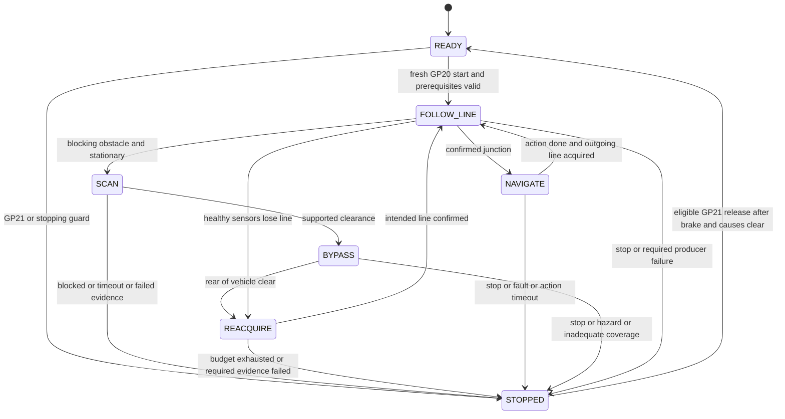

# System architecture

## Contents

- [Plan status and scope](#plan-status-and-scope)
- [Tasks](#tasks)
- [Core allocation implications](#core-allocation-implications)
- [Mission loop](#mission-loop)
  - [Startup and local controls](#startup-and-local-controls)
  - [Barcode and junction lifecycle](#barcode-and-junction-lifecycle)
  - [Recovery and encounter coordination](#recovery-and-encounter-coordination)
- [Source layout](#source-layout)
- [Implementation order and acceptance](#implementation-order-and-acceptance)
- [Authority](#authority)
- [Shared-data rules](#shared-data-rules)
  - [Fault bitmask](#fault-bitmask)
- [Motion command contract](#motion-command-contract)
- [Encoder contract](#encoder-contract)
- [Subsystem summaries](#subsystem-summaries)
  - [S1 Communications (subsystem1)](#s1-communications-subsystem1)
  - [S2 Motion (subsystem2)](#s2-motion-subsystem2)
  - [S3 Line, barcode and Mission (subsystem3)](#s3-line-barcode-and-mission-subsystem3)
  - [S4 Terrain (subsystem4)](#s4-terrain-subsystem4)
  - [S5 Obstacle and bypass (subsystem5, with Mission)](#s5-obstacle-and-bypass-subsystem5-with-mission)
- [Time](#time)
- [Post-Tribunal decisions](#post-tribunal-decisions)
- [MQTT binary protocol, schema version 2](#mqtt-binary-protocol-schema-version-2)
  - [Telemetry and snapshot reply (23 bytes)](#telemetry-and-snapshot-reply-23-bytes)
  - [Event (11 bytes)](#event-11-bytes)
  - [Mapping, acknowledgement, snapshot request](#mapping-acknowledgement-snapshot-request)
  - [Golden vectors](#golden-vectors)
  - [Binary frame sizes](#binary-frame-sizes)

## Plan status and scope

Target contracts reconciled 2026-10-29. Implementation sequence and pinned remote
source inventory live in [plan](../plan.md). These target contracts are not a
claim of implemented firmware or physical acceptance. The working implementation now creates Motion, Mission and core-0 I/O only.
The software verification and remaining calibration/feature gates are recorded in
[plan status](../plan.md#software-implementation--2026-10-29). This does not make
all target feature behavior below physically accepted. Requirements and calibrated values are
owned by [project-specs](project-specs.md); wiring by [team](team.md).

Keep micro T-Kernel, C/Pico SDK, five subsystem modules and binary MQTT schema v2.
No core-number migration, generic event bus, new scheduler or watchdog framework.

## Tasks

Exactly three application tasks; kernel boot/WiFi/USB activities remain additional
RTOS tasks. Smaller numeric priority means higher scheduling priority.

| Target task | Core | Responsibilities | Scheduling decision |
| --- | --- | --- | --- |
| Motion | 1 (`TP_PRC2`) | Motor outputs, wheel-speed loop, encoder actions, independent GP21/stop/expiry checks | Higher priority than Mission |
| Mission | 1 (`TP_PRC2`) | Bounded line/barcode/sonar/servo steps, calibration controls, navigation, safety policy and mapping acceptance | Below Motion; bounded work then sleep |
| `io_task` | 0 (`TP_PRC1`) | Bounded Terrain acquisition/calibration and Reporting steps | Below existing critical kernel services; numeric choice pending |

WiFi/lwIP/MQTT service and USB stay on core 0 in their existing execution contexts.
Existing numeric periods/priorities/ages are retained as explicitly provisional
software defaults with user authorization on 2026-10-29. Physical WCET budgets,
freshness margins and acceptance are still [D13](project-specs.md#pending-decisions). Existing source
constants are recorded in [plan inventory](../plan.md#remote-implementation-inventory),
not silently promoted to target values. Skip missed releases rather than replay
an unbounded backlog; bound capture decoding, incoming requests and event draining.
Only Motion performs wheel control; Mission scheduling authority does not outrank
its braking deadlines. No separate Safety, Line, Obstacle, Terrain or Reporting task.

## Core allocation implications

Keep encoder/barcode/Echo capture under the existing core-1 GPIO dispatcher.
I/O consolidation moves Terrain/Reporting application work, not WiFi/USB services.
Never hold shared locks across I2C, servo settling, Echo wait, formatting or network
work. Use bounded peripheral steps, acquisition timestamps and coherent copies.
Measure network-load effects on IMU age and interrupt/control latency. Audit S1
multi-producer events and mapping installation across cores: DI/EI protects only
one core. The existing same-core event-log assumption cannot survive unchanged.

## Mission loop

Seven states: READY=0, FOLLOW_LINE=1, NAVIGATE=2, SCAN=3, BYPASS=4,
REACQUIRE=5, STOPPED=6; code 7 is invalid and stops. The existing four-bit MQTT
state slot is unchanged. `scripts/mqtt_client.py` uses these new meanings;
recorded old-image state labels remain historical.
Calibration/mapping readiness belongs inside READY, not extra top-level states.
No automatic COMPLETE or finish-marker transition. A local stop or stopping guard
ends movement, while healthy operation continues around the course indefinitely.

GP21 and stopping guards apply in every state, including SCAN/READY. Scan/turn/
recovery phases issue a bounded step and return. Arbitration: local stop/stopping
fault, required-data freshness, obstacle hazards, active manoeuvre, junction
instruction, ordinary line following. Do not blindly resume an interrupted action.

### Startup and local controls

- Boot inhibited. Attempt stationary IMU calibration before enabling IR calibration;
  complete or fail the attempt within a bound and expose its outcome. IMU failure
  is flagged and does not permanently prevent IR calibration or starting.
- Start requires fresh functional line acquisition and valid calibration/guidance,
  functional Motion/encoder service, an installed four-letter mapping, WiFi and
  MQTT connected, no active stopping cause and a fresh local GP20 press.
- Connectivity is a readiness prerequisite, not remote motion authority. Mission
  observes connection state; network callbacks never call start/stop/motor APIs.
- GP21 press requests immediate persistent stop. Its debounced release may clear
  the latch only after Motion serviced braking and stopping causes cleared; it
  returns READY and never starts motion. A fault stop requires a deliberate fresh
  GP21 press/release after cause clearance. GP20 subsequently starts.
- Stop cancels active manoeuvres, scans and pending navigation; retain valid IR
  calibration, installed mapping and last barcode display. Do not replay commands.
  Operator repositions after a partial turn/bypass. Reboot still clears RAM-only
  calibration/mapping; no nonvolatile retention is added.
- Mapping replacement is accepted only while READY/STOPPED, installs atomically
  through Mission and clears pending movement. It never starts the robot.

### Barcode and junction lifecycle

Decode A-Z identically in either scan direction. Store one character/action from
the installed MQTT mapping and continue tracking until the next confirmed cross
junction; its distance from the barcode varies. Mark the action consumed when
navigation starts. Execute once and confirm encoder completion plus outgoing-line
tracking; left/right continue on the chosen branch. U-turn reaches the junction,
brakes, pauses about 200 ms, turns 180 degrees and tracks the return branch.
Never undo a turn. Pause reference/placement tolerance is pending D02/D08.

No pending instruction: continue straight using a requested minimum 25 mm crossing
travel (`MISSION_BROAD_FORWARD_MM`), then acquire/track the outgoing line. This is
not an accepted geometric clearance guarantee; sensor/axle offsets and completion
tolerance need measurement. Confirm a junction using tracking evidence plus
travel/geometry qualification. A single black barcode-sensor reading neither
identifies a barcode nor proves a junction; barcode capture must not block junction
checks. Exact mounted evidence is D01/D02/D04.

Remove the two-second barcode blind delay. Use the decoder's bounded quiet-zone/
encounter lifecycle to prevent repeated actions from the same print. A new visit
may produce a new action. Incomplete/unknown captures do not guess a character;
no elaborate damaged-print recovery. Multiple different barcodes before a junction
remain a pending course/policy decision, not an invented queue of route choices.

### Recovery and encounter coordination

Healthy IR seeing white enters REACQUIRE, unlike missing/stale acquisition, which
stops required movement. Requested recovery sweeps left/right up to 70 degrees
while creeping, for two back-and-forth attempts; exact sequence, speed, travel
cap and failure boundary await D07. Either sensor finding line initiates alignment;
confirm stable intended-line tracking before resuming. Heading/travel evidence
is required after bypass to avoid accepting an unrelated crossing.

Humps remain concurrent with tracking; request half normal tracking speed during
a valid encounter, settle at reduced speed for height estimation and restore after
confirmed completion. Only valid completed humps update count/maximum; report
measurements/events. Proposed stop retention/new-start reset is pending D06.

For a blocking obstacle, brake and confirm stationarity before profiling. Bypass
selects supported measured clearance, departs the line, follows the side, confirms
rear-edge and full-car clearance, returns toward the original line and aligns.
One servo sensor cannot look forward and sideways simultaneously: schedule fresh
coverage and bounded travel. Reverse needs a supported bounded path; no blind
rear-clearance assumption. A new hazard, unsupported route or exhausted action
budget brakes/stops. Exact rescan/reverse policy awaits D02/D05/D07.

## Source layout

Target: `app_program/mission/` holds coordinator and small policy helpers;
`app_program/common/` holds startup/shared contracts and I/O orchestration as
appropriate. Keep `subsystem1/` through `subsystem5/` for their reusable modules.
No separate Safety task. Move files/build/includes only with tested implementation
stages in [plan](../plan.md#implementation-stages). `mqtt_utk.c` stays in the kernel
library and only WiFi service context calls MQTT/lwIP.

## Implementation order and acceptance

[Plan](../plan.md#implementation-stages) is the single work sequence: preserve
Motion checks (#130), consolidate Mission (#131), consolidate I/O (#132), integrate
(#133), then physically calibrate/validate all features through #117. Align
contracts first (#129). No host/build result is firmware or physical acceptance.

## Authority

- Motion alone writes motor PWM and owns the persistent motor stop latch.
- Mission alone chooses movement, accepts mappings and coordinates local reset.
- S3/S4/S5 supply evidence and helpers; they never independently drive motors.
- Small safety functions are called by Mission/Motion, not a separate task.
- Network work reports connectivity and transports configuration/diagnostics;
  it never starts, stops or drives the robot. Loss during a run is report-only.

## Shared-data rules

One writer per storage unit; only that writer performs read-modify-write.

1. One aligned word snapshot: C11 release store/acquire load and field accessors.
2. Larger snapshot: short bounded mutex copy (use existing priority-inheritance
   primitives); never hold across I/O or formatting. Reporting skips busy data.
3. Bounded capture/bridge rings: explicit producer/consumer ownership and full
   policy. ISRs capture/signal/return; no blocking or allocation. Preserve sample
   acquisition time. Existing SPSC transport rings are retained provisionally;
   the professor's buffer diagram does not establish a required kernel primitive.

Same-core DI/EI is not cross-core synchronization. S1 events gain producers on
both cores, so select bounded mutex/spinlock copies or per-producer rings before
moving tasks. Mapping RX on core 0 must hand off to Mission on core 1 and wait
asynchronously for installation outcome before ACK. Do not call Mission's mutable
state from another task without the agreed copy/hand-off contract.

### Fault bitmask

Six existing owner bytes and positions remain wire-compatible. Owner denotes a
module, not necessarily a separate task. Target writers: Motion byte by Motion;
Line/Obstacle/Mission bytes by Mission; Terrain by I/O; Network by WiFi service.
This table owns target policy. `robot_data.c` now leaves IMU/calibration failure report-only. Mission checks
`s1_bridge_ready()` for local start; network loss does not stop an accepted run.

| Condition / detector | Start response | During run | Clear/reset |
| --- | --- | --- | --- |
| GP21 / Motion local input | Block | Latch brake | Eligible GP21 release after serviced brake; GP20 starts separately |
| Motion bit 0 stall / wheel controller | Block while active | Latch stop | Cause cleared plus local reset; threshold uncalibrated D07 |
| Motion bit 1 encoder / invalid edges or failed capture | Block | Latch stop | Validated encoder recovery; existing 64-count rule is provisional D03 |
| Line bit 0 acquisition invalid / S3 | Block | Stop if required acquisition invalid/stale | Valid readings/calibration and local reset |
| Healthy line lost / Mission | No start on unusable line | Bounded REACQUIRE, then stop if exhausted | Line confirmed or operator reposition/reset |
| Line bits 1/2 barcode capture/event overflow | Report | Report; never guess/replay an action | Existing encounter/run clearing behavior audited during integration |
| Terrain bits 0/1 IMU acquisition/calibration failure | Flag, allow after bounded startup attempt | Flag; ordinary tracking continues | Successful reacquisition/calibration; no invented height |
| Terrain bit 2 detected impact | Block while active | Latch stop | Cause cleared plus deliberate local reset |
| Obstacle bit 0 no echo / S5 | Flag, not universal block | Flag; ordinary tracking continues; no inferred clear space | Fresh valid readings clear/report status |
| Required scan/bypass evidence unavailable / Mission | Not ordinary readiness input | Brake/stop unsupported manoeuvre | Local reset after safe reposition/cause clearance |
| Mission bit 0 recovery exhausted | Report historical reason | Already stopped | Clear on accepted new start |
| Network bits 0/1 WiFi/broker unavailable | Mission blocks start | Report-only; healthy local run continues | Successful reconnect; no remote restart |
| Expired command, failed required copy/progress or action deadline / Motion/Mission | Inhibit | Brake/stop | Fresh validated context plus local reset; no stale replay |
| Startup control initialization failure or TEST | Inhibit | No enabled output | Startup failure requires correction/reboot; TEST remains inhibited |

No new fault bit is invented without a data-contract review. Conditions lacking
wire bits must still be observable through existing state/reason diagnostics.

## Motion command contract

Mission is the only latest-command writer. Keep packed `MotionCommand`, action
ID and coherent feedback. Repeating a command does not restart its encoder action
or extend its absolute deadline. Preserve acquisition time; copying stale evidence
never makes it fresh. No lease/generation/acknowledgement framework is added.

| Movement | Required evidence | Not universally required |
| --- | --- | --- |
| FOLLOW_LINE / straight crossing | Mission progress, Motion/encoder health, fresh usable tracking acquisition | IMU/sonar/network availability mid-run |
| Encoder turn/distance | Fresh Mission progress and encoder service; bounded action deadline; line evidence for acquisition/completion | Visible line throughout an in-place turn |
| SCAN | Braked output plus measured stationarity; fresh scan samples/angles | Motion command implying stationarity |
| BYPASS | Fresh encoder/Mission progress and mode-specific supported clearance/coverage | Side sample masquerading as forward sample |
| REACQUIRE | Functional fresh IR, encoder/Mission progress, bounded heading/travel search | Visible line before search starts |

Implemented software uses Motion service sequence/time, fresh IR acquisition for
tracking/crossing/reacquisition and Mission release time for encoder-only actions.
Motion enforces command expiry and the original absolute action deadline. Copies
do not renew acquisition time. Existing age limits remain provisional D07/D13. Stop must not wait for the command mutex or diagnostics.
Runtime stop/reset stays on Motion's core; Terrain publishes impact evidence and
Motion/Mission observe it. Motion checks GP21 independently every release.
Reset invalidates old commands and never enables output itself. Brake service
acknowledgement is software progress; stationarity uses encoder evidence.
Checks require Motion to execute and do not protect against a hung Motion/kernel.
A watchdog tick setup alone is not a reset watchdog; further policy remains D15.

## Encoder contract

ISR counts wrap at the justified width. Each consumer keeps its own origin and
uses modular subtraction; nobody resets shared counts. Calibrate counts/revolution,
wheel geometry and signs before distance/angle actions. Record shared GPIO IRQ
edge rate and ISR time at maximum tested wheel speed. PIO is only a conditional
follow-up if evidence shows the existing capture is inadequate.

## Subsystem summaries

### S1 Communications (subsystem1)

[Guide](architecture/subsystem1.md): bounded core-0 reporting functions; opaque
TX/RX bridge to kernel MQTT; mapping ACK only after Mission installation.

### S2 Motion (subsystem2)

[Guide](architecture/subsystem2.md): sole motor writer; wheel control, encoder
actions and independent stop/expiry checks.

### S3 Line, barcode and Mission (subsystem3)

[Guide](architecture/subsystem3.md): S3 retains line/barcode sensing/decoding;
Mission coordination moves out. No independent S3 control thread in the target.

### S4 Terrain (subsystem4)

[Guide](architecture/subsystem4.md): core-0 bounded IMU/terrain functions; measured
encoder travel, filtered pitch, valid completed hump results and impact evidence.

### S5 Obstacle and bypass (subsystem5, with Mission)

[Guide](architecture/subsystem5.md): bounded sonar/servo acquisition and uncertain
width/clearance estimates; Mission owns supported bypass/original-line recovery.

## Time

Keep kernel milliseconds and hardware microsecond capture domains explicit.
Use unsigned wrap-safe elapsed arithmetic and justified field widths. No unbounded
polling, waits, retries, frame backlog or movement phases. Slow MQTT cannot prove
short latency; measure directly on the final image.

## Post-Tribunal decisions

Historical Tribunal mechanisms are preserved in the [Tribunal record](additional-docs/tribunal1.md).
The active simplification retains timestamped commands, bounded action IDs,
four-letter runtime mapping, per-consumer encoder origins and word snapshots.
New target decisions are owned above, not an alternative historical architecture.

## MQTT binary protocol, schema version 2

Implemented by `app_program/subsystem1/mqtt_frame.[ch]`, tested by `testing/pure/test_mqtt_frame.c`; the laptop decoder `scripts/mqtt_client.py` checks the same golden vectors (`--self-test`). Field widths follow the data table in [project-specs](project-specs.md); rows pending there carry provisional widths here and change only through the data-contract review (#28). Version 2 added line status, the mapped flag, the Mission fault byte and obstacle width/depth; a version 1 frame is rejected.

Topics (root `robot/s3`, set in `config/wifi_secrets.h`): `<root>/telemetry` carries every robot-to-PC frame, `<root>/request` carries mapping and snapshot requests, `<root>/status` is the retained online/offline text.

Rules for every frame:

- Little-endian multi-byte fields, written with explicit masks and shifts, never by copying a struct.
- Byte 0: bits 7-4 version (2), bits 3-0 type.
- Length is exact for the type. A receiver rejects a wrong length, version or type, any set reserved bit and any out-of-range field. Nothing is partially accepted.
- Networking never drives, starts or stops the robot. The only command that changes robot state is the mapping, and only while stopped.
- Speed and movement direction are not sent: the laptop derives them from successive encoder counts.

| Type | Value | Direction | Length (bytes) |
| --- | --- | --- | --- |
| Telemetry | 1 | robot to PC, every 500 ms | 23 |
| Event | 2 | robot to PC | 11 |
| Snapshot reply | 3 | robot to PC, answers a request; body as telemetry | 23 |
| Mapping | 4 | PC to robot | 5 |
| Acknowledgement | 5 | robot to PC | 3 |
| Snapshot request | 6 | PC to robot | 2 |

### Telemetry and snapshot reply (23 bytes)

| Byte | Bits | Field | Range |
| --- | --- | --- | --- |
| 0 | 7-0 | version and type | `0x21` telemetry, `0x23` reply |
| 1 | 7-0 | sequence | 0-255, wraps |
| 2 | 3-0 | mission state | 0-15 |
| 2 | 5-4 | motion status | 0 IDLE, 1 RUNNING, 2 DONE, 3 FAILED |
| 2 | 7-6 | line status | 0 unknown, 1 visible, 2 lost, 3 broad black |
| 3 | 5-0 | motion action ID | 0-63 |
| 3 | 6 | mapped | four letters installed |
| 3 | 7 | reserved | 0 |
| 4-9 | 7-0 each | fault bytes: Motion, Line, Terrain, Obstacle, Mission, Network | [fault bitmask](#fault-bitmask) |
| 10-11 | 15-0 | left encoder count | wrapped, `ENC_COUNT_BITS` wide |
| 12-13 | 15-0 | right encoder count | wrapped |
| 14 | 7-0 | hump count | 0-255 saturating |
| 15 | 6-0 | maximum hump height code | 7-bit result, scale D06 |
| 15 | 7 | maximum valid | set once any hump completed |
| 16-17 | 12-0 | front range, mm | 0-8190; 8191 invalid |
| 16-17 | 13 | front range valid | no echo is not clear space |
| 16-17 | 15-14 | reserved | 0 |
| 18 | 4-0 | last decoded barcode letter | 0-25 (A-Z), 31 none |
| 18 | 7-5 | action it maps to | 0 unmapped, 1 left, 2 right, 3 straight, 4 U-turn |
| 19-20 | 15-0 | latest obstacle width, mm | 0 none |
| 21-22 | 15-0 | latest obstacle depth, mm | 0 none |

### Event (11 bytes)

| Byte | Field |
| --- | --- |
| 0 | version and type, `0x22` |
| 1 | bits 3-0 kind: 1 barcode, 2 hump, 3 obstacle, 4 turn; bits 7-4 reserved 0 |
| 2 | arg: letter (barcode), height code (hump), action (turn) |
| 3-4 | time, low 16 bits of kernel milliseconds |
| 5-6 | left encoder count at the event |
| 7-8 | right encoder count at the event |
| 9-10 | arg2: action (barcode), depth mm (obstacle) |

**Event RAM packing (issue #112).** The 11-byte event wire format and MQTT schema v2
remain unchanged. Byte 1 already reserves four bits for kind. `arg2` cannot be
reduced to three bits: barcode actions are small, but obstacle depth needs its
full 16-bit range (0-65535 mm). The Reporting ring uses 16 entries of
`s1_packed_event_t` (10 bytes each): kind uses three bits and arg seven bits
in a shared 16-bit field; time, encoder positions and arg2 stay 16-bit.
Invalid kinds and arguments above 127 are rejected rather than truncated.
Ring head (0-15) and count (0-16) share a 16-bit packed word, with
32-bit saturating `dropped`. Accessors isolate the bit operations; the
existing same-core interrupt-masked push/pop boundaries remain in the current implementation. During I/O consolidation, audit producer/consumer placement: local interrupt masking does not protect a cross-core ring.
Expected target ring storage is 168 bytes, including padding; confirm with
`testing/subsystem3/sizeof_probe.sh testing/subsystem1/sizeof_probe.c`.
This is a RAM layout change only: `mqtt_encode_event`, the laptop decoder
and schema-v2 golden vectors remain compatible.

### Mapping, acknowledgement, snapshot request

- **Mapping (5 bytes):** byte 0 `0x24`, byte 1 sequence, bytes 2-4 a 24-bit little-endian value; bits 4-0, 9-5, 14-10 and 19-15 are the letters for left, right, straight and U-turn (A=0 .. Z=25); bits 23-20 reserved 0. The four letters are distinct.
- **Acknowledgement (3 bytes):** byte 0 `0x25`, byte 1 the sequence answered, byte 2 the result: 0 installed, 1 busy (robot not stopped), 2 invalid letters, 3 malformed frame. The acknowledgement follows installation by Mission.
- **Snapshot request (2 bytes):** byte 0 `0x26`, byte 1 sequence.

### Golden vectors

Used by the host tests and `scripts/mqtt_client.py --self-test`.

| Frame | Bytes |
| --- | --- |
| Telemetry | `21 2A 72 45 01 02 04 08 01 03 34 12 78 56 03 F8 D0 30 61 A4 01 AA 00` |
| Event (barcode Z, action 2) | `22 01 19 E8 03 10 00 11 00 02 00` |
| Mapping A left, B right, C straight, D U-turn, sequence 7 | `24 07 20 88 01` |
| Acknowledgement installed, sequence 7 | `25 07 00` |
| Snapshot request, sequence 9 | `26 09` |

### Binary frame sizes

| Message | Baseline on `main` (JSON) | Binary |
| --- | --- | --- |
| Telemetry | up to 768 bytes (`S1_TELEMETRY_PAYLOAD_MAX`) | 23 bytes |
| Mapping | up to 512 bytes on `uat` | 5 bytes |

Baseline figures come from the CR baseline evidence and the #22 census and are historical; a comparison is not required. Binary sizes are the exact frame lengths above. Final message-size and RAM evidence: [SYS-11](../testing/system/TEST_LOG.md#3-final-memory-and-message-size-sys-11).

Implementation limits: the coordinator retains a bounded last-side recovery arc
until D07 defines the requested moving sweep; unknown-side loss stops. S5 scans
now have bounded median groups and qualified edge/model estimation. Their
operating settings are unset by user choice, and physical bypass release remains
inhibited. Supported forward/side scheduling, rear-edge/original-line acceptance
and the deferred operating policies remain Stage 8 work. These are not accepted floor
features. Terrain publishes original acquisition/service times under a mutex;
impact remains asserted until a fresh non-impact sample observes serviced braking.
S1 events use a short cross-core mutex; events stay in the ring when the TX bridge
is full. Overflow overwrites oldest entries, and lock misses are separately
saturating per-core counters exposed by `s1_event_drops()`. Mapping uses a single
outstanding word hand-off; only Mission installs/rejects before I/O ACKs.
