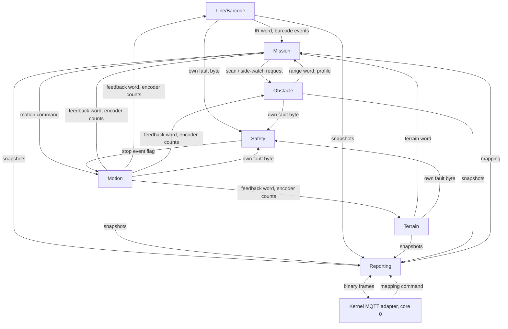

# System architecture

Target design for `main`. It implements the requirements and change requirement in [project-specs](project-specs.md) with the fewest mechanisms that meet them. [Tribunal 1](additional-docs/tribunal1.md) records the Week 8 plan: task ownership, priorities, RTOS interfaces and authority boundaries are unchanged from it, except for the four [post-Tribunal decisions](#post-tribunal-decisions). Pre-realignment code is on branch `legacy-main`; the fuller integration is on branch `uat` as a port source.

Related: pins, hardware and workflow in [team](team.md); data widths and scales in [project-specs](project-specs.md); subsystem detail in [S1](architecture/subsystem1.md), [S2](architecture/subsystem2.md), [S3](architecture/subsystem3.md), [S4](architecture/subsystem4.md), [S5](architecture/subsystem5.md).

## Tasks

All application tasks run on core 1. The kernel WiFi/lwIP/MQTT task (`cyw43_utk_task`, priority 4) runs on core 0. Smaller number = higher priority.

| Task | Owner | Priority | Release | Role |
| --- | --- | --- | --- | --- |
| Safety | Nicholas | 12 | 10 ms | GP21 stop latch, fault aggregation, freshness checks, stop authority |
| Motion | Mahesha | 13 | 20 ms, or woken by stop | Sole motor writer; encoders, wheel PID, distance/turn actions |
| Mission | Nicholas | 14 | 20 ms | Navigation decisions, state machine, mapping acceptance |
| Line/Barcode | Nicholas | 15 | ADC 20 ms; GP16 edge IRQ | IR line snapshot, barcode capture and decode |
| Terrain | Darrius | 16 | 20 ms | IMU calibration, pitch, humps, impact |
| Obstacle | Jia Jing | 17 | Echo IRQ; trigger every 60 ms | Forward range, servo scans, profiles, side-watch |
| Reporting | Shaun | 20 | Collect 20 ms; publish 500 ms | Binary telemetry, event record, snapshot replies, mapping hand-off |

## Authority

- Motion alone writes motor PWM.
- Mission owns navigation decisions and accepts mapping changes, only while stopped.
- Safety holds stop authority independent of Mission and Reporting.
- Line/Barcode, Terrain and Obstacle provide sensor evidence and never write motors.
- Networking has no movement authority; network loss never stops otherwise healthy local autonomy.

## Shared-data rules

Exactly three sharing patterns. Each storage unit has one writer; only that writer performs read-modify-write on it.

1. **Word snapshot.** A producer packs a snapshot of at most 32 bits into one aligned `uint32_t`, composes it in a register and publishes it with one store. Readers take one load and decode with accessors. An aligned 32-bit load/store is single-copy atomic on RP2040 across both cores: no lock, no torn snapshot.
2. **Mutex copy.** Snapshots above 32 bits (obstacle profile, event record, telemetry aggregate) are copied under one priority-ceiling mutex covering only the bounded copy.
3. **ISR-to-task ring.** Interrupts push timestamps into a single-producer/single-consumer ring (barcode edges, Echo edges). Scalars shared with an ISR on core 1 use a short `DI`/`EI` section.

No other mechanism: no custom PRIMASK code, no `volatile` as synchronisation, no lock-free retry loops. Fields are never read in place from another subsystem's storage (C cannot address a bit-field; in-place multi-field reads are not coherent).

### Fault bitmask

One byte per owner; each owner sets and clears only its own bits, so no two writers share a storage unit. Bit positions are in the data table in [project-specs](project-specs.md).

| Byte owner | Example bits |
| --- | --- |
| Motion (S2) | motor stall, encoder fault |
| Line/Barcode and Mission (S3) | IR invalid, line lost, barcode capture overflow, barcode event overflow |
| Terrain (S4) | IMU fault, calibration failed, impact |
| Obstacle (S5) | no echo, servo fault |
| Network (kernel task, core 0) | Wi-Fi lost, broker lost (report-only; never stops motion) |

Safety reads every byte each release, latches stop for motion-relevant bits and publishes the combined mask for telemetry. Simultaneous faults stay independently visible.

## Motion command contract

- Mission writes one packed command each 20 ms: mode (stop, follow, distance, turn), speed and steering or target, a small action ID, and the acquisition time of the sensor sample it was derived from.
- Motion brakes when that sample is older than the configured age limit (D07). Copying or rewriting a command never refreshes its sample time.
- Discrete actions report `IDLE`, `RUNNING`, `DONE` or `FAILED` with their action ID in Motion's feedback word. Mission starts the next action after seeing `DONE` for its ID; a new command replaces the old one. Only Motion writes the status.
- Stop: Safety or GP21 sets a persistent event flag and wakes Motion, which brakes in that release. Reset needs a fresh local GP20 press with the cause cleared and never starts motion by itself. Zero commanded speed is not proof of stopping; stationarity comes from encoder counts.

## Encoder contract

- The encoder ISR keeps one fixed-width wrapping count per wheel. Width is set from measured counts per revolution and the longest segment any consumer measures (D03).
- Each consumer (Motion actions, barcode bar widths, hump travel, bypass legs) stores its own origin and computes travel by modular subtraction. Nobody resets the shared count, so travel length is unbounded and consumers stay independent.

## Subsystem summaries

### S1 Communications ([subsystem1](architecture/subsystem1.md))

- The kernel adapter (`lib/liblwip/sysdepend/pico_rp2040/mqtt_utk.c`) only connects, reconnects, publishes byte frames and hands received frames to Reporting. No application logic; no application headers beyond one S1 bridge header.
- Three topics: telemetry (binary, every 500 ms and on snapshot request), command (binary snapshot request and mapping), status (retained online/offline last will and mapping acknowledgement).
- Wire format: [MQTT binary protocol](#mqtt-binary-protocol-schema-version-1). Native structs are never sent.
- Mapping acknowledgement `{sequence, result}` means the complete mapping was validated and installed; receipt alone is not an acknowledgement.

### S2 Motion ([subsystem2](architecture/subsystem2.md))

Sole motor writer, encoder counts, wheel PID, distance/turn actions, stop handling. Contracts: [motion command](#motion-command-contract) and [encoder](#encoder-contract).

### S3 Line, barcode and Mission ([subsystem3](architecture/subsystem3.md))

- **Line.** Two analogue IR channels (GP26/GP27), calibrated black/white, published as one word snapshot: normalised readings, line state, validity.
- **Barcode.** The GP16 edge ISR pushes edge time and encoder position into a ring. The task measures bar widths from encoder travel, decodes Code 39 A-Z in either direction and queues decoded events (small fixed depth; overflow sets a fault bit).
- **Mapping.** Four 5-bit letters (left, right, straight, U-turn). Boot state is unmapped.
- **Mission.** One `switch` on state with one handler per state. Candidate states: Calibrating, Ready, FollowLine, Navigation, Scan, Bypass, Reacquire, Stopped, Fault, Complete; the final list and bit width are set in the Mission issue. A decoded barcode command is held until the next cross junction, then executed as a Motion action. Line loss allows a bounded recovery before stopping. Arbitration order: stop/fault, required-data freshness, obstacle, navigation, line following.

### S4 Terrain ([subsystem4](architecture/subsystem4.md))

- Calibrate accelerometer bias while stationary at start.
- Height accumulates sin(pitch) times encoder travel through each climb, crest and descent. Working values are 16-bit fixed point; reported height is packed to 7 bits with a defined scale (D06) and an invalid code.
- Only a valid completed encounter adds a hump event and may update the maximum. An impact sets an S4 fault bit.

### S5 Obstacle and bypass ([subsystem5](architecture/subsystem5.md), with Mission)

- Forward range is a word snapshot; no echo means unknown, never clear space.
- When an obstacle blocks the line, Motion stops and Obstacle performs a stationary coarse scan (five rays) and a focused fine scan, producing location, width, closest point and left/right clearance.
- Side-watch bypass: turn toward the side with more clearance, drive an offset leg, turn parallel, then drive the parallel leg with the servo held toward the obstacle. A range jump marks pass-by; encoder travel along the leg gives obstacle depth. Turn back, return the offset and reacquire the original line using expected heading and two fresh line observations. A second obstacle during bypass stops the robot.

## Time

- Kernel milliseconds drive freshness and control; hardware TIMER microseconds time barcode and Echo edges. Each domain stays explicit.
- Timestamps may be stored narrow; all age calculations use unsigned wrap-safe subtraction, and each width is justified in [project-specs](project-specs.md).
- Storage, waits, retries and actions are bounded. ISRs capture, signal and return.

## Post-Tribunal decisions

Agreed 2026-10-25 as change type "Simplified". Each keeps the Tribunal's intent while removing machinery the requirements do not need.

| Tribunal 1 record | Adopted design | Reason |
| --- | --- | --- |
| Leased Motion commands renewed without moving the original sensor time; results retained until acknowledged | Timestamped command rewritten every 20 ms; Motion brakes on stale sample time; DONE/FAILED with action ID; no renewal, epochs, acknowledgement or two-phase reset | One producer and one consumer on one core. Staleness is the only hazard a lease guards against, and the sample time already covers it. A single status writer removes the acknowledgement race. |
| Full 26-entry mapping replacement with four acknowledgement slots | Four 5-bit letters (20 bits) and one `{sequence, result}` acknowledgement | The rule announces exactly four letters. 3 bytes instead of 26 entries; one acknowledgement state instead of a queue. |
| Encoder distance reset at every barcode | Fixed-width wrapping counts with per-consumer origins | A missed barcode leaves the interval unbounded, and a shared reset breaks other consumers (Tribunal Version C gap 3). |
| Mutex-protected copies for every snapshot | One-word snapshots by single store/load; mutex copies only above 32 bits | Atomic on RP2040 across cores, no lock time, no torn reads. Meets risks R1 and R4 with a single writer. |

## MQTT binary protocol, schema version 1

Implemented by `app_program/subsystem1/mqtt_frame.[ch]`, tested by `testing/pure/test_mqtt_frame.c`. Field widths follow the data table in [project-specs](project-specs.md); rows pending there carry provisional widths here and change only through the data-contract review (#28).

Rules for every frame:

- Little-endian multi-byte fields, written with explicit masks and shifts, never by copying a struct.
- Byte 0: bits 7-4 version (1), bits 3-0 type.
- Length is exact for the type. A receiver rejects a wrong length, version or type, any set reserved bit and any out-of-range field. Nothing is partially accepted.
- Networking never drives, starts or stops the robot. The only command that changes robot state is the mapping, and only while stopped.

| Type | Value | Direction | Length (bytes) |
| --- | --- | --- | --- |
| Telemetry | 1 | robot to PC, every 500 ms | 18 |
| Event | 2 | robot to PC | 11 |
| Snapshot reply | 3 | robot to PC, answers a request; body as telemetry | 18 |
| Mapping | 4 | PC to robot | 5 |
| Acknowledgement | 5 | robot to PC | 3 |
| Snapshot request | 6 | PC to robot | 2 |

### Telemetry and snapshot reply (18 bytes)

| Byte | Bits | Field | Range |
| --- | --- | --- | --- |
| 0 | 7-0 | version and type | `0x11` telemetry, `0x13` reply |
| 1 | 7-0 | sequence | 0-255, wraps |
| 2 | 3-0 | mission state | 0-15 |
| 2 | 5-4 | motion status | 0 IDLE, 1 RUNNING, 2 DONE, 3 FAILED |
| 2 | 7-6 | reserved | 0 |
| 3 | 5-0 | motion action ID | 0-63 |
| 3 | 7-6 | reserved | 0 |
| 4-8 | 7-0 each | fault bytes: Motion, Line/Barcode, Terrain, Obstacle, Network | owner bit positions |
| 9-10 | 15-0 | left encoder count | wrapped, `ENC_COUNT_BITS` wide |
| 11-12 | 15-0 | right encoder count | wrapped |
| 13 | 7-0 | hump count | 0-255 saturating |
| 14 | 6-0 | maximum hump height code | 7-bit result, scale D06 |
| 14 | 7 | hump height valid | |
| 15-16 | 12-0 | front range, mm | 0-8190; 8191 invalid |
| 15-16 | 13 | front range valid | no echo is not clear space |
| 15-16 | 15-14 | reserved | 0 |
| 17 | 4-0 | last decoded barcode letter | 0-25 (A-Z), 31 none |
| 17 | 7-5 | action it maps to | 0 unmapped, 1 left, 2 right, 3 straight, 4 U-turn |

### Event (11 bytes)

| Byte | Field |
| --- | --- |
| 0 | version and type, `0x12` |
| 1 | bits 3-0 kind: 1 barcode, 2 hump, 3 obstacle, 4 turn or segment; bits 7-4 reserved 0 |
| 2 | arg: letter (barcode), height code (hump), action (turn) |
| 3-4 | time, low 16 bits of kernel milliseconds |
| 5-6 | left encoder count at the event |
| 7-8 | right encoder count at the event |
| 9-10 | arg2: action (barcode), width mm (obstacle) |

### Mapping, acknowledgement, snapshot request

- **Mapping (5 bytes):** byte 0 `0x14`, byte 1 sequence, bytes 2-4 a 24-bit little-endian value; bits 4-0, 9-5, 14-10 and 19-15 are the letters for left, right, straight and U-turn (A=0 .. Z=25); bits 23-20 reserved 0. The four letters are distinct.
- **Acknowledgement (3 bytes):** byte 0 `0x15`, byte 1 the sequence answered, byte 2 the result: 0 installed, 1 busy (robot not stopped), 2 invalid letters, 3 malformed frame. The acknowledgement follows installation by Mission.
- **Snapshot request (2 bytes):** byte 0 `0x16`, byte 1 sequence.

### Golden vectors

Used by the host tests and the PC client (#42).

| Frame | Bytes |
| --- | --- |
| Telemetry | `11 2A 32 05 01 02 04 08 03 34 12 78 56 03 F8 D0 30 61` |
| Event (barcode Z, action 2) | `12 01 19 E8 03 10 00 11 00 02 00` |
| Mapping A left, B right, C straight, D U-turn, sequence 7 | `14 07 20 88 01` |
| Acknowledgement installed, sequence 7 | `15 07 00` |
| Snapshot request, sequence 9 | `16 09` |

### Sizes against the baseline

| Message | Baseline on `main` (JSON) | Binary |
| --- | --- | --- |
| Telemetry | up to 768 bytes (`S1_TELEMETRY_PAYLOAD_MAX`) | 18 bytes |
| Mapping | up to 512 bytes on `uat` | 5 bytes |

Baseline figures come from the CR baseline evidence and the #22 census; binary sizes are the exact frame lengths above. Message-size comparison under identical builds is completed in #55.
