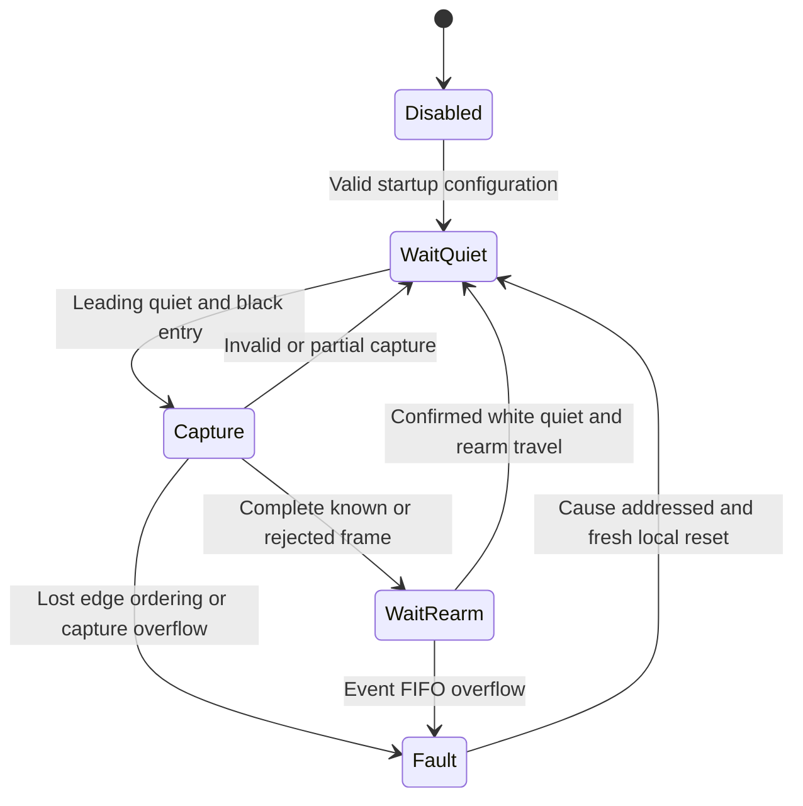

# Barcode

Owner: Nicholas / S3. Parent: [system architecture](../ARCHITECTURE.md). The configurable software capture/decoder/event implementation is active on the consolidation branch. Physical acceptance and final course decisions remain pending. See [S3 learning guide](../SUBSYSTEM3_GUIDE.md), [operation](../GETTING_STARTED.md#current-capabilities) and [specifications](../PROJECT_SPECS.md#barcode-examples).

## Functionality

GP16 comparator DOUT supplies digital transitions independently of periodic line ADC acquisition. The shared micro T-Kernel GPIO dispatcher processes S2 encoder changes before S3 capture. The ISR copies levels, original hardware microsecond time, coherent wheel counts, run context and epoch into a 256-entry SPSC ring. A separate priority-14/core-1 barcode task drains at most 64 edges per nominal 5 ms release; decoding, mutex access and event publication never run in the ISR.

S3 line and barcode snapshots stay separate. S3 does not drive motors or publish telemetry. Mission consumes navigation events and requests S2 actions. GPIO timing, encoder count resolution and interrupt latency require physical validation.

## Frame and distance contract

The selected implementation format is provisional standard Code 39 `*<one symbol>*`, consistent with the supplied A/Z patterns; course confirmation remains D01. Each character uses nine alternating bar/space widths, three wide and six narrow. Three characters and two narrow inter-character gaps require 29 widths. Both leading and trailing white quiet zones are checked using encoder travel.

Width identification sorts each character's widths into six narrow and three wide entries, validates configured count/range/cluster ratios, and matches the complete nine-element mask. Inter-character gaps must fit adjacent narrow widths. Unknown patterns, absent framing, zero/invalid widths, missing encoder context, changed encounter context, reverse wheel travel and partial/expired captures reject the frame.

All count-based barcode settings use **left signed-forward travel plus right signed-forward travel**, twice average decoded quadrature counts. Count subtraction wraps safely; a frame's directed travel must be positive and below INT32_MAX. Hardware timestamps wrap in microseconds; the configured frame deadline must be below INT32_MAX microseconds. Time is diagnostic/timeout information, never a guessed distance conversion.

Configuration explicitly sets measured DOUT polarity, matching encoder polarity, narrow count limits, wide:narrow bounds, narrow variation, quiet/rearm travel, frame timeout, event age, orientation and symbol/action mapping. Reversed print ordering is rejected by default; opt-in support does not authorize reverse car traversal.

The example maps A/B/C/D to left/right/straight/U-turn and leaves Z unmapped. These are examples, not confirmed course commands. Unmapped known symbols remain observable without an action.

## States and event lifetime

A validated mapped frame queues one copied `S3NavEvent`: encounter ID, symbol, action, original final-bar capture time, encoder position, run context and epoch. The four-entry FIFO consumes once; it never overwrites earlier events. Quiet/rearm travel suppresses duplicate encounters.

Capture overflow, simultaneously pending rising/falling edges, FIFO overflow and encounter-ID exhaustion explicitly latch faults. Context purge discards obsolete frames/events but **does not clear a fault**. The coordinator's fresh local reset invokes `s3_barcode_reset()`; resetting the decoder does not establish corrected hardware or valid lost encoder history.

Readers/consumers use the private nonblocking mutex through `s3_barcode_copy()` and `s3_nav_take()`. The coordinator alone writes `s3_barcode_context()` and records stale/context discards through `s3_nav_discard()`. Epoch changes immediately invalidate pending reads; task processing resets the ring on its owning core. Accepted/rejected/discarded totals survive context changes.

A pending GP16 edge or a nonempty ring prevents task polling from confirming a trailing quiet zone ahead of deferred capture. Service age remains original progress; stale cached status cannot authorize navigation.

## Mission integration

`NAVIGATION=0` preserves the calibrated line bench. `NAVIGATION=1` requires all explicit barcode, Motion and route configuration before movement starts. Setup and examples are in [S3 guide](../SUBSYSTEM3_GUIDE.md#7-configure-navigation-without-inventing-measurements).

Mission consumes fresh mapped events only during permitted following context. It approaches a junction window measured from the frame's final black-to-white edge. A broad-black candidate confirms the intended junction only inside that configured barcode/encoder context. Window/deadline failure stops; both-black alone has no navigation meaning.

Mission assigns a separate monotonically increasing Motion action ID, preserves target/deadline on renewal, acknowledges retained completion, then performs bounded expected-route reacquisition. Two distinct fresh visible acquisitions and configured travel/time bounds are required. These software guards do not prove physical original-line identity.

Local stop/critical fault outranks barcode navigation. Reads during recovery/navigation are discarded with a reason. Stop/reset/action completion purge obsolete events. Terrain/Obstacle preemption and full-course bypass remain deferred.

## Modules, wiring and validation

`barcode_capture.c/.h` owns the ring, `barcode_decoder.c` the pure frame/event algorithms, `barcode_service.c` the ISR/task/public boundary, and `barcode.h` portable types. Existing line modules remain independent. [TEAM](../TEAM.md#2-pins) owns pins/priorities; [TECHNICAL_INFO](../TECHNICAL_INFO.md#tcrt5000-based-ir-modules) owns electrical facts. Barcode AOUT remains disconnected.

[S3 test records](../../testing/subsystem3/TEST_LOG.md) own S3-U14–U19. Synthetic software tests and firmware builds do not prove mounted scale/speed tolerance, GPIO capture WCET, successful traversal or physical navigation. Retained BC-P01–BC-P07 labels are historical planning labels; permanent tests and planned T04/T05/T11/T14/T15 remain the evidence authority.
