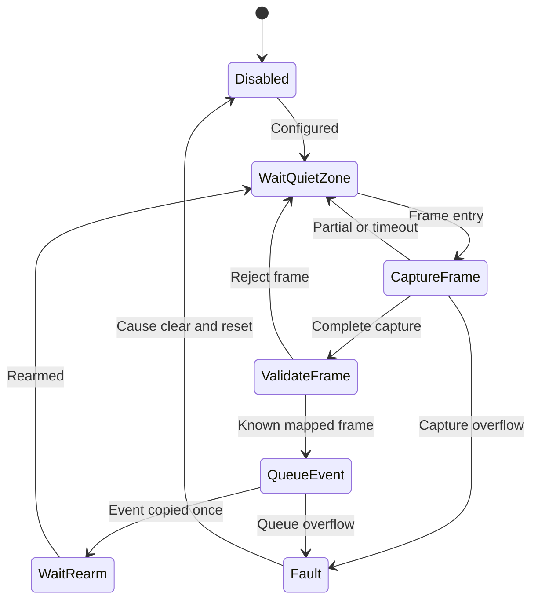

# Barcode

Owner: Nicholas / S3. Parent: [system architecture](../ARCHITECTURE.md). The capture/decoder/navigation design is proposed; operational status is in [GETTING_STARTED](../GETTING_STARTED.md#current-capabilities). Course geometry, A/Z patterns and pending mapping decisions are owned by [PROJECT_SPECS](../PROJECT_SPECS.md#barcode-examples).

## Functionality

The third IR sensor's comparator DOUT detects black/white transitions in the adjacent barcode lane. A bounded edge ISR records ordered timestamps and coherent encoder context independently of periodic line sampling. Task-level decoding measures **both black bars and white spaces**, validates a complete frame and emits one mapped navigation event. AOUT can aid difficult-surface diagnosis but is not required by this digital capture design.

Mission, rather than the decoder, requests encoder-based navigation from Motion. Line observations continue concurrently; barcode capture cannot overwrite their snapshot or erase navigation events.

## State diagram

## States and responses

| State | Response / actuation boundary |
| --- | --- |
| Disabled / unconfigured | No navigation event; movement is not authorized by decoder state |
| Wait Quiet Zone | Observe measured polarity and wait for validated frame entry |
| Capture Frame | Bounded ordered transition capture; reject missing/partial/time-out data |
| Validate Frame | Check framing, ordered bar/space widths, orientation and known symbol/mapping |
| Queue Event | Copy event ID, symbol, action and acquisition time once into `Q_nav` |
| Wait Rearm | Suppress repeat events until confirmed rearm condition |
| Fault | Report overflow independently of diagnostics; Mission/Safety apply the stop/fault response |

No HIGH/LOW-to-black/white polarity, frame format or command table is guessed. Unknown/partial/malformed frames are rejected outcomes; capture/queue overflow is an explicit fault.

## GPIO and peripherals

Follow [TEAM's barcode and line wiring](../TEAM.md#2-pins), including disconnected barcode AOUT and shared contacts. Component electrical behavior belongs to [TECHNICAL_INFO](../TECHNICAL_INFO.md#tcrt5000-based-ir-modules).

## Modules and drivers

| Module | Purpose / status |
| --- | --- |
| Existing S3 lifecycle and line modules | Keep line sampling/control separate from proposed decoding |
| Suggested barcode edge driver | Short DOUT ISR, bounded ordered capture buffer and overflow flag |
| Suggested frame decoder | Width normalization using encoder distance or validated speed compensation; framing and invalid-read rejection |
| Suggested event publisher | One-shot bounded `Q_nav` FIFO with explicit lifetime and overflow handling |
| Mission / Motion | Consume permitted events and perform unique encoder actions; [shared contract](../ARCHITECTURE.md#shared-contracts) |

Historical scaffold filenames are not current modules. A decoder/capture ISR/navigation FIFO is not active in the bench.

## Business logic

- Calibrate comparator threshold/polarity, sensor height/lateral offset, print scale and traversal orientation on the mounted car. The line and barcode lane need separate sensor placement.
- Edge-to-edge time changes with speed. Prefer encoder travel or validate compensation across slow/normal speeds; do not identify a symbol from bar count alone.
- Queue mapped frames once. Consume only in the correct mission context; reads during bypass/recovery may be logged but cannot redirect movement. Discard stale/context-mismatched events with a reason; purge obsolete events on reset/action completion.
- Mission issues left/right/straight/U-turn as one Motion action ID with encoder completion and absolute timeout. Renewing a lease does not restart the action. Obstacle handling cancels/preempts navigation; completion leads to bounded original-line reacquisition.

Use known samples at both scales, varying speeds, broken/partial/reverse/unknown frames, duplicates and capture/event bursts in planned T04/T05/T11/T14/T15. Case/result evidence belongs to [testing](../../testing/README.md).

## Retained planning cases

These labels from the former future-plan guide are planning labels, not permanent test IDs or run results. Allocate permanent S3/INT/SYS IDs before execution.

| Label | Scenario |
| --- | --- |
| BC-P01 | Known A/Z at both scales, confirmed framing and symbology |
| BC-P02 | Partial, malformed, unknown and reverse frames |
| BC-P03 | Speed variation with distance/validated compensation |
| BC-P04 | Exactly one event per encounter; later quiet-zone rearm |
| BC-P05 | Capture/FIFO overflow and stale context |
| BC-P06 | Concurrent ADC, local stop and barcode bursts |
| BC-P07 | Four mapped encoder actions and original-line recovery |
