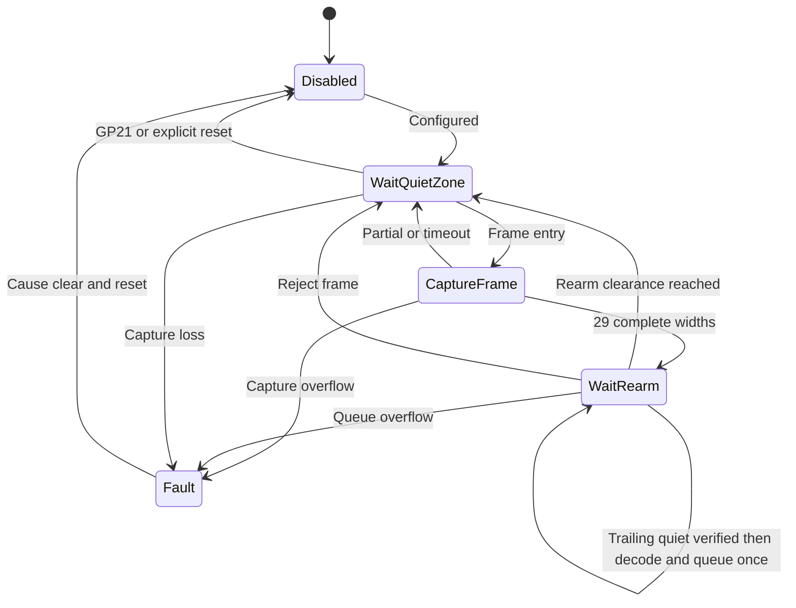

# Barcode

Owner: Nicholas / S3. Parent: [system architecture](../ARCHITECTURE.md). Capture buffering, a provisional Code 39 decoder, mapping and a copied event FIFO are implemented in software. **The scanner boots disabled:** measured configuration, S2 encoder feedback and an agreed GPIO dispatcher are not supplied. No physical barcode scan or navigation is established. Operational status belongs in the realignment tracking issue (#62); course geometry, A/Z patterns and pending decisions belong in [PROJECT_SPECS](../TECHNICAL_INFO.md#barcode-samples).

## Functionality

The third IR sensor's comparator DOUT detects black/white transitions in the adjacent barcode lane. The S3 capture entry records ordered timestamps and coherent encoder context independently of periodic line sampling. Task-level decoding measures **both black bars and white spaces**, validates a complete frame and emits one mapped navigation event. AOUT stays disconnected.

The selected first version supports uppercase **A–Z** in `*X*` frames in either traversal orientation. This is a provisional project choice, not a confirmed final course symbology. The [briefing](../donotsubmit/ZOOM-TRANSCRIPT-PROJECT.md#subsystem-3-line-following-and-barcode-decoding) requires the full alphabet, commands retained until the cross junction, and Wi-Fi mapping changes without recompilation. S3 supplies a local mapping API; S1's current status-only protocol does not implement that configuration route.

Mission, rather than the decoder, requests encoder-based navigation from Motion. Line observations continue concurrently; barcode capture cannot overwrite their snapshot or erase navigation events.

## State diagram

## States and responses

| State | Response / actuation boundary |
| --- | --- |
| Disabled / unconfigured | No navigation event; movement is not authorized by decoder state |
| Wait Quiet Zone | Observe measured polarity and wait for validated frame entry |
| Capture Frame | Bounded ordered transition capture; reject missing/partial/time-out data |
| Wait Rearm | Validate trailing white clearance, decode framing/letter/orientation, copy a mapped event once, then require rearm clearance |
| Fault | Report overflow independently of diagnostics; Mission/Safety apply the stop/fault response |

Public states are `BARCODE_DISABLED`, `BARCODE_WAIT_QUIET`, `BARCODE_CAPTURE`, `BARCODE_WAIT_REARM` and `BARCODE_FAULT`. Validation and enqueue are bounded operations, not extra tasks/stored states. Polarity and all physical limits are mandatory configuration. Every letter starts UNMAPPED; neither conflicting ABCD source example is adopted. Unknown/partial/malformed frames are rejected outcomes; capture loss and queue overflow latch faults.

## GPIO and peripherals

Follow [TEAM's barcode and line wiring](../TEAM.md#2-pins), including disconnected barcode AOUT and shared contacts. Component electrical behavior belongs to [TECHNICAL_INFO](../TECHNICAL_INFO.md#tcrt5000-based-ir-modules).

## Modules and drivers

| Module | Purpose / status |
| --- | --- |
| `drv_barcode.c/.h` | GP16 input setup on explicit configuration; core-1 ISR entry, 64-record ring, mapping revision and independent faults |
| `barcode_decode.c/.h` | Pure bounded width classification; framing and A–Z lookup in both orientations |
| `barcode_service.c/.h` | Task-owned frame/rearm state, encoder validation, mapping and eight copied events |
| `barcode_runtime.c/.h` | Public nonblocking API, provider connection and private priority-inheritance mutex |
| `barcode_types.h` | Portable configuration, encoder context, result/status and event types |
| Mission / Motion | Consume permitted events and perform unique encoder actions; [shared contract](../ARCHITECTURE.md#shared-data-rules) |

The existing S3 task services at most 16 captured records per nominal 10 ms input release, after due line ADC work. It adds no task, changes no priority and writes no motors or network data. Capture remains disabled without an explicit successful configuration. Source selection uses the existing application wildcard, with no shared build/configuration change. Kernel object accounting belongs in [TEAM](../TEAM.md#6-kernel-object-budget).

## Public API

Include `subsystem3.h` or the portable `barcode_runtime.h`.

| API | Contract |
| --- | --- |
| `s3_barcode_configure(config, provider)` | Core-1 task, after initialization, while disabled and GP21 released; validates configuration and live provider before enabling |
| `s3_barcode_reset()` | Core-1 task; disables capture, purges partial/queued events, clears faults and advances scanner epoch; does not restart capture |
| `s3_barcode_mapping_replace(actions)` | Any task; validates all 26 entries before atomic replacement; disabled/idle only, no pending edge records; busy active encounters retain their mapping |
| `s3_barcode_copy(status)` | Any task; coherent nonblocking status, latest decoded observation, original time, mapping/epoch, queue occupancy and rejection/fault reason |
| `s3_barcode_pop(event)` | Exactly one task consumer; copied FIFO event, distinct OK/EMPTY/BUSY/UNAVAILABLE/INVALID/FAULT result; ignore destination unless OK |
| `s3_barcode_faults()` | Independent atomic capture/queue fault bits, available even if the status mutex is busy |

All task APIs use `TMO_POL`; none is an ISR API. Ignore copy destinations on failure. A successful decode/pop never grants movement permission. Status-copy success does not prove configuration, encoder validity or measured motion. Native structs are not wire formats.

Mapped events contain encounter ID, letter, action, orientation, original last-bar exit time in hardware TIMER microseconds, mapping revision and scanner epoch. Unmapped letters remain diagnostic observations and create no navigation event. Event identity/revisions wrap as unsigned counters. Queued events retain their original mapping; Mission must reject obsolete context, age, revision and epoch before acting. GP21 inhibits event removal immediately and purges events when task access succeeds; releasing it never enables capture. Action completion/reset uses explicit reset before reconfiguration.

## Encoder and interrupt adapter

No S2 implementation is added. The provider supplies two bounded callbacks:

- `read_task`: actual GP16 level, coherent left/right counts, validity/reset epoch, encoder acquisition time and observation time. Both times use the existing hardware TIMER microsecond domain. Counts wrap modulo 2^32; copying cached counts must not invent fresh acquisition validity.
- `set_enabled_task`: synchronously enable/disable GP16 edges through the agreed GPIO-bank dispatcher. It never replaces USB, encoder or Echo handlers. The dispatcher calls `drv_barcode_edge_isr(events, sampled_us, encoder)` once per edge on core 1 and acknowledges its owned GPIO bits.

The read callback also runs briefly with local interrupts masked: direct acquisition only, no kernel calls, locks, allocation or retry loops. Measure its maximum duration and the edge/encoder association uncertainty before enabling. Both rise/fall flags together latch capture loss; their order cannot be reconstructed. Aligned atomic loads/stores publish the ring; no ISR atomic read-modify-write, blocking or allocation is used. A mapping replacement racing capture rejects old-revision records instead of interpreting them with the new table.

Successful configuration sets only GP16 to input and disables internal pulls; the mounted comparator's safe output/pull-up must be verified. Boot and unconfigured operation do not configure that pin or enable a GPIO interrupt. The adapter owns shared dispatch and gating, while S3 remains the GP16 owner.

GPIO bank interrupts are shared. The existing USB SDK compatibility shim is not a general GPIO dispatcher. Agree the adapter/dispatch with the owners in the [S3-to-S2 handoff](S3_TO_S2_HANDOFF.md#4-future-s2-capabilities-needed-for-barcode-navigation) before physical capture.

## Widths and measured configuration

Widths use mean calibrated wheel displacement in micrometres, never elapsed time or PWM demand. The straight-travel envelope requires bounded per-step and whole-frame wheel disagreement. Invalid/stale context, changed encoder epoch, backwards timestamps, changed counts at an unchanged timestamp, direction reversal, excessive travel and expired absolute deadlines reject the encounter.

`*X*` has 29 alternating elements: three nine-element characters and two narrow inter-character spaces. Fit narrow/wide classes across the frame, require three wide elements in each character, both framing patterns and one A–Z payload. The A/Z examples match the table; the full alphabet was checked against the [published ZXing encoding table](https://github.com/zxing/zxing/blob/master/core/src/main/java/com/google/zxing/oned/Code39Reader.java). No checksum, extended ASCII or multi-letter frame is accepted.

`barcode_config_t` has no ready-to-drive defaults. Supply measured distance/count for each wheel, narrow-width range, wide:narrow ratio limits, width tolerance, leading/trailing quiet clearance, rearm clearance, per-step/whole-frame travel bounds, wheel disagreement, encoder-age bound, edge-gap deadline, absolute frame deadline and black polarity. Ratios/tolerance use permille; distances use micrometres; time uses microseconds. Encoder quantization and capture latency must be small enough to distinguish the narrowest element at the intended speed. Integer distance/count precision must be validated on both print scales. Ring size, service budget and event capacity are software defaults, not physical acceptance limits.

## Business logic

- Calibrate comparator threshold/polarity, sensor height/lateral offset, print scale and traversal orientation on the mounted car. The line and barcode lane need separate sensor placement.
- Edge-to-edge time changes with speed. This implementation requires encoder travel and provides no timed fallback; do not identify a symbol from bar count alone.
- Queue mapped frames once. Consume only in the correct mission context; reads during bypass/recovery may be logged but cannot redirect movement. Discard stale/context-mismatched events with a reason; purge obsolete events on reset/action completion.
- Mission issues left/right/straight/U-turn as one Motion action ID with encoder completion and absolute timeout. Renewing a lease does not restart the action. Obstacle handling cancels/preempts navigation; completion leads to bounded original-line reacquisition.

Physical validation remains pending. Nicholas requested preserving the removed S3 test setup and adding no testing yet; no new test code or executed barcode test result is supplied. Future checks must cover all A–Z in both orientations, both scales, varying speed, invalid encoder data, partial/extra/unknown frames, quiet-zone rejection, duplicates, mapping replacement, reset and capture/event overflow, then concurrent ADC/buttons under load. Existing planned T04/T05/T11/T14/T15 and permanent result evidence belong to [testing](../../testing/README.md).

## Retained planning cases

These labels from the former future-plan guide are planning labels, not permanent test IDs or run results. Allocate permanent S3/INT/SYS IDs before execution.

| Label | Scenario |
| --- | --- |
| BC-P01 | Known A/Z at both scales, confirmed framing and symbology |
| BC-P02 | Partial, malformed, unknown and reverse frames |
| BC-P03 | Speed variation with distance/validated compensation |
| BC-P04 | Exactly one event per encounter; later quiet-zone rearm |
| BC-P05 | Capture/FIFO overflow and stale context |
| BC-P06 | Concurrent ADC, local stop and barcode bursts |
| BC-P07 | Four mapped encoder actions and original-line recovery |
