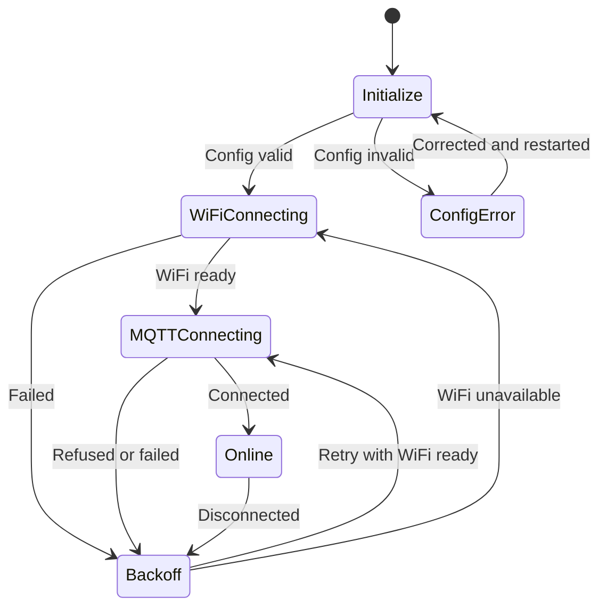

# Communications

## Functionality

Shaun / S1 owns the portable latest snapshot, mutex and JSON encoder. An S1-owned collector reads S3 sensor observations, the application coordinator and S2 output status. The existing kernel WiFi service, priority 4 on core 0, owns all CYW43, lwIP and MQTT calls. S2 remains the only motor writer. This later requested bench extension uses `SMP=1 WIFI=cyw43 NET=lwip MQTT=1`; `NET=none MQTT=0` remains available. No new application task exists.

The full-robot plan publishes mission state/reason, requested versus measured wheel motion, encoder counts/distance, line/junction/barcode, terrain/maximum valid hump, obstacle profile and validity/age/connection health. Its bounded status subscription validates reporting requests and rejects malformed or drive/start/stop messages; an illustrative request is `{"request":"status"}`. No request clears Safety or authorizes movement. Final mission schema is pending in [PROJECT_SPECS](../PROJECT_SPECS.md#pending-decisions).

The implemented bench publishes the existing S3 snapshot and now restores S1 heartbeat, retained connection status and a bounded **status-only subscription**. There are no drive/start/stop or calibration commands. Full mission measurements remain deferred until their producers and final schema are agreed. [GETTING_STARTED](../GETTING_STARTED.md#current-capabilities) owns current capabilities and operating steps; [system architecture](../ARCHITECTURE.md) owns mission arbitration.

## State diagram

This connection state machine preserves the established kernel-service design. The bench implements connection, status subscription and publication. Online status requests report diagnostics; they never reach motion policy.

## States and responses

| State | Response / actuation boundary |
| --- | --- |
| Initialize / Config Error | Load/validate configuration; invalid configuration stays offline |
| WiFi Connecting | Kernel-owned bounded radio/IP connection; control tasks continue locally |
| MQTT Connecting | One service-owned connection attempt |
| Online | Publish newest snapshot and heartbeat; validate bounded status requests |
| Backoff | Bounded delayed retry, no offline backlog or motor-state change |

No communications state calls Motion or authorizes actuation. Network loss preserves healthy local autonomy.

## GPIO and peripherals

Use [TEAM's radio/peripheral ownership](../TEAM.md#3-peripherals) and [reserved GPIO](../TEAM.md#2-pins). No student task performs networking. Hardware radio details belong to [TECHNICAL_INFO](../TECHNICAL_INFO.md#raspberry-pi-pico-w--wh).

## Modules and drivers

| File | Responsibility |
| --- | --- |
| app_program/subsystem1/telemetry.h | Portable S1Telemetry value type, update/copy/encode APIs; no RTOS/network headers |
| app_program/subsystem1/subsystem1.c | One priority-inheritance mutex and latest value; no S1 task |
| app_program/subsystem1/telemetry.c | Bounded JSON and integer-based decimal formatting |
| app_program/subsystem1/status_protocol.c / .h | Bounded fragmented status-request validation and network diagnostic JSON |
| app_program/subsystem1/telemetry_adapter.c | Nonblocking publication-time collector; maps actual S3, coordinator and S2 snapshots |
| app_program/robot_control.h | Portable read-only coordinator reporting snapshot |
| lib/liblwip/sysdepend/pico_rp2040/mqtt_utk.c | Connect/subscribe, heartbeat/status, last will, bounded retry and latest publication in the kernel service |
| scripts/mqtt_client.py | Laptop monitor and status-only request helper; Paho dependency in scripts/requirements-mqtt.txt |
| lib/liblwip/sysdepend/pico_rp2040/lwipopts.h | MQTT output ring 1024 bytes |
| config/wifi_secrets.h | Ignored local WiFi/broker credentials; example is tracked |

`s1_telemetry_update(const S1Telemetry *)` copies a complete value and assigns its sequence. `s1_telemetry_copy(S1Telemetry *)` returns the latest coherent value if one exists. Both use `tk_loc_mtx(..., TMO_POL)` and return false on unavailable/busy access, without waiting. Access before S1 initialization safely skips diagnostics through an atomic object ID. An optional mutex allocation failure logs once and leaves local startup available. S3 owns its separate sensor cache; see TEAM for current objects.

The latest value replaces the previous value; there is no offline queue. S3's float calculations are converted to signed thousandths in the adapter. The encoder emits three decimal places through bounded integer formatting, without `%f` or the T-Monitor formatter. The coordinator owns requested duties; S2 owns recorded applied PWM and brake acknowledgements. Unavailable required snapshots skip publication; unavailable S2 diagnostics emit `motion:null`.

## MQTT and payload contract

Topic `robot/s3/telemetry`, client-ID prefix `csc01-s3-pico` plus the radio MAC, TCP port 1883, QoS **0**, retain **false**, nominal period **500 ms**. After successful status subscription, the service attempts the latest snapshot immediately, then starts the periodic timer. Optional broker username/password are configured locally; empty values preserve anonymous access. Existing local headers remain compatible through transport defaults. When using different topics, configure all four explicitly; topics must be distinct, nonempty, under 96 bytes and contain no wildcards. An empty broker IP leaves WiFi available with MQTT disabled after a single configuration diagnostic. The payload limit is **1536 bytes** plus one local NUL byte; the MQTT output ring is **1024 bytes**. Oversized/unterminated input, unavailable snapshot or publication error skips that message. QoS 0 is observation without delivery guarantees.

| JSON field | Meaning / unavailable form |
| --- | --- |
| schema | 1 |
| sequence | Successful S1 snapshot update count, wraps as uint32; reset at reboot; normally jumps between publications |
| observed_ms | Collection observation time in boot milliseconds; it is not acquisition time |
| sampled_ms | Original latest acquisition-attempt timestamp; null before first attempt |
| sample_age_ms | Publication-time minus sampled_ms using uint32 subtraction; null before first attempt; works across wrap |
| acquisition_valid | Latest paired ADC acquisition succeeded; distinct from calibration and freshness |
| sample_fresh | Successful acquisition and age <=60 ms |
| raw | ADC left/right 0..4095 object; null before first/after failed acquisition |
| calibration.black_set / white_set | Completed reference flags, RAM-only |
| calibration.black / white | Paired ADC reference object, or null if its flag is false |
| fractions | Calibrated left/right black fractions 0..1, or null without a valid calibrated reading |
| error | Right fraction minus left fraction, or null without calibrated reading |
| line | unknown, visible, lost or broad_black; see the complete [IR classification](LINE_TRACKING.md#calibration-workflow) |
| ir_sequence | Original S3 acquisition-attempt sequence, including failed acquisitions |
| state | READY, START_PENDING, FOLLOW_LINE, RECOVER_LINE, STOPPED, FAULT or RESET_PENDING |
| reason | Current controller reason, including capture/start/stop/failure policy |
| capture | Typed capture outcome's display name; not a remote acknowledgement or request ID |
| requested_duty.left / right | Coordinator requested duties; not measured motor output/speed |
| motion_enabled | Coordinator following/recovery request permission |
| test_inhibited | True in TEST firmware; S2 brakes even when motion_enabled is true |
| motion | S2 age_ms, stopped, braked and applied_duty; null on unavailable copy. Output status is not measured wheel speed/stationarity |

Stale historical fractions can still be present; assess them with `sample_fresh`, acquisition validity and age. Telemetry never renews acquisition time. `null` means unavailable, rather than a made-up zero reading. A plausible ADC value cannot establish sensor connection. The 500 ms stream can miss a whole 100 ms recovery turn and cannot prove stop/recovery timing.

## Status and heartbeat contract

These restore S1 reporting from `wifi_telemetry` for the current kernel-service layout. The existing S3 telemetry schema above is unchanged.

| Topic | Behavior |
| --- | --- |
| `robot/s3/heartbeat` | Every 1000 ms, QoS 0, not retained; also attempted when subscription becomes ready |
| `robot/s3/status` | Online status on subscription readiness and accepted status requests, QoS 1, retained; retained offline last will on unexpected connection loss |
| `robot/s3/request` | Subscribe QoS 1; accept only `{"request":"status"}`, with optional JSON whitespace |

Heartbeat and online status contain `schema:1`, `online:true`, boot `uptime_ms`, `connection_sequence` (successful subscriptions since boot), `rejected_requests`, `dropped_publish`, `have_snapshot` and the last successfully copied `telemetry_sequence`. Counters wrap as uint32 and reset at reboot. `have_snapshot:false` means the latest copy was unavailable/busy; a heartbeat still publishes even before a producer supplies data. The offline will is `{"schema":1,"online":false}`. These fields are reporting health, not acquisition or watchdog progress.

Requests are capped at **64 bytes**, assembled only to the announced exact length, and reset on disconnect. Reject unknown/duplicate fields, malformed/unterminated/oversized payloads, embedded NUL, other topics and every movement/calibration request. No JSON escapes are accepted in the fixed request strings. Accept at most one status request per **1000 ms**, coalescing it into a single pending response at the next nominal 500 ms publication tick. This allocates no queue, task or kernel object. The response attempts current S3 telemetry plus retained status; no history is replayed. Publish requests with retain=false. lwIP does not expose the incoming retained flag; a retained status request can cause one harmless reporting response on reconnect.

A broker QoS acknowledgement confirms broker receipt, not Pico processing. A retained online flag can be stale; interpret it with live heartbeat freshness. The laptop monitor flags >3 seconds without a live heartbeat; this observation threshold is not a motion/stop deadline. The last will uses a 10-second MQTT keepalive and cannot establish immediate loss detection.

## Business logic

The adapter maintains at most one timer: a 15-second connection/subscription attempt deadline, a periodic publish timer or a retry timer. Connection acceptance subscribes to the reporting topic; only subscription success declares Online. Failure/refusal/timeout cancels the old adapter timer, closes the client, discards partial requests and backs off from 1000 ms, doubling to 30000 ms. Successful subscription resets backoff. Frequent polling cannot bypass the delay. Every radio link edge is passed to S1 before servicing lwIP timeouts; no broker attempt starts while the link is down. Invalid configuration is diagnosed once. Existing protocol timers remain owned by lwIP. Publication errors increment a diagnostic counter and drop that message without growing an offline backlog.

The existing WiFi service now also retries an immediately rejected initial join and bounds DOWN/JOIN/NOIP waits to 20 seconds followed by a 5-second rejoin delay. An empty SSID disables joining; a failed radio interface stays unavailable. These are service timers, not measured radio-call or scheduling limits.

Reconnect sends the newest stored snapshot, not a backlog, and restores the status subscription. No MQTT state transition calls S2 or S3 policy functions. Copying stays nonblocking, networking stays on core 0, and GP21 processing remains local. Healthy local control continues through network loss. Physical scheduling/stack margin under network load still needs measurement.

## Restoration audit

Compared `origin/wifi_telemetry` revision `828f6f9` with `main` revision `0546ea2` before this fix. The earlier S1 implementation used Pico SDK polling/CMake; current main uses micro T-Kernel/Make. Restoring obsolete paths verbatim would create a second network owner.

| Earlier S1 work | Main before fix | Current disposition |
| --- | --- | --- |
| WiFi association and recovery | Kernel service present; rejected initial join and DOWN/NOIP stalls could remain offline indefinitely | Restore bounded join/recovery in the existing owner |
| MQTT latest telemetry / coherent sensor age | S1 S3 snapshot and bounded encoder already present | Preserve current schema, timestamps, mutex and producer |
| Heartbeat, retained online/offline status, last will | Missing | Restored in kernel transport and S1 portable encoder |
| Subscription and bounded fragmented inbox | Missing | Restore reporting-only status subscription; remote actuation and stop-on-disconnect superseded by current autonomy policy |
| Unique board client ID, broker credentials | Fixed ID; authentication absent | Append radio MAC; restore optional local broker authentication |
| Reconnect backoff and attempt deadlines | Fixed 3-second retry; stack-dependent attempt timeout | Restore capped backoff, explicit deadline and subscription restoration |
| Laptop MQTT helper/dependency | Removed | Restore monitor and status helper for current topics |
| CMake/PowerShell build and fake-SDK runners | Replaced by Make; host runners retired | Preserve current build profiles and firmware self-tests |
| Whole-mission telemetry fields | Earlier portable schema existed over stub sensor drivers; main supplies actual S3 bench fields only | Pending final mission contract/producer integration; do not fabricate S2/S4/S5 measurements or revive obsolete controller types |

## Integration boundary

`s1_telemetry_refresh(now)` is invoked before kernel publication. Its application translation unit reads S3/coordinator/S2; its transport-facing header contains portable types only, avoiding Pico SDK/T-Kernel type collisions. Each source retains its own validity and acquisition/service time. S3 normalized [-1,1] values map back to the existing wire fractions [0,1]. No collector operation controls movement or performs networking.

## Local dashboard

`scripts/mqtt_dashboard.py` serves static `dashboard/` assets and a bounded latest-state SSE stream on `127.0.0.1:8765`. Paho uses callback API v2 and reconnects with bounded delay; HTTP remains available when MQTT is absent. The page is display-only, has no publish endpoint and uses no CDN. Credential environment variables stay on the server.

The page shows broker connection, live Pico heartbeat, state/reason, reference calibration, raw/normalized sensors, error history and requested versus recorded applied PWM. Values are unavailable when invalid; history holds at most 120 distinct telemetry points. Telemetry receipt older than 1500 ms is stale; heartbeat older than 3000 ms is stale. Retained status alone never establishes Live. Sensor freshness/age are explicitly at publication: the deliberately 500 ms stream does not establish continuous 60 ms sensor health or brief stop timing.

## Evidence

Use [wireless setup](../GETTING_STARTED.md#wireless-telemetry) for configuration/builds and [testing](../../testing/README.md) for evidence procedure. Existing S1-U04/U05 and INT-06/07 use real modules with host fakes; INT-08 is laptop loopback transport. Host runners are retired; saved results remain. Firmware S1-U04 is preserved; S1-U06/U07 add status parser and diagnostic encoding checks. They require on-target execution; compilation is not a pass. SYS-09/10 and planned T12/T13 require actual Pico/physical evidence; they remain pending. The 500 ms stream cannot prove short motor/stop timing.

## Consolidated navigation observations

Schema 1 gains additive `velocity_mode`, `requested_speed_mps`, `encoders`, `navigation` and `barcode` objects. Duty requests remain separate from speed/action targets. Applied PWM is signed for configured navigation; it is neither requested speed nor proof of movement. Unavailable sources/speed estimates are null, and original source age is retained. Barcode reports last symbol/result, service age, queued count and accepted/rejected/discarded totals. Navigation state numbers are idle=0, active=1, done=2, failed=3.

Telemetry payload capacity is 1536 bytes and the MQTT output ring is 2048 bytes including topic/protocol headroom. S1-U13 covers synthetic bounded encoding; test buffers are static to preserve the startup stack. The dashboard handles absent extension objects for earlier schema-1 producers, shows separate requested speed and encoder estimates, and remains display-only. Status requests cannot change calibration or local control.
