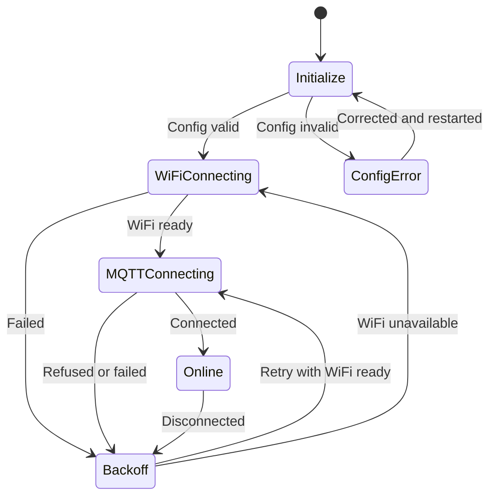

# Communications

## Functionality

Shaun / S1 owns the portable latest snapshot, mutex and JSON encoder. Nicholas / S3 supplies its local readings/control result. The existing kernel WiFi service, priority 4 on core 0, owns all CYW43, lwIP and MQTT calls. S2 remains the only motor writer. This later requested bench extension uses `SMP=1 WIFI=cyw43 NET=lwip MQTT=1`; `NET=none MQTT=0` remains available. No new application task exists.

The full-robot plan publishes mission state/reason, requested versus measured wheel motion, encoder counts/distance, line/junction/barcode, terrain/maximum valid hump, obstacle profile and validity/age/connection health. Its bounded status subscription validates reporting requests and rejects malformed or drive/start/stop messages; an illustrative request is `{"request":"status"}`. No request clears Safety or authorizes movement. Final mission schema is pending in [PROJECT_SPECS](../PROJECT_SPECS.md#pending-decisions).

The implemented bench stream has **no subscriptions, echo or remote commands**. Full mission telemetry/status requests remain deferred. [GETTING_STARTED](../GETTING_STARTED.md#current-capabilities) owns current capabilities and operating steps; [system architecture](../ARCHITECTURE.md) owns mission arbitration.

## State diagram

This connection state machine preserves the established kernel-service design. The bench implements connection/publication only; the proposed Online status-request path is deferred.

## States and responses

| State | Response / actuation boundary |
| --- | --- |
| Initialize / Config Error | Load/validate configuration; invalid configuration stays offline |
| WiFi Connecting | Kernel-owned bounded radio/IP connection; control tasks continue locally |
| MQTT Connecting | One service-owned connection attempt |
| Online | Publish newest snapshot; full plan additionally validates bounded status requests |
| Backoff | Bounded delayed retry, no offline backlog or motor-state change |

No communications state calls Motion or authorizes actuation. Network loss preserves healthy local autonomy.

## GPIO and peripherals

Use [TEAM's radio/peripheral ownership](../TEAM.md#3-peripherals) and [reserved GPIO](../TEAM.md#2-pins). No student task performs networking. Hardware radio details belong to [TECHNICAL_INFO](../TECHNICAL_INFO.md#raspberry-pi-pico-w--wh).

## Modules and drivers

| File | Responsibility |
| --- | --- |
| app_program/subsystem1/telemetry.h | Portable S1Telemetry value type, update/copy/encode APIs; no RTOS/network headers |
| app_program/subsystem1/subsystem1.c | One priority-inheritance mutex and latest value; no S1 task |
| app_program/subsystem1/telemetry.c | Bounded JSON and integer-based decimal formatting |
| app_program/subsystem3/telemetry_s3.c | Convert current tracker/controller results to thousandths and labels |
| app_program/subsystem3/task_ir.c | Attempt snapshot update after each control cycle when MQTT=1 |
| lib/liblwip/sysdepend/pico_rp2040/mqtt_utk.c | Connect, copy/encode and publish within the kernel network service |
| lib/liblwip/sysdepend/pico_rp2040/lwipopts.h | MQTT output ring 1024 bytes |
| config/wifi_secrets.h | Ignored local WiFi/broker credentials; example is tracked |

`s1_telemetry_update(const S1Telemetry *)` copies a complete value and assigns its sequence. `s1_telemetry_copy(S1Telemetry *)` returns the latest coherent value if one exists. Both use `tk_loc_mtx(..., TMO_POL)` and return false on unavailable/busy access, without waiting. Access before S1 initialization safely skips diagnostics through an atomic object ID. An optional mutex allocation failure logs once and leaves local startup available. S3 allocates no extra kernel object.

The latest value replaces the previous value; there is no offline queue. S3's float calculations are converted to signed thousandths in the adapter. The encoder emits three decimal places through bounded integer formatting, without `%f` or the T-Monitor formatter. The source of truth for motion remains the S3 controller and S2 request/health interfaces.

## MQTT and payload contract

Topic `robot/s3/telemetry`, client ID `csc01-s3-pico`, TCP port 1883, QoS **0**, retain **false**, nominal period **500 ms**. An accepted connection attempts the latest snapshot immediately, then starts the periodic timer. The payload limit is **768 bytes** plus one local NUL byte; the MQTT output ring is **1024 bytes**. Oversized/unterminated input, unavailable snapshot or publication error skips that message. QoS 0 is observation without delivery guarantees.

| JSON field | Meaning / unavailable form |
| --- | --- |
| schema | 1 |
| sequence | Successful S1 snapshot update count, wraps as uint32; reset at reboot; normally jumps between publications |
| observed_ms | S3 snapshot time in boot milliseconds; it is not acquisition time |
| sampled_ms | Original latest acquisition-attempt timestamp; null before first attempt |
| sample_age_ms | Publication-time minus sampled_ms using uint32 subtraction; null before first attempt; works across wrap |
| acquisition_valid | Latest paired ADC acquisition succeeded; distinct from calibration and freshness |
| sample_fresh | Successful acquisition and age <=60 ms |
| raw | ADC left/right 0..4095 object; null before first/after failed acquisition |
| calibration.black_set / white_set | Completed reference flags, RAM-only |
| calibration.black / white | Paired ADC reference object, or null if its flag is false |
| fractions | Calibrated left/right black fractions 0..1, or null without a valid calibrated reading |
| error | Right fraction minus left fraction, or null without calibrated reading |
| line | unknown, visible, lost or broad_black; see the complete [IR classification](LINE_TRACKING.md#states-and-responses) |
| state | READY, FOLLOW_LINE, RECOVER_LINE or STOPPED |
| reason | Current controller reason, including capture/start/stop/failure policy |
| capture | Typed capture outcome's display name; not a remote acknowledgement or request ID |
| requested_duty.left / right | S3 requested duties; not measured motor output/speed |
| motion_enabled | S3 following/recovery request permission |
| test_inhibited | True in TEST firmware; S2 brakes even when motion_enabled is true |

Stale historical fractions can still be present; assess them with `sample_fresh`, acquisition validity and age. Telemetry never renews acquisition time. `null` means unavailable, rather than a made-up zero reading. A plausible ADC value cannot establish sensor connection. The 500 ms stream can miss a whole 100 ms recovery turn and cannot prove stop/recovery timing.

## Business logic

The service uses one periodic publish callback and one retry callback, with at most one of these adapter timers pending. Each connection status cancels old adapter timers. A refused/disconnected/immediately failed connect schedules retry after 3000 ms. The service's frequent polling does not bypass the retry delay or start a second connection; invalid IPv4 configuration is diagnosed once. Existing lwIP/MQTT protocol timers remain owned by the stack. Publish failures skip the message while the connected periodic stream continues; an asynchronous disconnect enters the retry path.

Reconnect sends the newest stored snapshot, not a backlog. No MQTT state transition calls S2 or S3 policy functions. Snapshot copying is nonblocking, the network stays on core 0, GP21 processing stays in the core-1 control loop, and the watchdog still requires advancing valid ADC and Motion progress. Healthy local following continues through network loss. Physical scheduling/stack margin under network load still needs measurement.

## Evidence

Use [wireless setup](../GETTING_STARTED.md#wireless-telemetry) for configuration/builds and [testing](../../testing/README.md) for evidence procedure. Existing S1-U04/U05 and INT-06/07 use real modules with host fakes; INT-08 is laptop loopback transport. Host runners are retired; saved results remain. Firmware S1-U04 is preserved. SYS-09/10 and planned T12/T13 require actual Pico/physical evidence; they remain pending. The 500 ms stream cannot prove short motor/stop timing.
