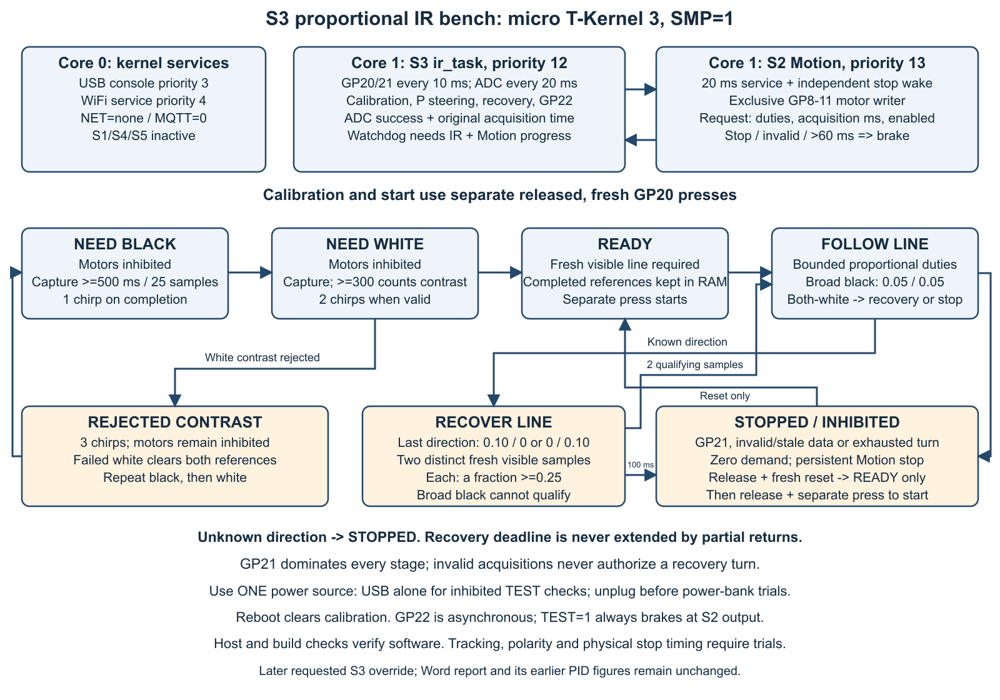

# Line following: S3 proportional IR bench

## 1. Ownership and implemented scope

Nicholas / 2501552 owns S3 acquisition, paired calibration, proportional steering, local controls, recovery and health policy. Mahesha owns S2 motor output. [TEAM.md](../../TEAM.md) defines the unchanged S2 interfaces; [getting started](../GETTINGS_STARTED.md) gives the button/power sequence.

This proportional-only implementation is Nicholas's later requested bench override on 8 October 2026. The unchanged [Word design, Section 6.6](<../../../CSC01 Design Review.docx>) describes the previous PID bench and proposed full mission. Barcode decoding, encoder speed control, terrain, sonar, junction interpretation and original-line identification remain deferred. The [future plan](IR_FUTURE_PLANS.md) separates those additions from active behaviour; the [historical guide](../history/pre-mtkernel/architecture/LINE_FOLLOWING.md) preserves earlier SDK/MQTT instructions.

## 2. Pins, peripherals and task

| Resource | S3 use |
| --- | --- |
| GP26 / ADC0 | Left AOUT, Grove 5 |
| GP27 / ADC1 | Right AOUT, Grove 6; shared GP26 contact disconnected |
| GP20 / GP21 | Active-low capture/start/reset and stop |
| GP22 / PWM3 | Asynchronous 2 kHz buzzer; check carrier mute switch |
| GP16 | Future barcode DOUT; inactive |

Use 3V3/GND; leave both line DOUT conductors disconnected. One task, priority 12, core 1 (TP_PRC2), checks controls every nominal 10 ms and samples paired ADC every 20 ms. It blocks between releases and skips missed releases. The kernel ADC device stays disabled. S3 discards one conversion after each mux change and averages eight; the whole pair has a 2 ms budget and finite poll cap, including a stalled timer.

S3 creates no mailbox, queue, mutex or event flag. S2 owns the request/health mutex and persistent stop event; S3 uses those interfaces. S3's task uses the existing 2048-byte task stack; stack margin still requires measurement.

## 3. Modules and data flow

| Module | Responsibility |
| --- | --- |
| subsystem3.c / subsystem3.h | Lifecycle and task priority; initialize timebase before startup |
| task_ir.c / task_ir.h | Private RTOS loop; local inputs, acquisition, S2 calls, feedback and watchdog |
| drv_ir.c | Bounded ADC access; return success/failure and a complete pair |
| ir_tracking.c | Capture/normalization, line classification/hysteresis and memoryless P output |
| robot_control.c | Local state transitions, bounded recovery and requested duties |
| drv_feedback.c / watchdog_policy.c | Existing input/buzzer/timebase/watchdog I/O and pure progress gate |

Data flow: driver pair + acquisition success + acquisition time -> tracker -> controller -> S2 MotionRequest. Failed acquisition is explicit; there is no fabricated out-of-range failure pair. S3 never writes motor GPIO and makes no network calls.

IrTrackingOutput retains validity, line condition, signed error, steering in [-1,1] and original acquisition ms. Its valid flag means a fresh calibrated visible-line steering result; it does not grant motion permission. A valid raw acquisition can still be lost or broad black and have invalid steering. P is calculated directly from the current reading; there is no separate PID update, derivative/integral history or steering timestamp. Latest samples are not made fresh by repeated reads.

## 4. Calibration and proportional control

Each black/white capture needs at least 25 distinct paired sample timestamps over at least 500 ms. Require at least 300 ADC counts contrast independently on both channels. Opposite sensor polarities and unequal spans are supported.

~~~text
fraction   = clamp((raw - white) / (black - white), 0, 1)
error      = right_fraction - left_fraction
correction = clamp(0.10 * error, -0.10, +0.10)
left_duty  = clamp(0.10 + correction, 0, 0.35)
right_duty = clamp(0.10 - correction, 0, 0.35)
~~~

Negative error requests a left correction; positive requests right. Initial base duty is 0.10, duty cap 0.35, and broad-black duty 0.05 per wheel. Physical forward polarity and suitable gains/duties require trials. Requested duty is not measured wheel speed.

One IrCaptureKind enum selects black/white. IrCaptureResult records pending, black/white completion, unsupported, busy, moving, stop held, acquisition gap, invalid acquisition, contrast rejection, missing black reference or stop cancellation. Strings are only presentation names; there are no capture IDs/acknowledgements. Starting a new black capture clears the old pair. White needs a black reference. Failed white contrast clears both references. GP21 cancels the active capture; completed references survive reset, but not reboot.

## 5. Complete IR state catalogue

### 5.1 Nine calibrated observation combinations

White means fraction <0.15; partial means 0.15 through 0.85 inclusive; black means >0.85. These are documentation bands, not nine additional controller states.

| Left | Right | Normal response while following |
| --- | --- | --- |
| White | White | Enter bounded recovery if direction is known; otherwise stop |
| White | Partial | Correct right |
| White | Black | Correct right |
| Partial | White | Correct left |
| Partial | Partial | Use signed difference; equal fractions give zero correction |
| Partial | Black | Correct right |
| Black | White | Correct left |
| Black | Partial | Correct left |
| Black | Black | Slow straight: both duties 0.05; no navigation event |

The table assumes normal following with valid data. During recovery, the recovery policy takes precedence. Both-white/both-black are ambiguous reflectance observations, not proof of position, junction, barcode or finish. Equal fractions do not prove centring. A plausible ADC value cannot reliably identify a disconnected sensor.

### 5.2 Line classification and data condition

| Line enum | Meaning / guard |
| --- | --- |
| UNKNOWN | No usable calibrated observation |
| VISIBLE | Usable fractions outside lost/broad-black conditions; may include partial reflectance |
| LOST | Both fractions <0.15; once lost, remain lost while both are <0.25 |
| BROAD_BLACK | Both fractions >0.85; overrides lost classification, but cannot reacquire the line |

Data conditions are separate: no sample; uncalibrated; capture active; fresh valid acquisition; invalid acquisition; stale acquisition. Acquisition freshness accepts age <=60 ms and rejects >60 ms. Invalid/stale acquisitions never authorize recovery. Losing the line is different from losing sensor validity.

### 5.3 Calibration workflow

| Stage | Entry / next step |
| --- | --- |
| Need black | Boot or rejected contrast; new GP20 press |
| Capturing black | Motors inhibited; wait >=500 ms and >=25 samples |
| Need white | Black completed; one chirp; release then press GP20 |
| Capturing white | Motors inhibited; same acquisition bounds |
| Calibrated | White contrast accepted; two chirps; position over visible line and press again |

Stages are derived from existing calibration flags and capture kind; no duplicate setup state machine is stored. Rejection gives three chirps. Cancellation/gap/invalid samples end the active capture. A cancelled replacement black leaves the pair cleared; a cancelled white keeps a completed black reference. A failed white contrast starts again at need black.

### 5.4 Controller transitions

| State | Behaviour | Exit |
| --- | --- | --- |
| READY | Zero demand; calibration or fresh start checks | Fresh valid visible-line start -> FOLLOW_LINE |
| FOLLOW_LINE | P steering; broad black uses slow-straight override | Valid both-white -> RECOVER_LINE if direction known; otherwise STOPPED |
| RECOVER_LINE | Last-direction turn: one duty 0.10, the other 0 | Two consecutive qualifying samples before deadline -> FOLLOW_LINE; failure -> STOPPED |
| STOPPED | Both demands zero; persistent S2 stop | Stop released + fresh GP20 reset -> READY only |

A qualifying recovery sample is fresh, VISIBLE, has at least one fraction >=0.25, and advances the acquisition timestamp. Both-black resets the streak; a duplicate timestamp cannot count twice. Recovery ends at elapsed >=100 ms, including a sample arriving exactly at that deadline. Once the line returns, P performs alignment; there is no separate blind alignment spin.

Stop reasons include local stop, invalid acquisition/calibration/steering, late control update, unavailable recovery direction, exhausted recovery, and Motion inhibition/reset/start/publish failures. Stop dominates calibration, following and recovery. Reset and start require separate released presses; held buttons cannot restart.

Editable source: [SVG](../diagrams/project-activity-diagram.svg). The Word figures remain the prior design record.

## 6. S2 boundary, watchdog and evidence

S3 publishes enabled requests only in FOLLOW_LINE or RECOVER_LINE. S2 alone writes GP8/9 left and GP10/11 right, checks acquisition-based expiry (>60 ms), duty bounds and the persistent stop event. Stop also wakes S2 independently of its snapshot mutex. Reset invalidates old requests; reset alone cannot move. TEST=1 always brakes at S2 output.

The 250 ms watchdog feeds only when valid IR acquisition and Motion output service both advance and are <=60 ms old. Neither a repeating sample nor a stuck Motion sequence is progress.

Run sh scripts/check-ir-tracking.sh and both firmware profiles in the [setup guide](../GETTINGS_STARTED.md). [S3 tests](../../testing/subsystem3/TEST_LOG.md) distinguish P/capture/recovery checks from historical PID results; [integration tests](../../testing/integration/TEST_LOG.md) exercise the real S3 loop against fakes and the unchanged S2 service. [Physical trials](../../testing/system/TEST_LOG.md) remain pending. Report T02/T03/T05/T11/T14/T15 remain planned mission trials; this short local recovery does not prove original-line identification after bypass.
