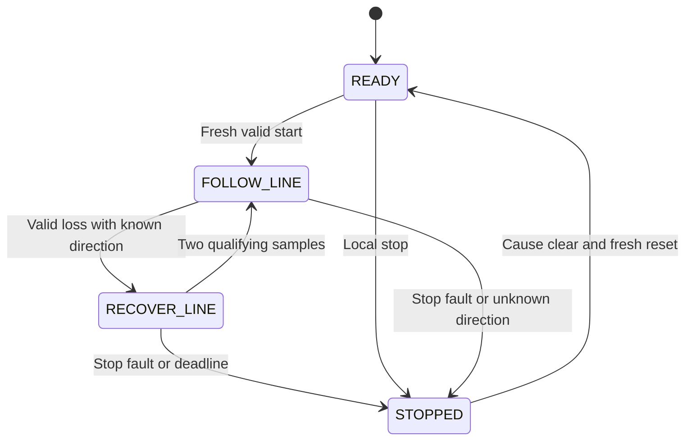
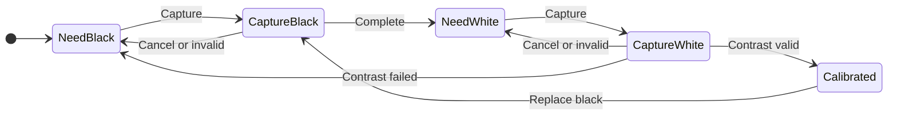

# Line Tracking

Owner: Nicholas / S3. Parent: [system architecture](../ARCHITECTURE.md). Line guidance uses calibrated **proportional control**; planned measured wheel PID stays in [Motion](MOTION.md). Current bench operating steps/status are in [GETTING_STARTED](../GETTING_STARTED.md). The later P decision supersedes the older line-PID proposal.

## Functionality

Two analogue IR sensors provide independent reflectance readings. Normalize each channel using its own black/white calibration, classify line visibility and calculate signed steering from the current reading. S3 publishes observations/steering; Motion alone actuates motors. Barcode capture is a separate concurrent [S3 feature](BARCODE.md).

In the full robot, Mission owns navigation and original-line search using these observations plus course/motion context. The implemented bench combines local controls, acquisition, tracking and a short last-direction recovery in one S3 task. That recovery does not establish original-line identification after a mission bypass.

## State diagram

The bench controller states are implemented; full Mission coordination remains proposed. Calibration phases below are derived from existing flags/capture kind, not another stored controller state.





## States and responses

| Controller state | Response / exit |
| --- | --- |
| READY | Zero demand; capture or start validation. Only fresh calibrated VISIBLE data permits FOLLOW_LINE |
| FOLLOW_LINE | P guidance; broad black uses slow straight. Valid LOST data enters RECOVER_LINE only with known direction |
| RECOVER_LINE | One-wheel last-direction turn; two consecutive distinct qualifying samples resume P alignment before deadline |
| STOPPED | Zero demand and persistent S2 stop; reset goes to READY only, requiring another fresh start |

### Line classification

| Condition | Guard / meaning |
| --- | --- |
| UNKNOWN | No usable fresh calibrated observation |
| VISIBLE | Usable fractions outside LOST/BROAD_BLACK conditions |
| LOST | Both fractions <0.15; remain lost while both <0.25 |
| BROAD_BLACK | Both fractions >0.85; slow straight in normal following, never a recovery confirmation |

No sample, uncalibrated, capture-active, fresh acquisition, invalid acquisition and stale acquisition are separate data conditions. White means fraction <0.15; partial means 0.15–0.85 inclusive; black means >0.85. These are observation bands, not nine new controller states. The previous LOST hysteresis can override a partial-band observation.

| Left | Right | Normal response with valid data |
| --- | --- | --- |
| White | White | Bounded recovery if direction known, otherwise stop |
| White | Partial | Correct right |
| White | Black | Correct right |
| Partial | White | Correct left |
| Partial | Partial | Signed difference; equal fractions give zero correction |
| Partial | Black | Correct right |
| Black | White | Correct left |
| Black | Partial | Correct left |
| Black | Black | Slow straight; no navigation event |

Recovery takes precedence over normal steering. Both-white/both-black do not prove line position, junction, barcode or finish; equal fractions do not prove centering. Two sensors cannot identify every junction/orientation without validated context. Plausible ADC counts do not establish sensor connection.

## GPIO and peripherals

Use [TEAM's line/button/buzzer allocation](../TEAM.md#2-pins), [peripheral ownership](../TEAM.md#3-peripherals) and [task schedule](../TEAM.md#4-task-priorities). Electrical/module facts belong to [TECHNICAL_INFO](../TECHNICAL_INFO.md#tcrt5000-based-ir-modules).

## Modules and drivers

| Module | Purpose |
| --- | --- |
| `subsystem3.c/.h` | Lifecycle and task startup |
| `task_ir.c/.h` | Single private task: inputs, acquisition, Motion calls, feedback and watchdog |
| `drv_ir.c/.h` | Complete bounded ADC pair with explicit success/failure |
| `ir_tracking.c/.h` | Calibration, normalization, classification/hysteresis and memoryless P output |
| `robot_control.c/.h` | Bench state transitions, recovery and duty requests |
| `drv_feedback.c/.h`, `watchdog_policy.c/.h` | Input/chirp/timebase I/O and meaningful progress gate |
| `telemetry_s3.c/.h` | Optional nonblocking S1 adapter; no network calls |
| Suggested full-robot observation publisher | Coherent `M_line` under the [shared contracts](../ARCHITECTURE.md#shared-contracts); Mission owns search movement |

IF-04 `IrTrackingOutput` contains `valid`, `line`, signed `error`, `steering` in [−1,1] and original `sampled_ms`. Valid means fresh calibrated VISIBLE steering; it is not movement permission. A fresh valid raw acquisition can be LOST/BROAD_BLACK with invalid steering. There is no integral/derivative history or separate P update timestamp.

Pipeline: complete ADC pair + acquisition result/time → tracker → controller → S2 request. S3 never writes motor PWM. [IR handoff](IR_MOTION_HANDOFF.md) preserves IF-01/02/03 and its publication example; [Communications](COMMUNICATIONS.md) owns optional IF-05.

## Business logic

### Acquisition and calibration

- Sample the pair every nominal 20 ms. After each mux change, discard one conversion and average eight. Complete the pair within a 2 ms total budget plus finite poll cap, including a stalled timer; no partial/fabricated pair is accepted.
- Each stopped capture needs at least 25 distinct sample timestamps spanning at least 500 ms. Each channel needs at least 300 ADC counts of black/white contrast; unequal spans and opposite polarities are supported.
- A replacement black capture clears the previous pair. White requires completed black; failed white contrast clears both. Cancelling replacement black leaves the pair cleared; cancelling white preserves completed black. References survive eligible reset, not reboot.
- `IrCaptureKind` selects none/black/white. Typed outcomes cover waiting/pending, completion, unsupported/busy/moving/stop-held, gap/invalid sample/contrast/missing black and stop cancellation. Strings are display labels, not command IDs or acknowledgements.

### P guidance and bench duty mixing

```text
fraction   = clamp((raw - white) / (black - white), 0, 1)
error      = right_fraction - left_fraction
correction = clamp(0.10 * error, -0.10, +0.10)
steering   = correction / 0.10
left_duty  = clamp(0.10 + correction, 0, 0.35)
right_duty = clamp(0.10 - correction, 0, 0.35)
```

Negative error corrects left; positive corrects right. Normal base duty is 0.10; broad-black duty is 0.05 per wheel. Duties are requested fractions, not measured wheel speed. Full Motion uses calibrated wheel control while preserving the signed P guidance contract.

### Freshness, recovery and stop

Age <=60 ms is accepted; >60 ms invalidates steering/control. Recovery uses the last nonzero error direction, with one duty 0.10 and the other zero. No direction means stop. At elapsed **>=100 ms**, stop; a sample exactly on the deadline cannot revive the run. Two consecutive fresh VISIBLE samples, each with at least one fraction >=0.25 and distinct acquisition time, resume following. Broad black resets that streak; duplicate timestamps never count twice.

GP21 dominates every state and cancels capture. Fresh released presses are required for reset/start; the input debounce is 30 ms. Stop reasons include invalid acquisition/calibration/steering, late update, unknown direction, exhausted recovery and Motion inhibit/reset/start/publish failures. Invalid/stale data never authorize recovery.

The watchdog freshness/progress policy is owned by [TEAM](../TEAM.md#3-peripherals). Telemetry copying/publication cannot change controller state, refresh sample time or count as watchdog progress.

### Establish a measured baseline

Record mounted height/spacing, calibration ranges, lighting, source/image, power, duties, lateral error, overshoot, losses and stopping. Repeat straight/curve trials at low duty before raising speed. Check calibration and motor asymmetry before tuning P; compare repeated runs with the same setup and agreed acceptance measures. Filtering or sensor-fault diagnostics require measured noise/latency and injected-fault evidence, retain acquisition time and preserve independent stop/freshness bounds.
