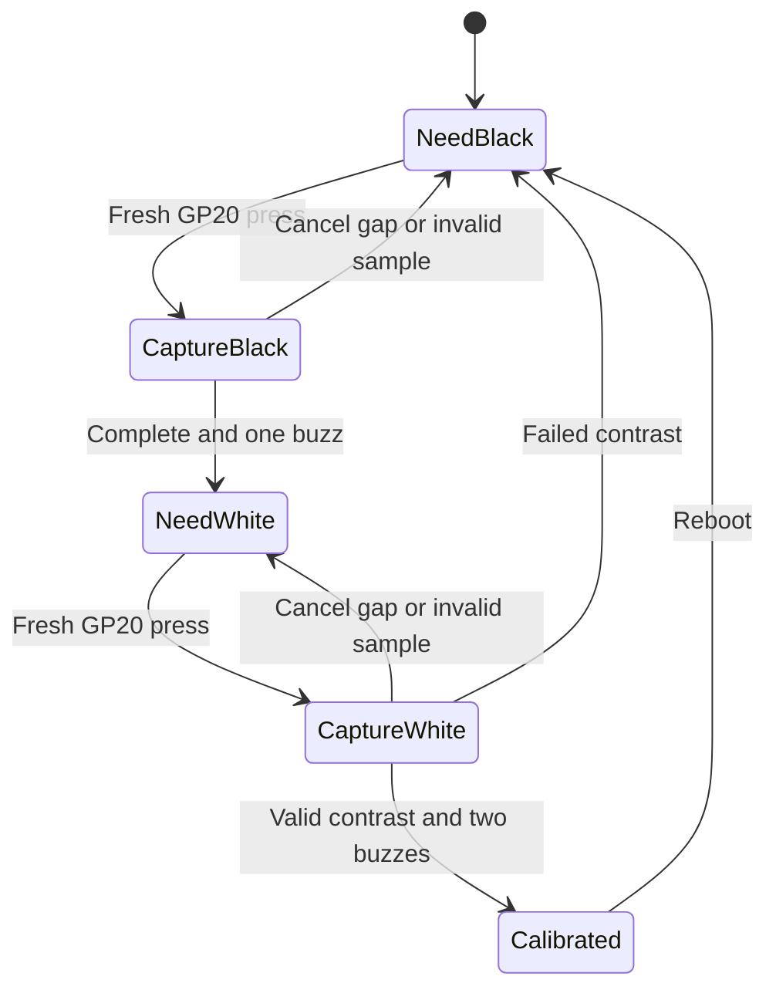

# Line Tracking

Owner: Nicholas / S3. Parent: [system architecture](../ARCHITECTURE.md). This guide defines the intended independent S3 line service. Implementation status, integration gaps and physical validation belong in [TASKS](../../TASKS.md#s3-line-service). [Barcode](BARCODE.md) is a separate concurrent S3 feature.

## Functionality and ownership

S3 acquires a complete pair of analogue IR readings, calibrates each sensor independently, classifies line visibility and calculates memoryless proportional guidance. It owns the calibration buttons and buzzer feedback. S3 provides portable typed observations through a read-only API; it neither controls motors nor formats or publishes network telemetry.

S1 reads S3 observations and owns telemetry encoding, transmission and reporting. Mission reads line guidance and owns movement decisions, including original-line search, bounded recovery and Motion requests. S2 alone actuates motors and owns measured wheel control. Safety owns independent whole-robot stop and watchdog policy. A line observation, requested steering or plausible ADC count does not establish movement permission, physical centering or sensor connectivity.

## Calibration workflow

Calibration is RAM-only and must use the mounted sensor height, lighting and surface for the trial. A completed pair survives normal observation and capture cancellation as described below; reboot loses it. The buzzer mute switch must permit audible feedback.

| Phase | Action / response |
| --- | --- |
| Need black | Release GP20 for at least 30 ms, place both sensors on black, then make a fresh debounced GP20 press |
| Capture black | Maintain the pose until completion: one 100 ms buzz |
| Need white | Release GP20, place both sensors on white, then make another fresh press |
| Capture white | Maintain the pose until valid completion: two 100 ms buzzes separated by 100 ms silence |
| Calibrated | Sampling/guidance continues; GP20 is handled by application start/reset control |
| Replace calibration | Reboot clears RAM calibration; repeat black then white before a new start |
| Cancel / rejection | GP21 immediately cancels capture and inhibits new capture while held; cancellation/rejection produces three buzzes |

GP20 requires a stable 30 ms release before arming and a stable 30 ms press before triggering. A held button, including one held at boot, cannot trigger repeated captures. GP21 dominates simultaneous inputs; releasing it does not replay a GP20 press made while it was held. Pressing GP20 during capture is rejected as busy. Buzzes are asynchronous; acquisition and button service do not wait for them.



These phases derive from calibration flags and capture kind rather than duplicate stored state. During capture, normalized readings and guidance are unavailable. Cancelling black leaves the pair cleared; cancelling white retains completed black. GP20 cannot replace a completed valid pair. Failed white contrast clears both references. Typed capture results distinguish waiting, pending, black/white completion, unsupported kind, busy, cancel held, sample gap, invalid sample, contrast failure, missing black and cancellation. Display strings are labels, not command IDs.

## Acquisition and calibration bounds

- Acquire GP26/ADC0 left and GP27/ADC1 right every nominal 20 ms. After each mux change discard one conversion, then average eight.
- Bound the complete pair by a 2 ms total budget and an independent finite 4096-poll cap, including stalled-timer failure. Publish either a complete pair or an explicit failed acquisition; never a partial/fabricated pair. Failed driver reads leave the caller's destination unchanged.
- ADC data is 12-bit: 0–4095 counts. These bounds describe the converter, not sensor connectivity or module voltage ratings.
- A capture requires at least 25 distinct acquisition timestamps spanning at least 500 ms **from its first collected sample**. The first sample must arrive within 60 ms of the request; subsequent gaps greater than 60 ms cancel capture. Duplicate timestamps do not count or replace a valid cached sample.
- Each channel requires at least 300 counts of absolute black/white contrast. Independent spans and opposite electrical polarities are supported. Capture sums/counts are bounded.
- Timestamp arithmetic uses unsigned wrap-safe elapsed subtraction. Acquisition time is paired-read completion time; copying or publishing cached data never refreshes it.

## Normalization, classification and proportional guidance

For each channel:

```text
black_fraction = clamp((raw - white) / (black - white), 0, 1)
normalized     = 2 * black_fraction - 1
error          = right_black_fraction - left_black_fraction
correction     = clamp(0.10 * error, -0.10, +0.10)
steering       = correction / 0.10
```

The public sensor value is −1 for calibrated white and +1 for calibrated black. Values beyond captured references clamp to the endpoints. A zero sensor value is midpoint reflectance; equal sensor readings do not prove centering. Line error and steering are in [−1,1], negative left and positive right. No integral/derivative history or separate guidance timestamp is stored.

Classification uses the internal 0–1 black fractions:

| Condition | Meaning |
| --- | --- |
| UNKNOWN | Missing, invalid, stale, uncalibrated or capture-active usable observation |
| LOST | Both fractions <0.15; remain lost while both remain <0.25 |
| VISIBLE | Fresh calibrated observation outside LOST/BROAD_BLACK conditions |
| BROAD_BLACK | Both fractions >0.85; an observation, not a junction/barcode/finish event |

White is <0.15; partial is 0.15–0.85 inclusive; black is >0.85. LOST hysteresis may override partial observations. An acquisition age of 60 ms is accepted; 61 ms is stale. Only VISIBLE observations authorize **valid guidance**. Fresh LOST/BROAD_BLACK readings still expose normalized sensor values and observational error, with invalid guidance and zero steering.

| Left / right band | Guidance interpretation with usable data |
| --- | --- |
| White / white | LOST; Mission decides whether/how to recover |
| White / partial or black | Correct right |
| Partial / white | Correct left |
| Partial / partial | Signed difference; equal fractions give zero correction |
| Partial / black | Correct right |
| Black / white or partial | Correct left |
| Black / black | BROAD_BLACK; Mission decides movement policy |

No S3 motor duty mixing, run/start state, movement timeout or recovery actuation follows from this table. Mission must validate context and movement preconditions through its agreed interfaces.

## Modules and public interface

### Understanding the source files

`subsystem3.c` is the entry point, but the repeated work happens in `task_ir.c`. At each acquisition release the task calls the ADC driver, passes the complete pair into the tracker, then publishes a snapshot through the subsystem. At input releases it reads buttons, applies calibration actions and services buzzer timing. S1 later calls `s3_ir_copy()` to obtain a coherent observation.

| File | Why it is separate / what to change here |
| --- | --- |
| `subsystem3.c` | Initialize/start S3 and protect its public data copy; this is the interface used by other subsystems |
| `task_ir.c` | Decide when to sample/service inputs and connect the modules; change scheduling/orchestration here |
| `drv_ir.c` | Access ADC registers and obtain raw counts; change sensor acquisition here |
| `ir_tracking.c` | Calculate references, normalized readings, visibility and P guidance; change the IR algorithm here |
| `calibration_control.c` | Interpret debounced GP20/GP21 presses as capture/cancel actions; change the calibration button workflow here |
| `drv_feedback.c` | Read physical buttons and drive the buzzer; change GPIO/PWM feedback here |
| `ir_snapshot.c` | Package tracker results and invalidate stale copied data; change the fields/read semantics here |

A `.c` file contains the implementation. Its `.h` file declares the functions and data types another file may use; it does not contain a second implementation. `subsystem3_internal.h` declares the private task-to-cache publication function, while `subsystem3.h` exposes the supported external S3 interface. Consumers should not call the private task or mutate its tracker.

These divisions keep hardware access, calculations, scheduling and consumer data independent. The sensing service uses one task; the separate bench line-following task uses existing S2 APIs, as recorded in [TEAM](../TEAM.md#4-task-priorities).

Nicholas requested preserving removal of the S3 firmware fixtures, runner and startup hooks, with no testing added yet. Historical evidence remains under `testing/subsystem3/`. TEST-only periodic console diagnostics in `task_s3.c` remain observations of the running service, not self-test assertions.

`IrTrackingOutput` retains IF-04's validity, line, signed error/steering and original `sampled_ms`. It is an internal typed value. The public reader is:

```c
bool s3_ir_copy(S3IrSnapshot *snapshot);
```

The function returns false immediately for null input, unavailable initialization, busy mutex or kernel error; ignore its destination on failure. Before any acquisition, an initialized service returns a coherent snapshot with `have_sample=false`. Reading requires task context; do not call kernel mutex APIs from an ISR.

| Snapshot fields | Meaning |
| --- | --- |
| `raw` | Latest attempted raw pair; interpret only with `acquisition_valid` |
| `calibration`, `contrast` | Black/white references and absolute spans; contrast meaningful only with `calibration_valid` |
| `normalized_left/right` | Independent sensor values in [−1,1]; meaningful only with `normalized_valid` |
| `line`, `error`, `steering` | Visibility, observational error and P guidance; steering meaningful only with `guidance_valid` |
| `capture_kind`, `capture_result` | Current capture phase and typed outcome |
| `have_sample`, `acquisition_valid` | Missing attempt versus failed/valid acquisition |
| `calibration_valid`, `sample_fresh` | Independent reference validity and valid raw acquisition age <=60 ms |
| `normalized_valid`, `guidance_valid` | Usable normalized data versus fresh VISIBLE steering |
| `sampled_ms`, `sample_age_ms` | Original attempt time and wrap-safe age at copy; age is zero before a first sample and must use `have_sample` |
| `sequence` | Advances on distinct acquisition attempts, including failed ones; wraps naturally as uint32_t |

Invalid normalized/error/steering values are zero with explicit validity flags. Stale reads retain raw/references and acquisition time but invalidate normalized/guidance data and return UNKNOWN. An error is meaningful only with normalized data; read success alone does not mean valid sensing.

S3 creates one priority-inheritance mutex during initialization. Its handle is published with C11 release/acquire atomics for cross-core readers. Both writer and reader use `TMO_POL`, copying coherent values. Contention skips a publication or read; no queue/network operation delays acquisition. Reads and status-only updates do not advance the acquisition sequence. Consumers cannot mutate the live tracker or refresh cached data into validity.

Example for a future S1 adapter:

```c
S3IrSnapshot sensors;
if (s3_ir_copy(&sensors))
{
    /* S1 maps these typed fields into its own telemetry format.
       Use validity and age; do not treat read success as sensor validity. */
}
```

This is an interface example, not an implemented S1 adapter. The struct is not a wire format and must not be serialized by native layout.

## Task and hardware boundaries

Use [TEAM](../TEAM.md#2-pins) for wiring and [TECHNICAL_INFO](../TECHNICAL_INFO.md#tcrt5000-based-ir-modules) for electrical facts. S3 retains one priority-12 task on core 1, with 10 ms input/feedback service and 20 ms acquisition. Deadline releases skip missed work rather than replaying a backlog. TEST builds report raw counts, normalized thousandths, calibration/capture status and validity every nominal 500 ms through the existing startup/test hooks.

Shared application startup initializes the 1 µs TIMER timebase without resetting it. The sensing service owns its ADC and buzzer PWM slice; barcode configuration additionally sets GP16 input mode. The separate bench line-following task calls S2 APIs. S3 does not enable/feed a whole-system watchdog. Critical system health/stop policy belongs to Safety and requires explicit integration; a data service is not a whole-robot safety controller.

## Establish a measured baseline

Record mounted height/spacing, calibration ranges, lighting, surface, power and reference lateral positions. Measure repeated straight/curve observations, noise, latency and loss classification before integrating actuation or tuning P. The application bench integration is described in the [IR-to-Motion handoff](IR_MOTION_HANDOFF.md). Physical tracking still requires measured motor asymmetry, lateral error, overshoot, losses and stopping.

Firmware self-checks and builds are software evidence only. They do not establish GPIO/button behavior, audible timing, sensor connection, paired acquisition WCET, wheel movement or a successful tracking run. Permanent cases and evidence are in [S3 testing](../../testing/subsystem3/TEST_LOG.md).
