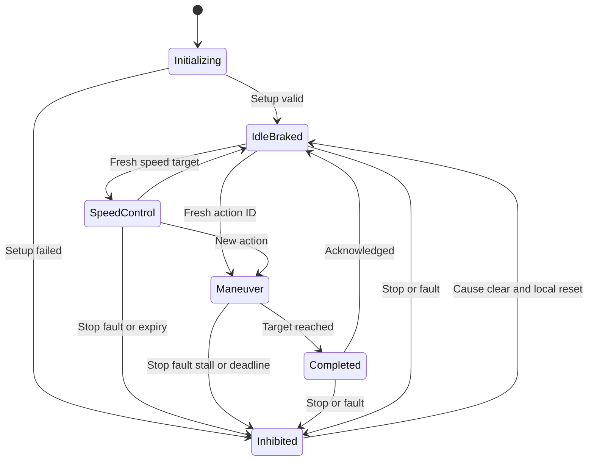

# Motion

Owner: Mahesha / S2. Parent: [system architecture](../ARCHITECTURE.md). This guide preserves the full-robot encoder/PID proposal. The checked duty-only bench API is specified below; configurable encoder/PID actions are implemented in the opt-in navigation profile; physical tuning/acceptance remains pending. Operational status is in [GETTING_STARTED](../GETTING_STARTED.md#current-capabilities).

## Current duty service contract

S2 alone writes motor PWM, booting with a persistent stop generation. Driver initialization/apply/brake check errors and output register readback. Requested duties are forward fractions in [0,0.35], not measured wheel speed. TEST always applies zero output. An enabled request must be finite, use the current generation and retain its original acquisition time; unsigned age <=60 ms qualifies, 61 ms fails and latches stop.

| API / type | Contract |
| --- | --- |
| `MotionRequest` / `s2_publish()` | Latest duties, enabled flag, original `sampled_ms` and generation; failures inhibit output |
| `s2_stop()` | Atomically advances stop generation, latches stop and wakes Motion without the request mutex; success is acceptance, not braking |
| `s2_request_reset(expected_generation)` | Asynchronous reset; Motion discards old requests, confirms zero output and clears only the matching acknowledged generation; a newer stop defeats reset |
| `s2_motion_copy()` | Nonblocking coherent `MotionHealth`; ignore destination on false |
| `MotionHealth` | Successful service sequence/time, stop generation/latch, brake/reset acknowledgement, applied PWM, TEST inhibition and driver fault status |

Motion rechecks stop state before and after the bounded PWM transaction. An already-running transaction may complete before braking. A matching brake acknowledgement means checked zero-output writes/readback completed; it does not prove stationary wheels. No nonzero output follows that acknowledgement until successful reset and a fresh generation-tagged request. Use the public micro T-Kernel SMP atomics rather than local interrupt masking across cores.

The request/health mutex is never part of accepting stop. Copying diagnostics cannot renew request age. Producer control and a separate new start are specified in [implemented coordination](../ARCHITECTURE.md#implemented-line-tracking-integration). The [handoff](IR_MOTION_HANDOFF.md) preserves historical evidence boundaries.

## Functionality

Motion is the sole motor-output writer. The motor driver controls two H-bridges; quadrature encoders provide direction/counts for speed, distance and turn estimates. Planned per-wheel PID closes measured speed loops, corrects straight travel and completes forward/backward distance or left/right/U-turn actions. Line Tracking supplies calibrated P guidance; it does not replace wheel-speed PID or write motor PWM.

Mission sends leased targets. Motion checks local stop/fault and expiry before output, publishes coherent measured feedback, and retains action completion until acknowledged. Safety can wake Motion independently of the request mutex.

## State diagram

The existing full-design states are organized below; transition labels express the established lease/action rules.

## States and responses

| State | Actuation / response |
| --- | --- |
| Initializing | Set electrical brake before driver/encoder configuration; unavailable required setup inhibits movement |
| Idle Braked | Zero demand/brake; wait for a fresh valid command |
| Speed Control | Regulate each measured wheel speed with planned PID; renew bounded lease; zero demand brakes |
| Maneuver | Track one ID-bound distance/angle target with encoder completion and absolute timeout |
| Completed | Brake at target; retain completed ID/status until acknowledged through the following command context |
| Inhibited | Brake both channels, invalidate previous target and retain reason; reset alone cannot move |

The diagram's unlabeled Speed Control → Idle Braked return means zero demand. The current bench services forward duty requests, not these full states. TEST firmware always brakes. The previous stop/reset limitations are historical; the current acknowledged generation contract is defined above.

## GPIO and peripherals

Use [TEAM's motor/encoder allocations](../TEAM.md#2-pins) and [PWM ownership](../TEAM.md#3-peripherals). [TECHNICAL_INFO](../TECHNICAL_INFO.md#motors-and-encoders) owns connector definitions, drive truth table and distance/yaw formulas.

## Modules and drivers

| Module | Purpose / status |
| --- | --- |
| `subsystem2.c/.h` | Existing lifecycle, motor service, request/health mutex, persistent stop event and public `MotionHealth` |
| `motion_policy.c/.h` | Existing duty/freshness/stop validation and `MotionRequest` |
| `drv_motor.c/.h` | Existing exclusive PWM/H-bridge boundary |
| `encoder.c` / `encoder_policy.c` | Implemented bounded quadrature capture and coherent raw context; hardware acceptance pending |
| `navigation.c/.h` | Implemented configurable count-window estimation and independent wheel PID; tuning pending |
| `navigation.c/.h` action controller | Implemented unique IDs, fixed deadlines, retained completion/ack and stall rejection; physical accuracy pending |

Use [shared `M_motion_cmd` / feedback contracts](../ARCHITECTURE.md#shared-contracts) for full integration. Feedback must expose measured counts/speeds/distance, validity/time, readiness/stationarity and active/done/failed action ID/reason. The existing bench's software health sequence is insufficient for scan stationarity.

## Business logic

- Calibrate decoded counts per wheel revolution, geometry, polarity and speed before enabling physical actions; unresolved values are in [PROJECT_SPECS](../PROJECT_SPECS.md#pending-decisions).
- Run measured wheel-speed PID separately from memoryless P line guidance. Bound requested speed/output and handle stalled encoders, saturation and invalid feedback explicitly.
- A renewed lease preserves the action ID and absolute deadline; repeated commands cannot restart or duplicate a turn. An expired/unconfigured target brakes locally.
- Boot, local stop, collision, stall, critical fault and deadline failure inhibit output. Reset discards prior targets; a new Mission command is required afterward.
- Measure commanded brake at outputs and physical stopping separately. LOW/LOW is the selected electrical brake; it does not establish stopped wheels.

Verification belongs to [S2](../../testing/subsystem2/TEST_LOG.md), [integration](../../testing/integration/TEST_LOG.md) and [system](../../testing/system/TEST_LOG.md) records. Planned T02/T05/T14/T15 cover stop/actions/fault/load; no encoder action or physical PID acceptance is claimed.

## Configurable encoder navigation

`encoder.c` owns GP0/GP1/GP7/GP28 quadrature capture through the shared micro T-Kernel GPIO dispatcher; `encoder_policy.c` owns the pure transition table. Coherent raw uint32 counts wrap naturally; invalid/missed transitions latch invalid encoder context. Diagnostic errors saturate so wrap cannot make that context valid. Lost ordering requires corrected wiring/load and reboot; a Motion reset does not invent missing counts.

`navigation.c/.h` provides explicit geometry, independent left/right PID tuning, encoder and motor polarities, bounded speed targets and unique straight/turn actions. Configuration is startup-only through `s2_navigation_configure()`; no calibration defaults are guessed. One wheel diameter and decoded counts/revolution apply to both wheels and must match measured hardware. SI units and yaw calculation follow [Technical information](../TECHNICAL_INFO.md#motors-and-encoders).

`MotionRequest.velocity_mode` selects `S2NavigationRequest`: S2_SPEED targets signed m/s; S2_DISTANCE targets signed metres; S2_TURN targets degrees (positive left/CCW). IDs are positive and increase within the armed context. A renewed action must keep kind, target, speed and absolute timeout unchanged. Same-ID mutation, replay, invalid configuration, stale service, stall or deadline faults. A completed action stays braked until a matching `acknowledge_id`; stop/reset discards old actions.

Measured per-wheel speed feeds independently configured PID plus feedforward, conditional integration and the existing maximum 0.35 magnitude duty cap. Motor polarity maps controller output to wiring; `drv_motor_apply_signed()` inserts one braked release before a direction reversal. TEST always brakes regardless of controller output. `MotionHealth` separately includes raw encoder context and estimated navigation feedback; output brake/readback still is not measured stationarity.

The default duty bench remains forward-only and uses the original MotionRequest contract. Navigation is opt-in, requires explicit setup and remains physically unvalidated. See [S3 guide](../SUBSYSTEM3_GUIDE.md#7-configure-navigation-without-inventing-measurements) and S2-U14–U17 in [test records](../../testing/subsystem2/TEST_LOG.md).
