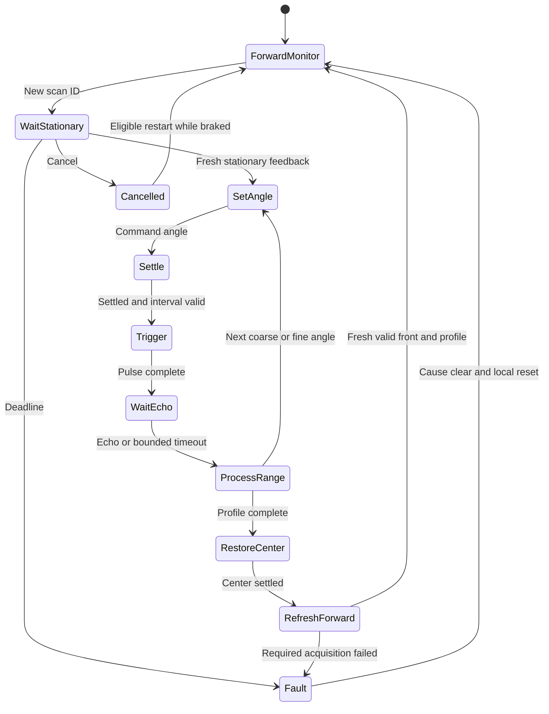

# Obstacle sensing and profiling

Owner: Jia Jing / S5. Parent: [system architecture](../ARCHITECTURE.md). This preserves the proposed full-robot scan/profile behavior. Current status and usable builds are in [GETTING_STARTED](../GETTING_STARTED.md#current-capabilities).

## Functionality

A servo points the ultrasonic sensor; Echo pulse timing gives range at a commanded angle. Forward clearance has its own validity/time, separate from side samples and the scan profile. Mission stops the car, confirms fresh measured stationarity and requests a bounded scan. Coarse readings select regions for finer sampling; Obstacle reports closest point, width/location and left/right clearance. Mission owns bypass and original-line recovery movement.

## State diagram

Cancellation, scan deadlines and critical-fault guards apply to every scan phase, including angle, settling, echo, processing and restoration; the diagram shows representative exits. These states organize existing acquisition phases; no new bypass algorithm is introduced.

## States and responses

| State | Response |
| --- | --- |
| Forward Monitor | Maintain current front validity/age; invalid/missing/stale range inhibits movement |
| Wait Stationary | Accept one scan ID; require measured stationary feedback before servo sweep |
| Set Angle / Settle | Command angle then wait nonblockingly for calibrated settling |
| Trigger / Wait Echo | Respect repeat interval; bounded pulse and echo wait; ISR timestamps edges and signals `S_echo` |
| Process Range | Retain angle/time/validity; coarse results guide targeted fine scan |
| Restore Center / Refresh Forward | Restore forward pose and acquire new valid front reading before any bypass |
| Cancelled / Fault | Cancel request on stop/fault, report reason/progress, keep movement inhibited |

No echo is unknown, never infinite clearance. A commanded servo angle is not measured angle. Side scans never refresh forward timestamps. Expected front gaps during a stationary scan are supervised by progress and deadline, while movement remains inhibited.

## GPIO and peripherals

Use [TEAM's sonar/servo allocation](../TEAM.md#2-pins) and [peripheral ownership](../TEAM.md#3-peripherals). [TECHNICAL_INFO](../TECHNICAL_INFO.md#ultrasonic-sensor) owns trigger/echo conversion, variant limits and [servo](../TECHNICAL_INFO.md#sg90-servo) data.

## Modules and drivers

| Module | Purpose / status |
| --- | --- |
| S5 lifecycle | Existing inactive placeholder; historical stationary-bench sources are not an active target |
| Suggested sonar driver | Trigger scheduling, bounded echo ISR/timeouts, timestamped range/validity |
| Suggested servo driver | Calibrated PWM angle mapping and nonblocking settling state |
| Suggested scan coordinator | Scan ID/deadline, coarse/fine plan, duplicates/cancellation and center restoration |
| Suggested profile generator | Closest point, width/location, left/right clearance with independent ages |
| Mission / Motion | Stationary confirmation, scan request and bounded movement; [contracts](../ARCHITECTURE.md#shared-contracts) |

## Business logic

- Ignore duplicate scan IDs; full request queue reports failure. Stop/fault cancels acquisition; retries and whole scan have finite bounds.
- Compare profile against measured car width, stopping distance, clearance margin and permitted course boundary. Only a supported path can authorize a bounded bypass; blocked/exhausted profiles stop.
- Restore center and valid front range before movement. New obstacles preempt bypass; completed navigation/bypass leads to original-line reacquisition.
- Reverse/retry requires proven rear clearance and permitted space; forward sonar alone does not supply that evidence.
- A five-reading scan spaced above the conservative initial interval already spans more than 240 ms from first to last trigger, before settling. Account for this in the stationary scan deadline rather than treating side readings as current front data.

Calibration/limits are in [PROJECT_SPECS](../PROJECT_SPECS.md#pending-decisions). Planned T08–T10/T14/T15 and [S5/system records](../../testing/README.md) cover no echo, scan freshness, cancellation, bypass and load.
