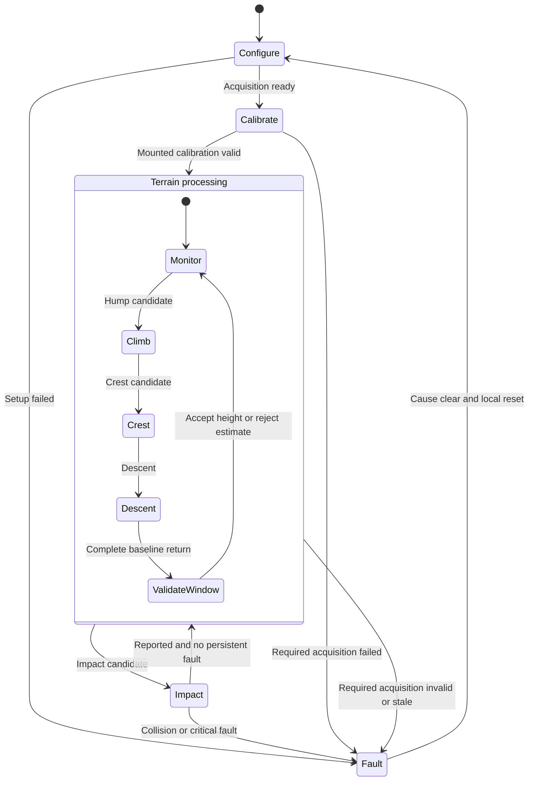

# Terrain and motion monitoring

Owner: Darrius / S4. Parent: [system architecture](../ARCHITECTURE.md). The classification and reference-validated height method remain proposed. Current status is in [GETTING_STARTED](../GETTING_STARTED.md#current-capabilities).

## Functionality

Read GY-511 acceleration/magnetic data and combine it with coherent measured Motion feedback. Calibrate mounted axes/offsets and filter acceleration before classifying stationary, accelerating, turning, climbing, descending and impact. Publish timestamped `M_terrain`; collision/critical acquisition faults notify Safety independently of diagnostic queues.

GY-511 has no gyroscope. Turn rate may be estimated from encoders and must be labelled accordingly. Hump detection and a valid physical height are separate results. Retain the greatest **valid** run height; invalid estimates cannot overwrite it.

## State diagram

Terrain processing groups the existing monitoring/hump phases; it is not a new classification. Incomplete/dynamic/slip/drift windows are discarded without creating a height; critical acquisition and impact guards apply in every processing state. Motion classifications are reported observations, not additional motor commands.

## States and responses

| State | Response / actuation boundary |
| --- | --- |
| Configure / Calibrate | Configure cores, verify advancing coherent samples and mounted-axis/bias calibration |
| Monitor | Report ordinary movement/tilt; detect hump/impact candidates with validity |
| Climb / Crest / Descent | Accumulate a complete candidate trajectory using pitch and measured travel |
| Validate Window | Accept only reference-validated estimates; larger valid result updates maximum |
| Impact | Report event promptly; a collision/critical condition invokes Safety inhibition |
| Fault | Required acquisition unavailable/invalid/stale: independent critical notification; height-only invalidity does not itself fabricate an acquisition fault |

No Terrain state writes motor outputs. Stopping retains the run maximum; a new run clears it through [Mission](../ARCHITECTURE.md#mission-and-safety-responses).

## GPIO and peripherals

Follow [TEAM's GY-511 wiring](../TEAM.md#2-pins) and [I2C ownership](../TEAM.md#3-peripherals). [TECHNICAL_INFO](../TECHNICAL_INFO.md#gy-511--lsm303dlhc-imu) owns addresses, registers, data ordering, scales and electrical limits.

## Modules and drivers

| Module | Purpose / status |
| --- | --- |
| S4 lifecycle | Existing inactive placeholder; historical optional bench is not active firmware |
| Suggested LSM303DLHC driver | Finite I2C reads/configuration, data-ready gating, coherent XYZ, overflow/age validity |
| Suggested calibration/filter module | Mounted-axis/bias model and dynamic-acceleration guards |
| Suggested classifier | Stationary/acceleration/turn/climb/descent/impact observations; encoder-derived turn rate |
| Suggested height/peak module | Complete-window validation, reference-based height conversion and maximum retention |
| Motion feedback consumer | Coherent measured counts/travel/speed, not requested duty or bench latch |

The historical stationary bench used acceleration 50 Hz, ±2 g, high-resolution/BDU and magnetic 30 Hz, ±1.3 gauss. These are useful initial configuration examples, not accepted full-robot calibration. Decode the separate sensor core maps correctly; check for advancing data rather than refreshing a cached timestamp.

## Business logic

- Gravity-derived pitch/roll is valid only after mounting calibration and when acceleration is sufficiently close to gravity. Separate dynamic acceleration and magnetic disturbances from reliable pose estimates.
- Candidate height method: accumulate vertical rise from calibrated pitch and encoder travel over the climb; map chassis rise to physical hump height using measured wheelbase/contact geometry and reference humps.
- Reject slip, incomplete windows, excessive dynamic acceleration and baseline drift. Raw uncorrected double integration is not an established height measurement.
- Separate movement classification, hump detection, valid height and critical acquisition health. An invalid height cannot replace a retained valid maximum.
- I2C waits/retries must be finite and must not block higher-priority control. Required acquisition failure and impact notification use the independent Safety path.

Record calibrated thresholds/model/limits in [PROJECT_SPECS](../PROJECT_SPECS.md#pending-decisions). Planned T06/T07/T14/T15 need labelled traces, measured reference humps and an invalid estimate after a valid maximum; [S4 records](../../testing/subsystem4/TEST_LOG.md) own results.
