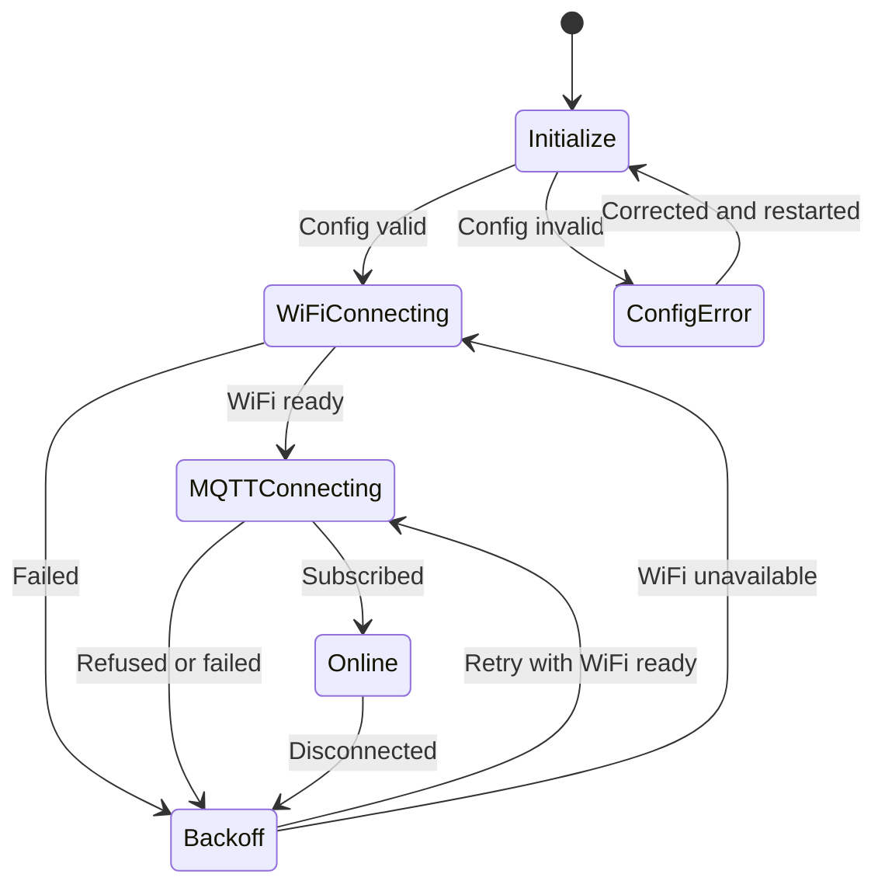

# Subsystem 1: Communications

Owner: Shaun. Parent: [architecture](../architecture.md); roster and pins in [team](../team.md); requirements and pending decisions in [project-specs](../project-specs.md).

## Contents

- [Functionality](#functionality)
- [Interfaces and contract](#interfaces-and-contract)
  - [Connection states](#connection-states)
- [Data and fault bits](#data-and-fault-bits)
- [Status](#status)
- [Open items](#open-items)

## Functionality

- Reporting task (core 1, priority 20): collects robot state every 20 ms, publishes binary telemetry every 500 ms, logs events, answers snapshot requests and installs the barcode mapping.
- A kernel WiFi/lwIP/MQTT task on core 0 (`cyw43_utk_task`, priority 4) owns all CYW43, lwIP and MQTT calls. It only connects, reconnects, publishes byte frames and hands received frames to Reporting.
- Networking never drives, starts or stops the robot. Network loss sets only the Network fault byte; local autonomy continues. The only command that changes robot state is the mapping, accepted only while the robot is stopped.

## Interfaces and contract

| Item | Contract |
| --- | --- |
| Producers | Reporting reads Motion feedback/encoders, Mission state, fault bytes, Terrain, Obstacle and barcode values through the shared-data rules in [architecture](../architecture.md#shared-data-rules) |
| Events | `s1_event(kind, arg, arg2)`: any core-1 task; ring of 16 events; a full ring overwrites the oldest and counts drops |
| Bridge | Two single-producer/single-consumer rings between core 1 and core 0: outgoing depth 4, incoming depth 2, frames up to 18 bytes. A full ring drops the frame. `s1_bridge.h` is the only application header the transport includes |
| Topics | Telemetry (binary, QoS 0, not retained, 500 ms and on snapshot request); command (`robot/s3/request`, binary snapshot request and mapping); status (`robot/s3/status`, QoS 1, retained, online/offline last will) |
| Frames | Version/type header, little-endian, explicit masks and shifts, exact length per type; wrong length, version, type, set reserved bit or out-of-range field rejects the whole frame. Types: telemetry 18 B, event 11 B, snapshot reply 18 B, mapping 5 B, acknowledgement 3 B, snapshot request 2 B. Byte layouts and golden vectors are in the protocol and data-representation documents (some widths provisional) |
| Mapping | Four distinct letters (A-Z) for left, right, straight, U-turn. Acknowledgement `{sequence, result}`: 0 installed, 1 busy (robot not stopped), 2 invalid letters, 3 malformed. Sent only after Mission installs the mapping, never on receipt |
| Source/sink | Code: `app_program/subsystem1/` (`subsystem1.c`, `s1_report.c`, `s1_bridge.c`, `mqtt_frame.c`); transport `lib/liblwip/sysdepend/pico_rp2040/mqtt_utk.c`; laptop helper `scripts/mqtt_client.py` |

Transport constants (from `mqtt_utk.c`): keepalive 10 s; connection/subscription attempt deadline 15 s; retry backoff from 1000 ms doubling to 30000 ms; topics must be nonempty and under 96 bytes; up to 2 frames serviced per poll. Credentials are local (`config/wifi_secrets.h`, git-ignored).

### Connection states

Only subscription success declares Online. Failure, refusal or timeout closes the client, discards partial requests and backs off; success resets the backoff. No offline backlog; reconnect sends the newest data. Invalid configuration is diagnosed once and stays offline. The WiFi service retries a rejected initial join and bounds DOWN/JOIN/NOIP waits (carried from the prior guide: 20 s with a 5 s rejoin delay; an empty SSID disables joining). An empty broker IP leaves WiFi up with MQTT disabled.

## Data and fault bits

Telemetry (23 bytes, schema v2): sequence (8-bit, wraps); mission state (4 bits); motion status IDLE/RUNNING/DONE/FAILED and action ID (6 bits); line status (2 bits); mapped flag; six fault bytes; left/right wrapped encoder counts (16 bits each); hump count and 7-bit maximum height code with valid flag (set once any hump completed); front range mm (13 bits, 8191 invalid) with valid flag; last barcode letter (31 = none) and mapped action; latest obstacle width and depth in mm. No echo is never reported as clear space. Motor speed and direction are derived on the laptop from successive counts. Byte layout: [architecture](../architecture.md#mqtt-binary-protocol-schema-version-2).

Fault bytes are telemetry bytes 4-9 in owner order (Motion, Line, Terrain, Obstacle, Mission, Network); bits and the start/stop policy are in [architecture](../architecture.md#fault-bitmask). S1 writes only the Network byte (via `s1_bridge_link`); Network bits are report-only and never stop motion.

## Status

| Item | State |
| --- | --- |
| Binary frame codec, report assembly, event ring, bridge, mapping flow | Implemented in code (`app_program/subsystem1/`); host tests under `testing/pure/` per the protocol description. Firmware/physical execution status: see [testing](../../testing/subsystem1/TEST_LOG.md) |
| Core-0 transport: connect, subscribe, last will, bounded backoff, retained status | Implemented in `mqtt_utk.c` |
| Earlier bench JSON telemetry (`robot/s3/telemetry` object with IR fields), 1000 ms heartbeat topic, JSON status-request subscription | Superseded by the binary protocol on `main`; not described further here |
| Mapping install and acknowledgement end to end with Mission | Implemented (`mission_set_mapping`); laptop sender `scripts/mqtt_client.py map`; not yet run against the robot |
| Whole-mission telemetry fields from S2/S4/S5 producers | Wiring depends on each producer; do not fabricate values for absent producers |

QoS acknowledgement confirms broker receipt only. A retained online flag can be stale; judge liveness by telemetry freshness. The 500 ms stream cannot prove short stop or recovery timing. A laptop monitor flag threshold of >3 s without a live message (from the prior guide) is an observation threshold, not a motion deadline.

## Open items

- Confirm fault-bit positions and provisional data rows with each owner (issue #28 thread).
- Final mission-state width and event arguments depend on the Mission issue.
- Measure scheduling and stack margin on core 0/1 under network load (not measured).
- Physical evidence for network-loss behaviour (SYS and planned T12/T13 records) remains pending; compilation is not a pass.
