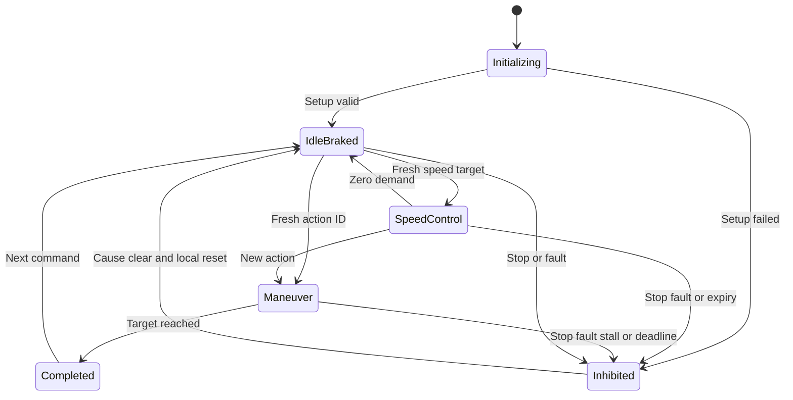

# Subsystem 2: Motion

Owner: Mahesha. Parent: [architecture](../architecture.md); pins and peripherals in [team](../team.md); pending decisions in [project-specs](../project-specs.md#pending-decisions).

## Contents

- [Functionality](#functionality)
- [Interfaces and contract](#interfaces-and-contract)
- [Data and fault bits](#data-and-fault-bits)
- [Status](#status)
- [Open items](#open-items)

## Functionality

- Motion (core 1, priority 13, 20 ms release or woken by stop) is the sole motor-output writer. Two H-bridges drive the motors; quadrature encoders provide counts and direction.
- Per-wheel PID on measured speed, with FOLLOW (speed plus steering), DISTANCE (signed mm) and TURN (signed degrees, positive left) modes. Line guidance from S3 is memoryless P steering and never writes PWM.
- Mission sends one packed command per 20 ms; Motion checks local stop and sample age before output, brakes on any failure, and publishes a feedback word (status IDLE/RUNNING/DONE/FAILED plus action ID).

## Interfaces and contract

| Call / item | Contract (from `app_program/subsystem2/subsystem2.h`, `motion_control.h`) |
| --- | --- |
| `s2_command(const MotionCommand *)` | Mission only. Copies the latest command under a mutex; not queued. Fields: mode, `speed_mmps`, `steering` (-1..1, left = v(1+s), right = v(1-s)), `target`, `action_id`, `sampled_ms` |
| Sample age | `sampled_ms` is the original acquisition time. Rewriting or copying never refreshes it. Motion brakes when older than `MOTION_EXPIRY_MS` (wrap-safe). Proposed limit 60 ms (D07, provisional) |
| `s2_feedback()` | Packed status and action ID; only Motion writes it. Mission starts the next action after seeing DONE for its ID; a new action ID replaces the old action; a renewed lease keeps the ID and absolute deadline, so repeated commands cannot restart a turn |
| `s2_stop()` | Core-1 callers. Sets a persistent flag and wakes Motion independently of the command mutex; each call invalidates the previous brake acknowledgement. S2 boots with stop latched |
| `s2_health(&h)` | Check the return code first. `stopped`, `brake_acknowledged` (brake serviced since the latest stop), `serviced_ms`, `sequence`. These report software service only, not physical stationarity or speed |
| `s2_reset_stop()` | Fresh local action only. Returns `E_OBJ` unless stop is latched and the latest brake serviced (or after a startup inhibit). Clears the stored command; never commands movement. The return code is authoritative because a new stop can invalidate the acknowledgement |
| `s2_inhibit_startup()` | Any core, startup only; latches stop and a permanent inhibit |
| Stationarity | Zero commanded speed is not proof of stopping; consumers use encoder counts. Brake acknowledgement alone is insufficient for scans |

Rules for producers (carried from the integration requirements, still applicable):

- One authorized command producer (Mission). Do not race writers or bypass S2 to write PWM. Mission and Obstacle agree command handover before Obstacle-driven movement.
- Keep motion disabled during calibration and until a fresh local start action. Require a fresh, valid acquisition and valid guidance before enabling movement; invalid snapshot fields can be zero.
- Route local stop, lost/unknown/stale sensing, publication failure and producer error exit through `s2_stop()`, check its result and stay inhibited on error. Stop-on-line-loss is the proposed initial behaviour; any recovery needs a separately agreed policy.
- While stopped, publish no enabled command. After `stopped && brake_acknowledged`, a fresh local reset action may call `s2_reset_stop()`; do not reset automatically each sample. After reset require a separate fresh start and revalidated guidance. Held buttons, boot inputs and cached commands must not replay a start.
- Stop and reset serialization relies on sharing Motion's core; cross-core runtime stop/reset is unsupported. Mutex-taking calls belong in task context, not in interrupt handlers. No stop-latency bound is measured.

States (full design):

Boot, local stop, collision, stall, critical fault and deadline failure inhibit output and discard targets; a new Mission command is required after reset. TEST firmware always brakes. LOW/LOW is the selected electrical brake and does not establish stopped wheels.

## Data and fault bits

- Command and feedback are packed words per [architecture](../architecture.md#motion-command-contract); encoder counts are fixed-width wrapping per wheel (`ENC_COUNT_BITS` = 16, provisional until counts per revolution and longest segment are measured). Consumers store their own origin and subtract modularly; nobody resets the shared count.
- Motion duty limit `MOTION_MAX_DUTY` 0.35 and `ENC_COUNTS_PER_REV` 360 are marked PROVISIONAL in `robot_config.h`.
- Fault byte (Motion): bit 0 motor stall, bit 1 encoder fault (proposed positions, awaiting owner confirmation). Both block a start and stop a run ([fault bitmask](../architecture.md#fault-bitmask)). Encoder fault is set by a change in the invalid-quadrature-transition counter (`drv_encoder_invalid_edges`) and clears after `ENC_FAULT_CLEAR_COUNTS` (64) valid counts with no new invalid transition, so a hand-spun wheel proves the encoder again; it stays set if the encoder ISR never started. Stall lasts while driving into it and clears once stopped; the Safety latch holds the stop.

## Status

| Item | State |
| --- | --- |
| Lifecycle, motor service, command mutex, persistent stop, `MotionHealth` | Implemented (`subsystem2.c`) |
| PID, distance/turn/follow actions, expiry, stall detection | Code present in `motion_control.c` (kernel-free) |
| Quadrature encoder driver (GP0/GP1 via shared GPIO IRQ dispatcher; builds need `CONSOLE=usb_cdc CRASH_REPORT=0`), motor driver `drv_motor.c` | Code present |
| Calibrated counts per revolution, geometry, polarity, PID gains, physical stopping distance | Not established; no physical PID or action acceptance claimed. See [S2 test log](../../testing/subsystem2/TEST_LOG.md) |
| Earlier duty-only `MotionRequest` API (0..0.35 forward duty, 60 ms expiry) and its S3 hookup proposal (`left=0.10+0.10*steering`, `right=0.10-0.10*steering`) | Superseded by `MotionCommand`; the steering mapping was a proposal only and is not adopted here |

## Open items

- Calibrate decoded counts per revolution, wheel geometry, polarity and speed before physical actions (pending decisions D03, D07).
- Confirm steering sign and safe initial duty once motor wiring/polarity is verified (a hardware fault was noted in the prior integration requirements; current state not verified).
- Measure commanded brake at outputs and physical stopping separately.
- Decide whether stop-on-line-loss suffices or bounded recovery is required.
- Confirm fault-bit positions with owners; scan stationarity feedback for S5 needs measured-stationary signalling beyond software health.
