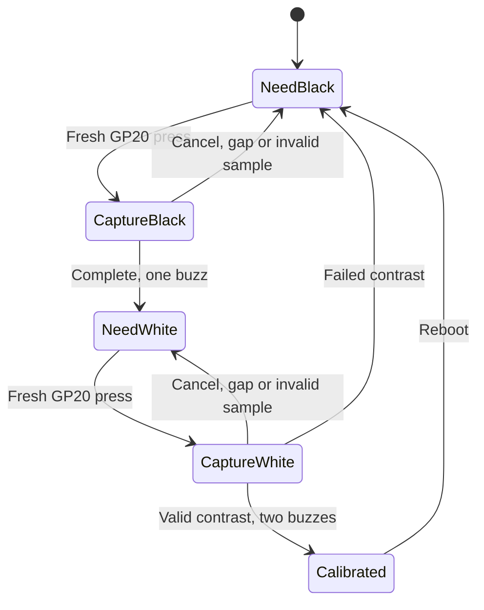
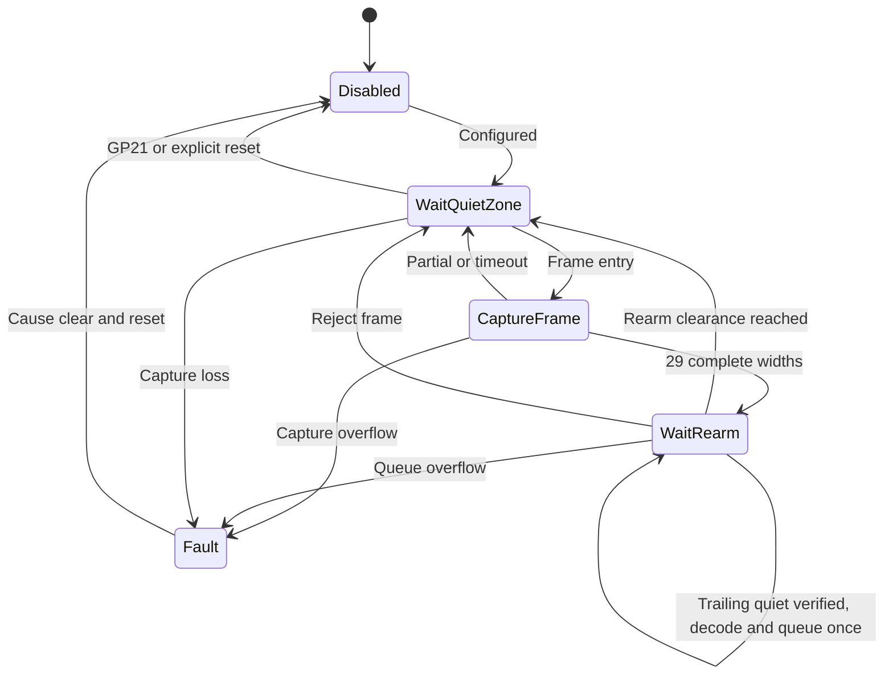

# Subsystem 3: Line tracking, barcode and Mission/Safety

**Owner:** Nicholas. Parent: [architecture](../architecture.md) (task table, authority, shared-data rules). Requirements and pending decisions: [project specs](../project-specs.md#pending-decisions). Pins and kernel budget: [team](../team.md). Motion interface: [subsystem 2](subsystem2.md). Telemetry: [subsystem 1](subsystem1.md). Implementation and physical-validation status is tracked in issue #62.

## 1. Functionality

S3 has three parts.

- **Line tracking.** Acquires a complete pair of analogue IR readings (left GP26/ADC0, right GP27/ADC1), calibrates each sensor independently, classifies line visibility and computes memoryless proportional (P) guidance. Owns the calibration buttons and buzzer feedback.
- **Barcode.** The third IR sensor's comparator DOUT (GP16) detects transitions in the adjacent barcode lane. Capture records ordered edge timestamps and encoder context; task-level decoding measures bars and spaces, validates a frame and emits one mapped navigation event. AOUT is disconnected.
- **Mission/Safety.** Mission (priority 14, 20 ms) owns navigation decisions and mapping acceptance. Safety (priority 12, 10 ms) owns the GP21 stop latch, fault aggregation, freshness checks and stop authority independent of Mission and Reporting. Their behaviour is defined in [architecture](../architecture.md#subsystem-summaries) and summarised in section 6.

Boundaries:

- S3 sensing never controls motors and never formats or sends telemetry. S1 reads S3 observations and owns encoding and transmission. S2 alone writes motor PWM.
- A line observation, steering value, plausible ADC count or decoded barcode does not establish movement permission, physical centering or sensor connectivity.
- S3 does not enable or feed a whole-system watchdog; that policy belongs to Safety.

## 2. Line tracking

### 2.1 Acquisition and calibration bounds (implemented in software)

- Acquire GP26 and GP27 every nominal 20 ms. After each mux change discard one conversion, then average eight.
- The complete pair has a 2 ms budget and an independent 4096-poll cap (covers a stalled timer). Publish a complete pair or an explicit failed acquisition, never a partial pair. Failed driver reads leave the caller's destination unchanged.
- ADC data is 12-bit (0-4095). Acquisition time is paired-read completion time; copying or publishing cached data never refreshes it. Timestamp arithmetic is unsigned wrap-safe.
- A capture needs at least 25 distinct acquisition timestamps spanning at least 500 ms from its first sample. The first sample must arrive within 60 ms of the request; later gaps over 60 ms cancel capture. Duplicate timestamps do not count.
- Each channel needs at least 300 counts of black/white contrast. Independent spans and opposite polarities are supported.

### 2.2 Calibration workflow

Calibration is RAM-only and must use the mounted sensor height, lighting and surface. A completed pair survives normal operation and capture cancellation; reboot clears it. The buzzer mute switch must allow feedback.

| Phase | Action / response |
| --- | --- |
| Need black | Release GP20 at least 30 ms, place both sensors on black, fresh debounced GP20 press |
| Capture black | Hold pose until completion: one 100 ms buzz |
| Need white | Release GP20, place both sensors on white, fresh press |
| Capture white | Hold pose: two 100 ms buzzes separated by 100 ms silence on valid completion |
| Calibrated | Sampling and guidance continue; GP20 is then application start/reset control |
| Cancel / rejection | GP21 cancels capture immediately and inhibits new capture while held; cancellation or rejection gives three buzzes |

GP20 needs a stable 30 ms release before arming and a stable 30 ms press to trigger; a button held at boot cannot trigger repeated captures. GP21 dominates simultaneous inputs and releasing it does not replay a GP20 press made while held. GP20 during capture is rejected as busy; GP20 cannot replace a completed valid pair. Buzzes are asynchronous.



Cancelling black leaves the pair cleared; cancelling white keeps completed black; failed white contrast clears both. During capture, normalized readings and guidance are unavailable. Typed capture results distinguish waiting, pending, black/white completion, unsupported kind, busy, cancel held, sample gap, invalid sample, contrast failure, missing black and cancellation. Display strings are labels, not command IDs.

### 2.3 Normalization, classification and guidance

```text
black_fraction = clamp((raw - white) / (black - white), 0, 1)
normalized     = 2 * black_fraction - 1          (-1 white, +1 black)
error          = right_black_fraction - left_black_fraction
correction     = clamp(0.10 * error, -0.10, +0.10)
steering       = correction / 0.10               (-1 left ... +1 right)
```

Equal sensor values do not prove centering. No integral/derivative history is stored.

| Class | Meaning |
| --- | --- |
| UNKNOWN | Missing, invalid, stale, uncalibrated or capture-active observation |
| LOST | Both fractions < 0.15; stays lost while both < 0.25 |
| VISIBLE | Fresh calibrated observation outside LOST/BROAD_BLACK |
| BROAD_BLACK | Both fractions > 0.85; an observation only, not a junction, barcode or finish event |

White < 0.15; partial 0.15-0.85 inclusive; black > 0.85. Age 60 ms is accepted, 61 ms is stale. Only VISIBLE authorizes valid guidance; fresh LOST/BROAD_BLACK still expose normalized values and error but give invalid guidance and zero steering.

| Left / right | Guidance (usable data) |
| --- | --- |
| White / white | LOST; Mission decides recovery |
| White / partial or black | Correct right |
| Partial / white | Correct left |
| Partial / partial | Signed difference; equal gives zero |
| Partial / black | Correct right |
| Black / white or partial | Correct left |
| Black / black | BROAD_BLACK; Mission decides |

## 3. Barcode

### 3.1 Scope (implemented in software; disabled at boot)

Capture buffering, a provisional Code 39 decoder, mapping and a copied event FIFO are implemented. **The scanner boots disabled**: measured configuration, S2 encoder feedback and an agreed GPIO dispatcher are not supplied, so no physical scan or barcode navigation is established.

The first version supports uppercase A-Z in `*X*` frames in either orientation. This is a provisional project choice, not a confirmed course symbology (decision D01). The briefing requires the full alphabet, commands held until the cross junction, and Wi-Fi mapping changes without recompilation; S3 supplies a local mapping API, but S1's current status-only protocol does not implement that route. Mission, not the decoder, requests encoder-based navigation from Motion. Line sampling continues concurrently and barcode capture cannot overwrite its snapshot.

### 3.2 States



Public states: `BARCODE_DISABLED`, `_WAIT_QUIET`, `_CAPTURE`, `_WAIT_REARM`, `_FAULT`. Disabled state never authorizes movement. Every letter starts UNMAPPED; neither conflicting ABCD source example is adopted. Unknown, partial or malformed frames are rejected outcomes. Capture loss and queue overflow latch faults, reported independently of diagnostics; Mission/Safety apply the stop response.

### 3.3 Widths and measured configuration

- Widths use mean calibrated wheel displacement in micrometres, never elapsed time or PWM demand. Invalid or stale context, changed encoder epoch, backwards timestamps, changed counts at an unchanged timestamp, direction reversal, excess travel, wheel disagreement and expired deadlines reject the encounter. No timed fallback exists; bar count alone never identifies a symbol.
- `*X*` has 29 alternating elements (three 9-element characters plus two narrow inter-character spaces). Fit narrow/wide classes across the frame, require three wide elements per character, both framing patterns and one A-Z payload. No checksum, extended ASCII or multi-letter frame is accepted.
- `barcode_config_t` has no ready-to-drive defaults. Supply: distance per count for each wheel, narrow-width range, wide:narrow ratio limits, tolerance, leading/trailing quiet clearance, rearm clearance, per-step and whole-frame travel bounds, wheel disagreement, encoder-age bound, edge-gap and absolute frame deadlines, and black polarity (permille, micrometres, microseconds). Ring size, service budget and event capacity are software defaults, not physical limits. Encoder quantization and capture latency must resolve the narrowest element at the intended speed.

### 3.4 Encoder and interrupt adapter (proposed integration)

No S2 code is added. The provider supplies two bounded callbacks:

- `read_task`: actual GP16 level, coherent left/right counts (wrap modulo 2^32), validity/reset epoch, encoder acquisition and observation times (hardware TIMER microseconds). It also runs briefly with local interrupts masked: no kernel calls, locks, allocation or retries. Measure its maximum duration and edge/encoder association uncertainty before enabling.
- `set_enabled_task`: enable or disable GP16 edges through an agreed GPIO-bank dispatcher that calls `drv_barcode_edge_isr(events, sampled_us, encoder)` once per edge on core 1. It never replaces USB, encoder or Echo handlers.

GPIO bank interrupts are shared and the USB SDK shim is not a general dispatcher. Both rise and fall flags together latch capture loss. Successful configuration sets only GP16 to input with pulls disabled; verify the comparator's safe output level. Boot and unconfigured operation touch neither the pin nor a GPIO interrupt.

## 4. Interfaces and contract

### 4.1 Source modules

| File | Role |
| --- | --- |
| `subsystem3.c/.h` | Initialization, task start, protected line-snapshot copy (`s3_ir_copy`); the supported external interface. Also holds the Line/Barcode task (core 1; 10 ms input/feedback, 20 ms acquisition; missed releases skipped): ADC, calibration buttons, buzzer, barcode service |
| `drv_ir_tracking.c/.h` | ADC register access |
| `ir_tracking.c/.h` | References, normalization, visibility, P guidance; snapshot packaging that invalidates stale copies |
| `drv_barcode.c/.h` | GP16 edge ISR and the timestamp ring |
| `barcode_decode.c/.h` | Host-tested bar-width framing and Code 39 A-Z decode; portable types |
| `barcode.c/.h` | Scanner state, mapping, copied event queue; public API |
| `mission.c/.h`, `mission_logic.c/.h`, `safety.c/.h`, `safety_logic.h` | Mission and Safety tasks; `*_logic` files are kernel-free and host-tested |

The task services a bounded number of captured barcode records per 10 ms release, after due ADC work, and writes no motors or network data. [architecture](../architecture.md#tasks) lists Line/Barcode at priority 15 and Safety at 12 and governs; `app_program/common/robot_config.h` currently sets 11 and 12 (to be reconciled).

### 4.2 Line snapshot API

```c
bool s3_ir_copy(S3IrSnapshot *snapshot);
```

Returns false immediately on null input, unavailable initialization, busy mutex or kernel error; ignore the destination on failure. Task context only. Before any acquisition an initialized service returns a coherent snapshot with `have_sample=false`.

| Fields | Meaning |
| --- | --- |
| `raw`, `have_sample`, `acquisition_valid` | Latest attempted pair; missing attempt vs failed/valid acquisition |
| `calibration`, `contrast`, `calibration_valid` | References and spans |
| `normalized_left/right`, `normalized_valid` | Values in [-1,1] |
| `line`, `error`, `steering`, `guidance_valid` | Visibility, observational error, P steering (valid only when fresh VISIBLE) |
| `capture_kind`, `capture_result` | Current phase and typed outcome |
| `sample_fresh`, `sampled_ms`, `sample_age_ms` | Valid acquisition age <= 60 ms; original attempt time; wrap-safe age at copy (zero before first sample) |
| `sequence` | Advances per distinct acquisition attempt including failed ones; wraps as `uint32_t` |

Invalid normalized/error/steering values are zero with explicit validity flags; stale reads keep raw data and acquisition time but return UNKNOWN. Read success alone does not mean valid sensing. S3 creates one priority-inheritance mutex (handle published with C11 release/acquire atomics); both writer and reader use `TMO_POL`, so contention skips a publication or read and never delays acquisition. The struct is not a wire format.

### 4.3 Barcode API

Declared in `barcode.h`; core-1 task context only; none is ISR-safe.

| API | Contract |
| --- | --- |
| `barcode_init()` | Claims GP16 on the dispatcher; false on failure |
| `barcode_set_mapping(letters)` | Four distinct letters A-Z indexed by action; refused while scanning or if invalid |
| `barcode_start()` / `barcode_stop()` | Start is refused until a mapping is installed; start clears ring, partial frame, queued events and barcode fault bits |
| `barcode_service(cancel)` | Once per release: drain ring with a fixed edge budget, assemble and decode, queue events; GP21 (`cancel`) stops scanning |
| `barcode_pop(event)` | Exactly one consumer (Mission); false when empty |

Unmapped letters are never queued as actions. A successful decode or pop never grants movement permission; Mission rejects stale context before acting.

### 4.4 Interface to S2 (Motion)

Owned by [subsystem 2](subsystem2.md); the S3-side expectations are:

- `MotionRequest.left/.right`: finite forward duty fractions 0-0.35 (not measured speeds; reverse not requestable). `.sampled_ms` is the original paired IR acquisition time (age <= 60 ms accepted); republishing cached data must not refresh it. `.enabled=false` brakes without clearing the stop latch.
- `s2_publish()`: bounded latest-value copy; check the return, failure means local inhibition and the independent stop path. `s2_stop()`: persistent stop and wake-up; every stop invalidates the previous brake acknowledgement. `s2_reset_stop()`: needs the latest stop's brake acknowledgement; failure keeps the consumer stopped; never commands movement. `s2_health()`: use only after a successful read; `stopped` and `brake_acknowledged` indicate software state, not stationarity.
- Runtime stop/reset callers share Motion's core 1; cross-core stop/reset is unsupported. One authorized request producer; any Mission/Obstacle handover needs agreement.

**Proposed S2 capabilities for barcode navigation** (requirements for owner review, no API signatures agreed): coherent encoder feedback (counts, direction, time, sequence, validity, units); bounded ISR-safe association of barcode edges with encoder context; per-wheel speed PID; left/right/straight/U-turn actions via calibrated distance/angle targets; unique action ID with lease, absolute deadline and active/done/failed status (lease renewal must not restart the action; completion retained until acknowledged); cancellation on stop, expiry, fault, stall or obstacle; measured stationarity (brake acknowledgement alone is insufficient). Do not guess mappings, turn geometry, reverse permission, tolerances, lease durations or stall thresholds; unresolved values go to D03, D07, D08, D10 and D01/D02 in [project specs](../project-specs.md#pending-decisions).

## 5. Data and fault bits

- The line snapshot (section 4.2) is the S3 data product; barcode status and events come from section 4.3. S1 maps typed fields into its own telemetry format and must not serialize native layout. The shared word-snapshot, mutex-copy and ISR-ring patterns are in [architecture](../architecture.md#shared-data-rules).
- S3 owns one fault byte; Safety reads it each release. Example bits per [architecture](../architecture.md#fault-bitmask): IR invalid, line lost, barcode capture overflow, barcode event overflow. Bit positions are not specified in the sources merged here; Insufficient data to verify.
- Barcode capture and event-queue overflow bits are latched in the S3 fault byte until the cause clears and `barcode_start()` is called.

## 6. Mission and Safety (summary; owned by architecture)

[architecture](../architecture.md#subsystem-summaries) is authoritative; this is a pointer, not a second definition.

- Mission is a single `switch` with one handler per state. Candidate states: Calibrating, Ready, FollowLine, Navigation, Scan, Bypass, Reacquire, Stopped, Fault, Complete (final list and bit width set in the Mission issue). A decoded command is held until the next cross junction, then executed as a Motion action. Line loss allows bounded recovery before stopping. Arbitration order: stop/fault, required-data freshness, obstacle, navigation, line following.
- Mission writes one packed command every 20 ms (mode, speed and steering or target, action ID, source-sample acquisition time); Motion brakes on a sample older than the age limit (D07). Safety or GP21 sets the persistent stop flag; reset needs a fresh local GP20 press with the cause cleared.
- Mission and Safety are proposed target design, not implemented here, except the bench policy below.

## 7. Status

### 7.1 Implemented (software only; no physical evidence)

- Paired acquisition, calibration, classification, P guidance, snapshot API, buzzer/button handling.
- Barcode capture ring, decoder, mapping, event FIFO, public API; scanner disabled at boot.
- Removal of S3 firmware fixtures, runner and startup hooks was kept at Nicholas's request; no new testing added. Historical evidence stays under `testing/subsystem3/`. TEST-only periodic console diagnostics (about every 500 ms) are observations, not assertions.

### 7.2 Proposed / not established

Barcode navigation end to end; encoder feedback and action interface from S2; full Mission/Safety; measured barcode configuration. No physical tracking, stopping, scan or navigation result is claimed. Builds, firmware self-checks, console states and software brake acknowledgement are not physical evidence.

## 8. Open items

- Reconcile the bench controller documentation with source and startup wiring; review the single-producer boundary with S2 before motor trials.
- Raised-wheel check of motor identity, forward polarity and steering sign; verify boot brake, GP21 stop, acknowledgement and restart; measure brake timing and physical stopping; record motor asymmetry at equal duty.
- Baseline measurements: mounted height/spacing, calibration ranges, lighting, surface, power, noise, latency, loss classification; straight/curve, broad-black, controlled-loss and recovery-timeout trials.
- Barcode: comparator threshold/polarity and safe output level, sensor placement separate from the line pair, print scale, orientation, encoder-callback WCET, GPIO dispatcher agreement, symbology and mapping route (D01, D02, D04, D11).
- Planned physical cases (T02, T03, T04, T05, T11, T14, T15 in [testing](../../testing/README.md)) and barcode planning labels BC-P01 to BC-P07 (known A/Z at both scales; partial/malformed/unknown/reverse frames; speed variation; one event per encounter and rearm; capture/FIFO overflow and stale context; concurrent ADC, local stop and bursts; four mapped actions with original-line recovery). BC labels are not permanent test IDs; allocate permanent IDs before running and never reuse retired ones. Results: [S3 testing](../../testing/subsystem3/TEST_LOG.md).
- Electrical module facts and wiring live in [team](../team.md#2-pins); units, sample patterns and course geometry in [project specs](../project-specs.md).
