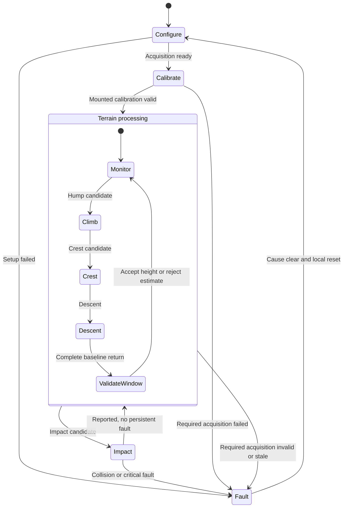

# Subsystem 4: Terrain and motion monitoring

**Owner:** Darrius. Parent: [architecture](../architecture.md) (Terrain task: core 1, priority 16, 20 ms; sensor evidence only, never writes motors). Requirements and pending decisions: [project specs](../project-specs.md#pending-decisions) (D06 covers IMU supply, axes/bias, filters, impact thresholds and the height method). Wiring and I2C ownership: [team](../team.md#2-pins). Motion partner: [subsystem 2](subsystem2.md). Telemetry: [subsystem 1](subsystem1.md).

## 1. Functionality

Read GY-511 (LSM303DLHC; I2C0, GP4 SDA / GP5 SCL) acceleration and magnetic data and combine them with coherent measured Motion feedback. Calibrate mounted axes and offsets, filter acceleration, then classify stationary, accelerating, turning, climbing, descending and impact. Publish timestamped terrain data; collision or critical acquisition faults notify Safety independently of diagnostic queues.

- The GY-511 has no gyroscope. Turn rate may be estimated from encoders and must be labelled as encoder-derived.
- Hump detection and a valid physical height are separate results. Retain the greatest valid run height; invalid estimates never overwrite it. Stopping retains the maximum; a new run clears it through Mission ([architecture](../architecture.md#subsystem-summaries)).
- No Terrain state writes motor outputs; classifications are reported observations.

## 2. States and responses



| State | Response |
| --- | --- |
| Configure / Calibrate | Configure cores, verify advancing coherent samples, mounted-axis and bias calibration |
| Monitor | Report movement/tilt; detect hump and impact candidates with validity |
| Climb / Crest / Descent | Accumulate a complete trajectory from pitch and measured travel |
| Validate Window | Accept only reference-validated estimates; a larger valid result updates the maximum. Incomplete, dynamic, slip or drift windows are discarded |
| Impact | Report promptly; collision or critical condition invokes Safety inhibition |
| Fault | Required acquisition unavailable/invalid/stale: independent critical notification. Height-only invalidity does not fabricate an acquisition fault |

## 3. Interfaces and contract

### 3.1 Provided (implemented per owner status; see section 5)

```c
uint32_t s4_terrain_word(void);   /* one-load terrain word; layout and accessors in terrain_pack.h */
```

The terrain word carries the last and maximum hump height codes, hump count, state (FLAT, CLIMBING, CRESTING, DESCENDING, IMPACT), height validity and calibration status. It is a word snapshot per [architecture](../architecture.md#shared-data-rules); the former `TerrainSnapshot` struct and its mutex were removed because nothing in firmware read them.

### 3.2 Consumed from S2 (proposed, not agreed)

Coherent measured counts, travel and speed (not requested duty or the bench latch). The owner proposes `s4_update_odometry(float delta_dist_m)` and/or `s4_update_motion_feedback(avg_speed_mps, delta_dist_m, turn_rate_dps)` called each 20 ms cycle, with a fallback to a nominal distance when encoder data is absent. The final shape must follow the encoder contract in [architecture](../architecture.md#encoder-contract) (each consumer keeps its own origin and uses modular subtraction); S2 has not agreed any of these signatures. Turn rate from differential wheel speed: (v_right - v_left) / track width; the owner estimates track width at about 0.13 m, unverified.

### 3.3 Safety path

On collision or critical acquisition failure S4 must reach Safety and S2 stop independently of diagnostic queues. The owner's note calls `s2_stop(S2_EMERGENCY_OBSTACLE)`; the S2 interface in [subsystem 2](subsystem2.md) documents `s2_stop()` and stop authority resides with Safety, so the call form is unresolved.

## 4. Data and fault bits

- Reported data: pitch, roll, calibrated acceleration, terrain/motion state, hump events, last and maximum valid height, validity flags. Packed telemetry form (heights packed to 7 bits with a defined scale and invalid code; working values 16-bit fixed point) is the target in [architecture](../architecture.md#subsystem-summaries). Only a valid completed encounter adds a hump event and may update the maximum.
- Fault byte (S4 owner): IMU fault, calibration failed, impact ([architecture](../architecture.md#fault-bitmask)). Bit positions are not specified in the sources merged here; Insufficient data to verify.
- Proposed snapshot additions: `turn_rate_dps` and `turn_rate_is_estimate`, to keep the encoder-derived label explicit.

## 5. Status

**Implemented (owner-reported 2026-10-13; not independently verified against source in this revision).** Owner states the baseline compiles, links and runs at 50 Hz on core 1 (priority 16, 2048 B stack):

- Register-level I2C0 driver at 400 kHz; accelerometer 0x19, magnetometer 0x1E; auto-increment multi-byte reads; 5 ms bus timeout returning false; accelerometer 100 Hz, +/-2 g high resolution; magnetometer 30 Hz.
- Startup calibration: 100 samples over 2.0 s for zero-bias; first-order IIR low-pass (alpha 0.20); pitch and roll from the gravity vector.
- Hump state machine FLAT, CLIMBING, CRESTING, DESCENDING (+/-3.5 degree entry, +/-2.0 degree return); height from the sum of sin(pitch) times travel times a geometric factor of 1.15; only a completed climb-crest-descent above 5 mm validates; greatest valid peak retained.
- Impact when horizontal deceleration exceeds 2.5 g while flat.
- A 5 Hz `[MQTT_XYZ]` bench telemetry string and `tools/simple_mqtt_server.py` dashboard.

The earlier architecture guide instead described the S4 lifecycle as an inactive placeholder, with the classifier and reference-validated height method proposed. The two accounts conflict; the thresholds above (3.5, 2.0, 5 mm, 1.15, 2.5 g) and the nominal 0.004 m per tick (0.20 m/s assumed cruise) are owner-reported, uncalibrated working values, not accepted limits. The historical stationary bench used acceleration 50 Hz, +/-2 g, high-resolution/BDU and magnetic 30 Hz, +/-1.3 gauss; neither configuration is accepted full-robot calibration.

**Proposed:** modules (driver with data-ready gating and overflow/age validity; calibration/filter with dynamic-acceleration guards; classifier; complete-window height/peak validator against reference humps; Motion feedback consumer). Motion classification thresholds suggested by the owner (stationary |A_y| < 0.08 g with wheel speed about zero; accelerating A_y > +0.15 g; braking A_y < -0.15 g; turning above 10 deg/s or |A_x| > 0.15 g) and an optional climb-time speed/torque advisory (+15 percent PWM to S2) are unvalidated proposals; the advisory would need S2/Mission agreement and must not bypass Motion's sole-writer authority.

## 6. Design rules

- Gravity-derived pitch/roll are valid only after mounting calibration and when acceleration is close to gravity; separate dynamic acceleration and magnetic disturbance from pose estimates.
- Height: accumulate vertical rise from calibrated pitch and encoder travel through the climb; map chassis rise to physical hump height with measured wheelbase/contact geometry and reference humps. Raw uncorrected double integration is not an established measurement.
- Reject slip, incomplete windows, excess dynamic acceleration and baseline drift. Keep movement classification, hump detection, valid height and acquisition health separate.
- I2C waits and retries are finite and must not block higher-priority control. Check for advancing sensor data; do not refresh a cached timestamp.
- Component addresses, registers, scales and electrical limits: manufacturer datasheets (not reproduced here).

## 7. Open items

- Record calibrated thresholds, model and limits in [project specs](../project-specs.md#pending-decisions) (D06), including whether the owner-reported working values hold on the mounted robot.
- Agree S2 encoder/motion-feedback interface and the stop call form; add turn-rate fields.
- Replace fixed per-tick distance with measured travel.
- Reconcile owner status with source (placeholder vs running baseline).
- Joint bench checks, results recorded in [S4 testing](../../testing/subsystem4/TEST_LOG.md): stationary pitch/roll near zero; straight drive travel versus wheel revolutions; turning direction and flag; hump pass FLAT, CLIMB, CREST, DESCENT, FLAT with reported peak against the reference (owner expects 60 mm +/- 15 mm for a 6 cm ramp, unconfirmed); impact tap triggers stop. Planned T06, T07, T14, T15 need labelled traces, measured reference humps and an invalid estimate after a valid maximum.
