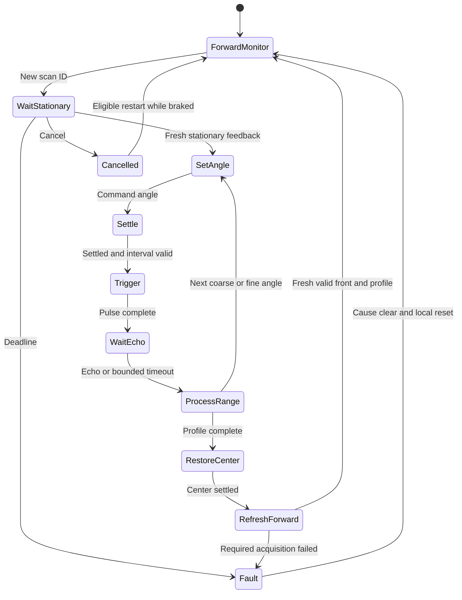

# Subsystem 5: Obstacle sensing and profiling

Owner: Jia Jing. Parent: [architecture](../architecture.md#subsystem-summaries); pins and peripherals in [team](../team.md); pending decisions in [project-specs](../project-specs.md#pending-decisions). Motion partner: [subsystem2](subsystem2.md).

## Functionality

- A servo (GP12, 50 Hz PWM) points the ultrasonic sensor; echo pulse timing gives range at a commanded angle. The echo ISR timestamps edges; the Obstacle task triggers (nominally every 60 ms) and processes results.
- Forward clearance has its own validity and time, separate from side samples and the scan profile.
- Mission stops the car, confirms measured stationarity and requests a scan. A coarse sweep selects regions for fine sampling. Obstacle reports closest point, width, location and left/right clearance. Mission owns bypass and original-line recovery movement.
- No echo is unknown, never infinite clearance. A commanded servo angle is not a measured angle. Side readings never refresh forward timestamps.

## Interfaces and contract

| Call / word | Contract (from `app_program/subsystem5/subsystem5.h`) |
| --- | --- |
| `s5_front_word()` | One load, any task. Bits 0-12 range mm (8191 invalid), bit 13 valid, bits 16-31 low 16 bits of sample ms. 0 before first reading. Layout provisional pending sign-off (#28, #54) |
| `s5_scan_request(id)` | Mission only; id 0-15. Honoured only while stationary; movement, cancel or deadline fails it. Duplicate IDs ignored |
| `s5_scan_cancel()` | Cancel wins over progress |
| `s5_scan_word()` | Bits 0-2 scan state (IDLE, SETTLING, COARSE, FINE, DONE, FAILED, CANCELLED, SIDE_WATCH), bits 3-6 scan id |
| `s5_profile_copy(&p)` | Copy under mutex; `E_OK` when the last scan completed, `E_OBJ` if none yet |
| `s5_side_watch(on, angle_deg)` / `s5_side_word()` | Hold servo at an angle (positive left) and range every release for the bypass leg; turning off recentres. Same word layout as front |

`ObstacleProfile`: closest angle and range, width, left/right clearance, nearest point forward/left of the reference point, valid flag. A profile is built only from 5..9 rays that are all valid and within the sweep limit; any missing ray (no echo) leaves the profile unknown.

Behaviour rules:

- Forward monitoring: invalid, missing or stale range inhibits movement.
- Scan: wait for fresh measured stationary feedback, set angle, settle without blocking, trigger, wait for echo or bounded timeout, process; coarse readings guide fine angles; restore centre and acquire a new valid front reading before any bypass. Cancellation, fault and deadline apply to every phase.
- Full request or duplicate ID reports failure; retries and whole-scan duration are finite.
- Profile is compared against measured car width, stopping distance, clearance margin and permitted course boundary; only a supported path authorizes a bounded bypass, otherwise stop.
- New obstacles preempt bypass; completed navigation leads to original-line reacquisition. Reverse or retry requires proven rear clearance; forward sonar does not supply that.
- A five-reading scan spaced above the conservative initial interval spans more than 240 ms from first to last trigger before settling; include this in the stationary scan deadline.

The diagram is representative; cancel, deadline and fault guards apply in every phase. The published scan word uses the smaller encoded set listed above.

## Data and fault bits

- Obstacle fault byte: bit 0 no echo, bit 1 servo fault (proposed positions, awaiting owner confirmation).
- Telemetry carries front range mm (13 bits plus valid); obstacle width is an event argument (mm) per [subsystem1](subsystem1.md).
- Sonar conversion constants and servo limits live in `robot_config.h`; hardware limits are in the project specs and team pin tables. Calibration values are pending.

## Status

| Item | State |
| --- | --- |
| Front range with echo ISR on the GPIO dispatcher, front word, `echo_range.h` | Code present |
| Servo driver (GP12 PWM), coarse/fine scan, side-watch, `s5_profile_copy`, profile builder and scan-state packing (`obstacle_profile.c`) | Code present; the servo scan was marked as following in issue #49 in the header comment, so completeness is not verified here |
| Calibrated servo angle mapping, settling time, trigger interval, car width and clearance margin | Not established |
| Bypass decisions and movement | Proposed; owned by Mission, not implemented here |
| Physical scan and bypass evidence | None claimed; see [S5 test log](../../testing/subsystem5/TEST_LOG.md) (planned T08-T10, T14, T15: no echo, scan freshness, cancellation, bypass, load) |

## Open items

- Confirm the S5 data rows and word layouts (#28, #54) and fault-bit positions.
- Calibrate servo angles, settling time, minimum trigger interval and sweep limit; measure car width and stopping distance.
- Agree the stationary feedback source with Motion (encoder counts, not brake acknowledgement alone).
- Agree command handover between Mission and Obstacle for bypass.
