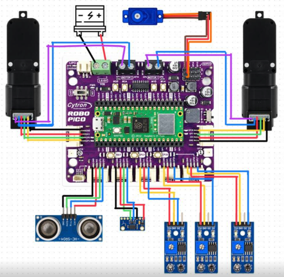
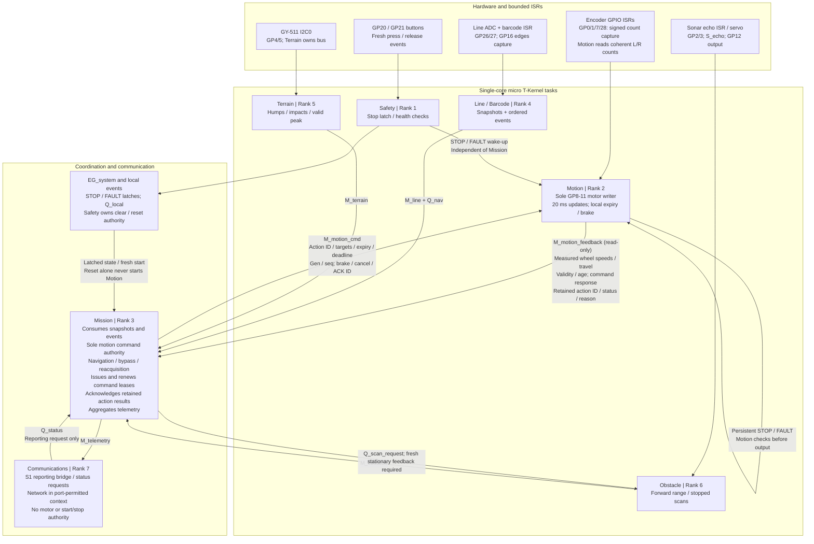
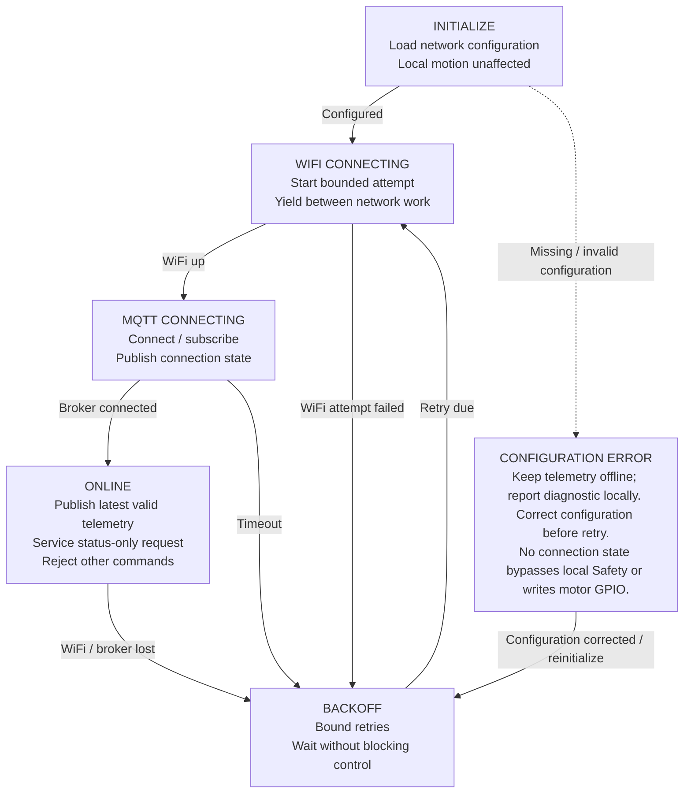
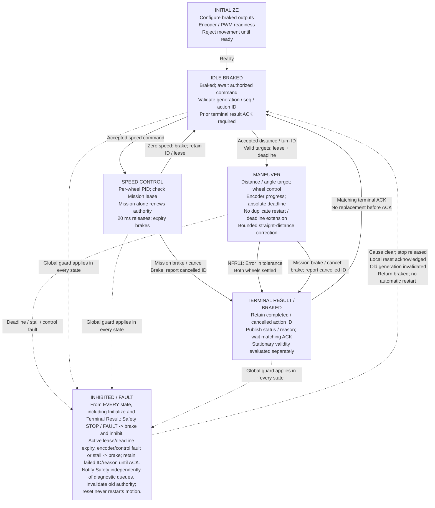
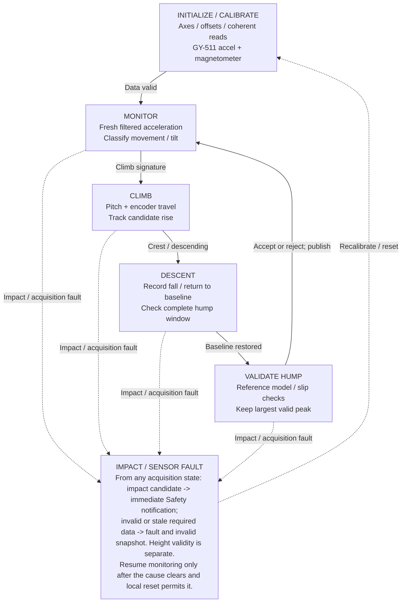
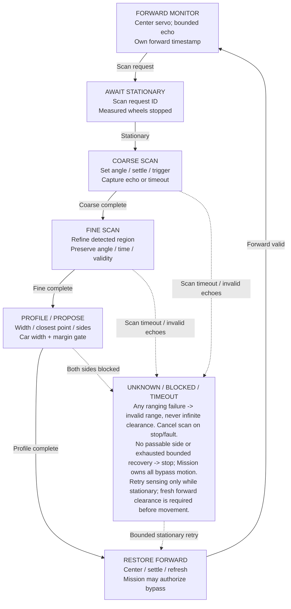

# Design Review

## Submission Detail

| Submission Detail | Student Entry |
| --- | --- |
| GROUP ID | CSC01 |
| GITHUB REPO LINK | https://github.com/shaun-ie/Autonomous-Robotic-Car |

## Team Role and Subsystem Ownership

| Buddy | Student ID | Primary subsystem / responsibility |
| --- | --- | --- |
| Shaun | 2500629 | WIFI/MQTT, telemetry, status-request validation, connection recovery and communications tests. |
| Mahesha | 2503973 | M1/M2 motor outputs, encoders, PID, distance/turn actions, braking, stall and motion tests. |
| Nicholas | 2501552 | Line/barcode sensing and decoding; integration owner; Mission and Safety task design and coordination. |
| Darrius | 2500360 | GY-511 processing, movement/terrain classification, impact detection and calibrated hump-height estimation. |
| Jia Jing | 2502825 | HC-SR04P/SG90 acquisition, obstacle scanning ,obstacle profiles, bypass proposals and line-recovery support. |

---

## 1. Requirements

### 1.1 Functional Requirements

| ID | Requirement | Tests |
| --- | --- | --- |
| FR1 | After a fresh local start in Ready, follow the black line autonomously using the two analogue IR observations; tolerate minor lighting, track and speed variation. | T03 |
| FR2 | Capture ordered black-bar and white-space widths; decode only complete, valid frames. Reject partial/unknown frames and queue each mapped navigation event once. | T04 |
| FR3 | The robot shall execute left, right, straight and U-turn actions using encoder-based motion control and explicit completion feedback, then acquire the commanded outgoing line branch. A timeout or motion fault shall stop the action and report failure. | T05 |
| FR4 | In Ready state, calibrate GY-511 zero offsets when stationary. During operation, filter acceleration and use motion context to classify stationary, accelerating, turning, climb or descent, and impact events. Turn-rate estimates shall be encoder-derived, not raw gyro readings. | T06 |
| FR5 | Estimate physical hump height from a reference-validated method and retain/report the greatest valid peak in the current run. Invalid estimates shall not replace a valid maximum. | T07 |
| FR6 | Maintain independent forward clearance. Invalid, missing or stale forward range shall inhibit movement until a fresh valid reading establishes clearance. | T08, T09 |
| FR7 | After an obstacle, stop and confirm stationary feedback; perform coarse and targeted fine servo-sonar scans. Estimate location, width, closest point and left/right clearance with validity. | T09 |
| FR8 | Authorize a bounded bypass only when the profile supports the vehicle envelope and clearance margin; minimize route departure. If no justified path exists, stop. | T10 |
| FR9 | After navigation, the robot shall perform bounded acquisition of the commanded outgoing branch. After bypass or recoverable line loss, it shall perform bounded recovery of the intended original route. Tracking shall resume only after stable reacquisition; Motion shall stop if the recovery deadline or travel limit is exceeded. | T10, T11 |
| FR10 | Publish timestamped MQTT mission/reason, measured speed/counts/distance, line/barcode, terrain/maximum valid hump, obstacle profile, validity/age and connection health. | T12 |
| FR11 | GP21, collision, stall, expired command or critical acquisition/task fault shall cause Motion to brake both motors and latch Stopped/Fault. Recovery requires cleared cause and local reset; reset alone shall not move the car. | T02, T06, T14 |
| FR12 | Subscribe to validated status requests only. Reject malformed or drive/start/stop messages. WiFi/MQTT loss shall not block healthy local autonomous operation or override Safety. | T12, T13 |
| FR13 | GP20 starts only from Ready after required data/configuration are valid. In Stopped/Fault it resets only to Ready after cause clearance; release and a separate new press are needed to start. | T02, T07 |

### 1.2 Non-Functional Requirements

| ID | Requirement | Tests |
| --- | --- | --- |
| NFR1 | Motion control shall have a nominal release period of 20 ms and complete each control update within 20ms of its scheduled release; record execution time and missed deadlines. Sonar, logging and networking shall not block it. | T15 |
| NFR2 | Safety shall check local controls and critical health every 10 ms, with event-triggered wake-up. Both motor outputs shall enter the configured brake state within 50ms of GP21 becoming active or a critical fault being raised. Physical stopping time and distance shall be measure separately. | T02, T15 |
| NFR3 | Mission, line ADC and Terrain shall use nominal 20 ms schedules. Barcode edges are captured by ISR, independently of periodic sampling. Initial required-sample age limit: 250 ms, to calibrate per signal. | T04, T14, T15 |
| NFR4 | Ranging shall have bounded echo waits and a conservative initial trigger spacing of more than 60 ms. Full coarse/fine scans shall only occur while stationary. settling and scan deadlines are to be measured on the installed HC-SR04P/SG90. | T08, T09 |
| NFR5 | Only Motion writes GP8-GP11. Boot, local stop, fault and command expiry shall brake both motor channels. Mission alone shall issue and renew command leases. Motion shall check expiry and shall not renew its own authority. Action IDs shall prevent repeated execution, and lease renewal shall not extend the absolute maneuver deadline. | T02, T05, T14 |
| NFR6 | Keep sensor GPIO/ADC and I2C highs within the Pico 3.3 V interface. Respect the carrier 300 mA aggregate Grove 3V3 budget and 1 A continuous / 1.5 A peak under 5 s per motor channel. Measure actual rails, logic highs and load currents. | T01 |
| NFR7 | Network processing shall be bounded and lower priority than local control. Publish nominal telemetry every 500 ms; no unavailable network call may stall Safety, Motion or Mission. | T12, T13, T15 |
| NFR8 | Every observation shall carry acquisition time, units and validity. Forward range, scan profile and height use separate validity/age. Latest-value updates shall not overwrite queued navigation events or clear stored run maximums. | T04, T07, T09, T14 |
| NFR9 | ISRs shall capture only bounded edge/count information and use suitable FromISR wake-up APIs. Fault notification shall remain effective if a diagnostic queue is full; queue overflow shall be detected. | T14, T15 |
| NFR10 | High-priority tasks shall block between work periods/events. Use bounded memory and finite queues/capture buffers; record stack high-water marks, heap usage and peak load before integration acceptance. Buffer capacities and memory/timing budgets require measurement. | T15 |
| NFR11 | Distance and turn actions shall use configured absolute deadlines and explicit completion guards. Completion shall require measured distance or angle error within the configured tolerance and wheel speed below the configured settling threshold for the configured settling interval. Stall detection shall use a minimum commanded-motion threshold, startup allowance and persistence interval. | T05, T10, T11 |
| NFR12 | All I2C0 communication with the GY-511 sensor shall use a non-blocking timeout bounded to ≤ 5 ms. An I2C bus error or unresponsive slave shall flag a sensor health fault without blocking the RTOS scheduler. | T14, T15 |
| NFR13 | Terrain task execution time (I2C read, filtering, and height/state math) shall not exceed 5 ms per 20 ms release period (CPU utilization ≤ 25%). | T15 |
| NFR14 | The motion subsystem shall meet documented acceptance limits for steady-speed error, forward/backward distance error, straight-line lateral drift, turn-angle error and repeatability over the agreed operating speeds, loads and course surfaces. Distance, drift and turn accuracy shall be checked against external references. Acceptance limits and the number of repeated trials shall be specified before verification and reported through T05. | T05 |

---

## 2. Hardware Integration Pin Layout

| Device / module | Type | Signal | Wire color / label | GPIO Port | Interface | RTOS Task Owner / Notes |
| --- | --- | --- | --- | --- | --- | --- |
| Power bank | Power | VIN+ / VIN- | Red / black | Green VIN + / - | Carrier supply | Shared power supply / Verify polarity, USB disconnected before power-bank usage |
| Left motor M1 | Actuator | M1A / M1B | Black / yellow | GP8 / GP9 control | H-bridge PWM | Exclusive control of the left motor channel. Uses left-wheel encoder feedback for speed regulation and turn actions. Verify forward polarity and loaded current. Stop, fault or command expiry selects the brake state. |
| Right motor M2 | Actuator | M2A / M2B | Black / yellow | GP10 / GP11 control | H-bridge PWM | Exclusive control of the right motor channel. Uses right-wheel encoder feedback for speed regulation and turn actions. Verify forward polarity and loaded current. Stop, fault or command expiry selects the brake state. |
| Right encoder | Sensor | B / A / supply / GND | Green / red / white / blue | Grove 1: GP0 / GP1 / 3V3 / GND | GPIO edge IRQ | Motion Task + encoder ISR. ISR captures bounded signed counts; Motion reads coherent count snapshots and calculates right-wheel speed and travel. Verify output voltage, A/B order, decoding convention and counts per wheel revolution. Forward wheel rotation shall produce positive counts. |
| Left encoder | Sensor | B / A / supply / GND | Green / red / white / blue | Grove 7: GP7 / GP28 / 3V3 / GND | GPIO edge IRQ | Motion Task + encoder ISR. ISR captures bounded signed counts; Motion reads coherent count snapshots and calculates left-wheel speed and travel. Verify output voltage, A/B order, decoding convention and counts per wheel revolution. Forward wheel rotation shall produce positive counts. |
| Right line IR | Sensor | AOUT / VCC / GND | Board labels | Grove 6: GP27 / 3V3 / GND | ADC0 | Line/Barcode / DOUT disconnected |
| Left line IR | Sensor | AOUT / VCC / GND | Board labels | Grove 5: GP26 / 3V3 / GND | ADC0 | Line/Barcode / DOUT disconnected and shared GP26 contact disconnected |
| Barcode IR | Sensor | DOUT / VCC / GND | Board labels | Grove 4: GP16 / 3V3 / GND | GPIO edge IRQ | Line/Barcode / AOUT disconnected |
| GY-511 | Sensor | SDA / SCL / Vin / GND | Board labels | Grove 3: GP4 / GP5 | I2C0 | Terrain / leave 3.3/INT/DRDY disconnected. Verify pull-ups and mounted axes |
| HC-SR04P | Sensor | Echo / Trig / VCC / GND | Board labels | Grove 2: GP2 / GP3 | Echo IRQ / trigger | Obstacle / confirm installed variant and echo HIGH <= 3.3V before connecting GP2 |
| SG90 | Actuator | Signal / supply / GND | Orange / red / brown | Servo 1: GP12 S / + / - | Servo PWM | Obstacle / Verify servo variant, supply voltage and settling time |
| Local start/reset | Input | Button event | Onboard button | GP20 | GPIO input | Safety / Validate fresh GP20 presses and send start/reset events to Mission |
| Local stop | Input | STOP latch | Onboard button | GP21 | GPIO input | Safety / GP21 triggers independent Safety-to-Motion stop path. Verify input polarity, debounce and stop response |
| Buzzer | Output | Feedback | Onboard GP22 | GP22 | PWM3 | Safety / 1: Chirp black, 2: Valid white; 3 Rejection; check mute switch |

### 2.1 Wiring Diagram



---

## 3. RTOS Task Table

| Task and owner | Purpose | Inputs | Outputs | Trigger | Application Priority Rank (1 = highest) |
| --- | --- | --- | --- | --- | --- |
| Safety<br>Mahesha | Latch stop/fault; validate local controls; monitor producer health. | GP20/21; independent fault notifications; heartbeats; Q_fault_safety | STOP notification to Motion; EG_system; Q_local; reset acknowledgements | 10 ms + fault/local event | 1 |
| Motion<br>Mahesha | Exclusively control motor outputs; estimate wheel speed and travel from encoders; regulate per-wheel speed; correct straight-distance motion; execute bounded distance/turn actions; brake on stop, fault or command expiry. | M_motion_cmd: mode, action ID, targets, command expiry and absolute action deadline; coherent signed encoder-count snapshots; Safety stop/fault wake-up; EG_system stop/fault latches. | GP8–GP11 motor-control outputs; M_motion_feedback: measured wheel speeds/travel, stationary validity, action ID/status and failure reason; persistent fault indication and bounded progress heartbeat. | Periodic release every 20 ms; complete each control update within 20 ms of its scheduled release. Stop/fault events wake Motion immediately. Block between releases/events. | 2 |
| Mission<br>Nicholas | Arbitrate line/navigation/obstacles; one motion authority; aggregate telemetry. | Latest observations; Q_nav; Q_local; Q_fault_mission; feedback; EG_system; Q_status | M_motion_cmd; Q_scan_request; M_telemetry; mission state | 20 ms + bounded event service | 3 |
| Line/Barcode<br>Nicholas | Sample ADC; decode complete barcode frames and preserve events. | GP26/27 ADC; GP16 captured edges; encoder count/speed snapshots | M_line; Q_nav; health/heartbeat; independent fault notification | ADC 20 ms; barcode capture IRQ | 4 |
| Terrain<br>Darrius | Read/calibrate GY-511; classify events; validate and retain peak. | I2C0 GP4/5; coherent motion context; reference-model parameters | M_terrain; impact/fault notification; heartbeat; valid maximum | 20 ms fresh-data polling | 5 |
| Obstacle<br>Jia Jing | Monitor forward clearance, perform stationary coarse/fine ultrasonic scans, estimate obstacle profiles, and recommend safe bypass directions. | GP2 echo capture / S_echo; Q_scan_request; stationary feedback; GP3/GP12 | M_obstacle; profile/forward validity; fault/health/heartbeat | Bounded range state machine; scan request | 6 |
| Communications<br>Shaun | WiFi/MQTT; bounded retries; publish and validate status requests. | M_telemetry; broker/network events; configuration | MQTT telemetry/heartbeat; Q_status; connection state | Network events; 500 ms telemetry | 7 |

### Priority and ownership justification

The table shows relative scheduling urgency among application tasks, rather than numerical kernel priorities. The proposed kernel priority assignments are listed below and remain subject to team confirmation.

Safety P12 has the shortest application stop target and independently wakes Motion P13. The proposed full mission then allocates Mission P14, Line/Barcode P15, Terrain P16, Obstacle P17 and S1 reporting bridge P20. Application tasks block between bounded work. Kernel USB/WiFi services have higher priorities on core 0; S1 cannot call network functions from an application task. The current bench combines Safety, Mission coordination and line acquisition in S3 P12, with S2 Motion P13. The changed priority bands/shared configuration are a revised proposal; teammate approval is not recorded.

Motion has higher scheduling precedence than Mission and the other application processing tasks, but lower precedence than Safety, because wheel-speed regulation, command expiry and braking require bounded response. Motion alone writes GP8–GP11. Mission issues and renews commands; Motion checks their leases and absolute action deadlines without extending them. Each periodic update reads coherent encoder counts, updates motion estimates and control outputs, and publishes feedback. A stop/fault event wakes Motion to select the brake state without waiting for Mission or the next periodic release. Motion blocks between releases/events, and an early stop wake-up does not shift its periodic schedule.

Motion release jitter, execution time, deadline misses, stack usage and encoder-capture load shall be recorded under representative peak load in T15. Each activation shall perform bounded work, and noncritical feedback or diagnostic publication shall not block motor control or braking. Missed releases shall be recorded and skipped rather than replayed as a burst of control updates. Encoder calculations shall use the actual elapsed measurement interval.

All subsystem objects are created before any application task starts. Deadline-based periodic work skips missed releases instead of replaying a backlog. The implemented watchdog is 250 ms and is fed only after valid IR acquisition and Motion output service both advance with age <=60 ms. Stalled progress prevents feeding; hardware reset returns to inhibited boot and empty RAM calibration. Deadline, reset and physical stopping behavior still require on-target measurement. Watchdog recovery is a separate fallback for stalled task progress and does not demonstrate compliance with the 50 ms stop-response requirements. Watchdog timeout, motor-output behavior through reset and physical stopping shall be verified separately on target.

---

## 4. Task Interaction Diagram



*Figure 2 Hardware tasks and proposed micro T-Kernel communication paths*

> **Notes on Figure 2:**
> Critical producers independently notify Safety; persistent fault state survives full diagnostic queues. Diagnostics: `Q_fault_safety` / `Q_fault_mission`. `M_` objects hold coherent latest values; terminal results persist until ACK. Ranks: 1 = highest application precedence. Dots join paths; bridged crossings do not. ISRs capture only; tasks interpret.

### 4.1 Communication Objects and Contracts

| Object | Producer and consumer | Data and Behavior | Failure / retention rule |
| --- | --- | --- | --- |
| M_line / M_terrain / M_obstacle | Sensor task -> Mission; health readers peek coherent snapshots | Length-one latest-value mailboxes; acquisition timestamp, sequence, units, validity. Profile and forward range have separate timestamps. | Overwrite snapshots only; never encode one-shot navigation solely here. |
| Q_nav | Line/Barcode -> Mission | FIFO event: event ID, symbol, mapped action and acquisition time. Consume once; accept only in relevant mission context. | No overwrite. Full/capture overflow -> fault; purge obsolete events on reset/action completion. |
| M_motion_cmd | Mission -> Motion | Coherent latest-value command containing run generation, command sequence, action ID, mode, bounded targets, speed limits, issue/expiry times, absolute action deadline and completion acknowledgement ID. Modes support braking, wheel-speed control, distance movement, angle turns and cancellation. Mission alone issues and renews commands. | Reject stale, expired, wrong-generation or invalid requests without executing them. Active lease expiry brakes locally. Renewing a distance/turn action preserves its ID, target and absolute deadline. Brake/cancel requests remain published until acknowledged. Safety STOP/FAULT latches override every command. |
| M_motion_feedback | Motion → Mission, Terrain, Line/Barcode and Obstacle | Coherent read-only snapshot containing acquisition time, sequence, validity, signed encoder counts, measured wheel speeds/travel, ready/stationary validity, active action ID/status, command acceptance/rejection result, and retained terminal action ID/status/reason. | Completed, cancelled and failed results persist until Mission explicitly acknowledges the matching action ID. Measurement updates shall not erase unacknowledged results. Other readers cannot consume or clear the snapshot. Invalid or stale feedback cannot establish stationary motion or successful completion. |
| Q_scan_request | Mission -> Obstacle | Bounded request ID, region/mode and deadline; enter scan only after fresh measured stationary feedback. | Duplicate ID ignored; stop/fault cancels; full queue reports failure rather than blocking control. |
| S_echo / capture buffer | Echo ISR -> Obstacle; barcode ISR -> Line/Barcode | Binary semaphore wakes echo processing; buffer holds coherent edge timestamp/count records. Encoder ISR updates bounded counters. | Only bounded capture and interrupt-context-safe wake-up mechanisms permitted by the selected micro T-Kernel port; interpretation occurs in tasks; capture overflow is flagged. |
| Fault notification + Q_fault_safety / Q_fault_mission | Each critical producer -> Safety; copies -> separate diagnostic consumers | Persistent producer fault state plus direct notification; source, time, code and diagnostic context copied independently. | Safety stop does not depend on either queue; full diagnostics latch/report overflow. Mission also observes EG_system. |
| EG_system / Q_local | Safety -> Motion and Mission | Safety-owned STOP/FAULT latches; validated fresh local start/reset events. GP20 reset clears eligible latches only after cause clearance. | No network clear. Stop remains dominant; held button cannot cause reset then start. |
| M_telemetry / Q_status | Mission -> Communications; validated status request -> Mission | Latest structured mission snapshot; request only asks for refreshed reporting. Invalid values represented with validity/null, not fabricated zero. | Telemetry may replace older snapshot. Status backlog is bounded/rate-limited; never changes motion. |
| Health snapshots / heartbeats | Each producer -> Safety | Coherent progress timestamp and availability. Heartbeat advances after meaningful bounded work, not merely a stuck loop. | Expired critical health while moving -> fault. Expected stationary scan gaps are governed by scan deadline. |

Motion validates each command before producing a nonzero output. For an active distance/turn action, lease renewal preserves the target and absolute deadline; a different motion action is rejected until the current action completes or cancellation is acknowledged. Wheel-speed targets may be updated within the active speed-control action while retaining its identity and configured limits. Mission keeps brake/cancel requests published until Motion acknowledges them and does not issue replacement movement before acknowledging the prior action’s terminal result. Duplicate requests do not restart actions. Safety stop/fault always overrides this handshake.

### 4.2 Shared Data and Resource Rules

All distances/heights are meters, wheel speed is meters/second and positive forward, and angles are degrees. Line error is negative left and positive right. Record acquisition time using a monotonic clock; compare elapsed times with wrap-safe arithmetic. A cached value is not made fresh by reading it again.

Motion alone writes GP8–GP11 and owns motor PWM, encoder-derived control and braking. Safety independently requests stop/fault service and owns the persistent STOP/FAULT latches. Motion checks these latches, the active command lease and action deadline before every motor-output update. A stop/fault wake-up selects the brake state without waiting for Mission or diagnostic publication. Motion faults remain visible to Safety even when diagnostic queues are full. Local reset invalidates previous command generations and does not itself authorize movement.

A collision/critical producer fault sets persistent source state and notifies Safety independently of diagnostic queue insertion. Safety latches EG_FAULT and notifies Motion; Motion checks the latch and lease locally before output updates. Event/diagnostic queues have finite capacities and bounded producers. Queue sizes, capture depth, ISR load, command lease and stack budgets are to be measured before integration.

Command and feedback records are fixed-size latest-value snapshots copied using bounded synchronization supported by the selected micro T-Kernel port. Reads and writes shall not expose partially updated records. The encoder ISR performs bounded signed-count capture only; Motion takes coherent left/right count snapshots and calculates speed and travel using the actual elapsed measurement interval. Stationary validity requires fresh, valid feedback showing both wheel speeds below their configured thresholds for the configured settling interval. A zero target or one interval without encoder edges is insufficient by itself.

### 4.3 MQTT Reporting and Subscription

Publish mission state/reason, requested versus measured motion, encoder counts/distance, line/junction/barcode, hump events and maximum valid height, forward range/scan profile, validity/age and connection health. A status request asks Mission for a fresh reporting snapshot; it never becomes a navigation or motor command. An illustrative permitted request is `{"request":"status"}`; drive/start/stop and malformed messages are rejected. Motion telemetry shall distinguish requested targets from measured wheel speeds/travel and shall report action ID/status, failure reason and feedback validity/age. Communications reads reporting snapshots only, MQTT messages cannot write motor outputs, renew motion leases, cancel actions or clear Safety latches.

During WiFi/broker loss, record connection health and continue local autonomy only while required sensing/control remains healthy. Reconnection yields between bounded work, then publishes current state rather than replaying old commands. Credentials remain outside version-controlled source. Broker endpoint, network, authentication/transport, final topic names, payload bounds and retry/heartbeat limits require configuration and verification by Shaun.

---

## 5. System-Level State chart

```mermaid
flowchart TD
    Init[INITIALIZING<br>Motor outputs braked<br>Check subsystem readiness]
    Ready[READY<br>Zero demand<br>Wait for fresh GP20 press]
    Follow[FOLLOW LINE<br>Steer from valid line data<br>Monitor forward clearance]
    Nav[NAVIGATION<br>Execute mapped action<br>Encoder completion / timeout]
    Scan[OBSTACLE SCAN<br>Request stop; await stationary<br>Coarse / fine profile]
    Bypass[BYPASS<br>Bounded encoder motion<br>Require fresh front clearance]
    Reacquire[REACQUIRE LINE<br>Bounded search<br>Require stable original line]
    Complete[COMPLETE<br>Zero demand<br>Report run maximum]
    Stopped[STOPPED<br>GP21 / blocked route / recovery exhausted: brake]
    Fault[FAULT<br>Critical fault / collision / command expired: brake]

    Init -->|Healthy| Ready
    Ready -->|GP20| Follow

    Follow -->|Obstacle priority| Scan
    Follow -->|Valid queued barcode<br>[no obstacle]| Nav
    Follow -->|"Line lost:<br>bounded search"| Reacquire

    Nav -->|Action complete| Reacquire
    Scan -->|Valid passable profile| Bypass
    Bypass -->|Done| Reacquire
    Reacquire -->|Stable line| Follow

    Follow -.->|Confirmed finish only| Complete
    Complete -.->|GP20 reset<br>Finish rule unresolved| Ready

    Stopped -.->|"GP20 reset [cause clear; stop released]"| Ready
    Fault -.->|"GP20 reset [cause clear; stop released]"| Ready

    subgraph GlobalGuards["From every operating state:"]
        direction TB
        G1["GP21 -> STOPPED"]
        G2["Critical fault -> FAULT"]
        G3["Motor demand stays zero"]
        G4["Obstacle in NAV / BYPASS / REACQUIRE -> stop, then SCAN"]
    end
```

*Reset returns to READY. Release GP20, then press again to start; network messages cannot start motion.*

*Figure 3 Proposed mission states with local start reset stop and bounded recovery*

Safety guards apply to every operating state, including initialization/readiness. GP21 or a deliberately exhausted/blocked recovery enters Stopped; collision, stall, command expiry or critical data/task failure enters Fault. Both latch brake demand. A finish transition is conditional on the course rule, not a substitute for a stop-button press.

Mission owns mission-state transitions and alone issues and renews motion commands; Motion alone writes GP8–GP11. Movement requires an accepted command from the current run generation, an unexpired lease, an unexpired action deadline where applicable, valid required motion feedback and clear Safety STOP/FAULT latches. Before replacing an active action, Mission retains a brake/cancel request until Motion acknowledges termination, records and acknowledges the matching terminal result, and only then issues replacement movement. Safety stop/fault overrides this handshake and causes Motion to brake without waiting for Mission. These rules apply in every state; reset invalidates earlier commands and does not authorize movement.

### 5.1 State Guards and Recovery Behavior

| State | Entry / ongoing behavior | Exit guard or failure path |
| --- | --- | --- |
| Initializing | Brake before hardware setup; check drivers, calibrated configuration and fresh observations. | Ready when required subsystems are usable; acquisition/critical health failure -> Fault. |
| Ready | Zero demand; fresh line, front clearance, terrain and motion feedback required for start. | New GP20 press -> Follow Line only after all gates pass. |
| Follow Line | Use signed line error and measured wheel control; terrain/telemetry continue alongside. | Obstacle first -> Scan; valid mapped barcode -> Navigation; recoverable line loss -> Reacquire. |
| Navigation | Issue one ID-bound encoder action; retain command context until completion. | Done feedback -> Reacquire; obstacle preempts to Scan and cancels prior action; timeout -> Fault. |
| Obstacle Scan | Stop request; require measured stationary before servo movement; scan with bounded deadline. | Valid passable profile, sensor restored forward and verified clearance for the first bypass segment → Bypass. |
| Bypass | Bounded encoder action with verified envelope, forward clearance and permitted course boundary. | Action done -> Reacquire; new obstacle -> stationary Scan; unsafe/missing required data -> Fault. |
| Reacquire Line | Low-speed bounded search using valid line readings and current forward clearance. | Stable expected branch/route identification → Follow Line. |
| Stopped / Fault | Brake; retain reason; reject stale actions; report state. | Cause clear, stop released and fresh GP20 reset -> Ready only; subsequent fresh GP20 starts. |
| Complete | Brake and publish final maximum valid hump/state. | Entry requires an instructor-confirmed finish rule; local reset starts a new run only through Ready. |

All motion transitions follow the command validation, cancellation and terminal acknowledgement rules in Section 4. Completion refers to the matching active action ID. Scanning requires fresh valid stationary feedback. Reacquisition targets the commanded outgoing branch after navigation, or the intended original route after bypass or line loss.

Arbitration order is local stop/critical fault, required data/command validity, obstacle handling, barcode/navigation, then ordinary steering. A barcode read during bypass/recovery is logged but cannot silently preempt the recovery maneuver; stale or context-mismatched queued events are discarded with a reason. Original-line confirmation must distinguish an intended recovery from an unrelated crossing. Retain the last run maximum while stopped; clear it only when a fresh Ready-to-Follow Line start begins a new run.

Retain the expected branch/route, active action ID, progress and remaining recovery bounds across obstacle preemption. Cancelled targets are not replayed automatically; Mission reassesses the retained intent before issuing a new action ID. The overall recovery deadline/travel budget shall not restart after each scan or command renewal. Unjustified continuation or healthy recovery-budget exhaustion enters Stopped; active Motion deadline expiry, stall or lease expiry enters Fault. Cancellation/acknowledgement waits are bounded; timeout causes Fault and maintains braking.

---

## 6. Subsystem Statecharts

### 6.1 Subsystem Statechart 1

| Field | Entry |
| --- | --- |
| Subsystem name | WiFi and MQTT communications |
| Related RTOS tasks | Communications Task |
| Purpose | Publish valid telemetry, service status-only requests and restore connectivity without delaying local control. |
| Reason a statechart is needed | Connection attempts, timeouts and asynchronous loss have history-dependent behavior, requiring explicit nonblocking retries. |



*Status request: validate request and payload bound; respond with a snapshot. No drive / start / stop subscription.*

*Figure 4 Communications statechart*

Initialization loads approved configuration. Bounded WiFi and MQTT attempts lead to Online; loss/timeouts enter Backoff. A configuration error leaves reporting offline until corrected. Online accepts only validated status requests. Local stop/fault never depends on network state.

---

### 6.2 Subsystem Statechart 2

| Field | Entry |
| --- | --- |
| Subsystem name | Motor and encoder motion control |
| Related RTOS tasks | Motion Task and encoder ISR |
| Purpose | Own all motor writes; close per-wheel speed loops and complete bounded distance/turn actions. |
| Reason a statechart is needed | Commands persist over time and must complete, expire or fail without conflicting motor writers. |



*Motion alone writes GP8-11. Brake: A = LOW, B = LOW. Mission alone renews leases.*
*Zero demand / cancellation is not proof of stationary motion; measure physical stopping separately.*

*Figure 5 Motor and encoder motion statechart*

Initialization configures braked outputs and validates encoder/PWM readiness before accepting movement. Mission alone issues and renews command leases; Motion checks command validity, lease expiry and absolute action deadlines before applying outputs. Speed Control regulates measured per-wheel speed. Maneuver executes a bounded distance/turn target without restarting on duplicate requests or extending its deadline on renewal. Completion requires the NFR11 error and settling guards. Brake/cancel terminates the active action and publishes its matching terminal ID/status; terminal results remain visible until Mission acknowledges them under Section 4. A zero-speed update within an ongoing speed action commands brake while retaining its identity and lease. From every state, Safety stop/fault inhibits outputs. Active expiry, stall or encoder/control failure brakes both H-bridges and reports failure independently of diagnostic queue availability. Local reset invalidates earlier command generations and does not itself authorize movement.

Motion reads coherent signed left/right count snapshots. For each wheel, interval travel is $\Delta s = \pi D \Delta N / C$ and measured speed is $\Delta s / \Delta t$, using calibrated effective diameter $D$, decoded counts per wheel revolution $C$ and actual elapsed time $\Delta t$. Estimated centre travel is $(\Delta s_L + \Delta s_R) / 2$. Estimated turn angle follows the declared differential-drive geometry and sign convention. Capture the action baseline once on acceptance; validate estimates against external references.

Document PWM saturation, anti-windup, filtering and acceleration/deceleration limits. Safely reinitialize controller history on action changes, reversal, braking and inhibition. Safety braking bypasses normal target ramps. Motion applies bounded left/right travel correction during straight-distance actions; Mission supplies line-based steering targets.

Stationary validity requires fresh valid feedback and both wheel speeds below their configured thresholds for the settling interval. Zero demand or one interval without edges is insufficient. Stall detection evaluates each wheel after the startup allowance, using a minimum commanded-motion threshold and persistent insufficient encoder progress.

---

### 6.3 Subsystem Statechart 3

| Field | Entry |
| --- | --- |
| Subsystem name | IR line tracking and barcode decoding |
| Related RTOS tasks | Line/Barcode Task, ADC and barcode edge ISR |
| Purpose | Publish line error/junction validity and ordered one-shot navigation events without controlling motors. |
| Reason a state chart is needed | Line observation and barcode framing progress concurrently; partial frames, losses and duplicate reads need different handling. |

```mermaid
flowchart TD
    subgraph Line observation region
        L_Ready[CALIBRATE / READY<br>GP26 / GP27 black-white ranges]
        L_Track[TRACKING<br>Sample two analogue channels<br>Publish signed error / junction]
        L_Lost[LINE NOT DETECTED<br>Publish detected=false<br>Mission owns recovery motion]
        L_Fault[SENSOR FAULT<br>Invalid / stale acquisition<br>Notify Safety; mark invalid]

        L_Ready -->|Calibration valid| L_Track
        L_Track -->|Valid sample; line absent| L_Lost
        L_Lost -->|Line restored| L_Track
        L_Ready -.->|Fault| L_Fault
        L_Track -.->|Fault| L_Fault
        L_Lost -.->|Fault| L_Fault
        L_Fault -->|Reset / recalibrate| L_Ready
    end

    subgraph Barcode decode region
        B_Wait[WAIT QUIET ZONE<br>Ignore partial / repeated symbol]
        B_Capture[CAPTURE FRAME<br>ISR stores edges only<br>Task derives bar + space widths]
        B_Decode[DECODE / VALIDATE<br>Complete widths / framing<br>Configured symbol mapping]
        B_Queue[QUEUE EVENT<br>Q_nav: sequence / timestamp<br>Emit once; overflow -> fault]

        B_Wait -->|Valid frame start| B_Capture
        B_Capture -->|Frame complete| B_Decode
        B_Capture -.->|Capture timeout| B_Wait
        B_Decode -->|Known mapped symbol| B_Queue
        B_Decode -.->|Malformed / timeout| B_Wait
        B_Queue -->|Enqueued; rearm after quiet zone| B_Wait
    end
```



*Regions run together. Latest line snapshots never overwrite Q_nav events; no ISR or sensor task turns the car.*

*Figure 6 Concurrent line-observation and barcode-decoding state regions*

Calibrated line observations continue while the barcode region waits for a quiet zone, captures both bar and space widths, validates the frame and queues one event. ISR capture is short; task-level decoding uses encoder travel or speed compensation. Latest line mailboxes never overwrite Q_nav. Capture/event overflow faults explicitly. Line absence is distinct from invalid sensing; Mission owns any search motion.

---

### 6.4 Subsystem Statechart 4

| Field | Entry |
| --- | --- |
| Subsystem name | GY-511 terrain monitoring |
| Related RTOS tasks | Terrain Task with coherent Motion feedback |
| Purpose | Classify movement and humps/impacts, then retain the highest separately validated height estimate. |
| Reason a statechart is needed | Climb, crest, descent and baseline return form a time sequence; a single acceleration sample cannot establish a hump peak. |



*Height estimator and event thresholds require reference tests. No gyroscope; turn rate is encoder-derived.*

*Figure 7 Terrain classification and hump-validation statechart*

Configure fresh coherent GY-511 samples, calibrate mounted axes/offsets and filter acceleration. Monitor separates ordinary movement from climb/descent signatures; impact candidates notify Safety promptly. Validate a complete hump window before updating the run maximum. Derived turn rate uses encoder motion context, not a nonexistent gyroscope. Height failure alone invalidates that estimate; failure of required terrain acquisition causes a fault.

Candidate height method: accumulate vertical rise from calibrated pitch and encoder travel over the climb using $\text{Rise} = \sum \sin(\theta_{\text{pitch}}) \cdot \Delta d$, then map chassis rise to physical hump height using measured wheelbase/contact geometry ($K_{\text{geom}}$) and reference humps. Reject slip, incomplete windows, climb timeouts (> 2 s without forward travel), excessive dynamic acceleration or baseline drift. It is not yet a validated height measurement.

---

### 6.5 Subsystem Statechart 5

| Field | Entry |
| --- | --- |
| Subsystem name | Servo-mounted ultrasonic obstacle sensing |
| Related RTOS tasks | Obstacle Task and echo ISR |
| Purpose | Maintain fresh forward clearance and produce stationary coarse/fine profiles and safe-path proposals. |
| Reason a statechart is needed | Servo settling, echo waiting and scan progression take time; explicit states keep them bounded and distinct from control. |



*Servo settling, scan deadline, vehicle width, margins and acoustic timing require calibration.*

*Figure 8 Servo ultrasonic acquisition and profiling statechart*

Forward Monitor maintains its own timestamp. Mission requests a scan after a stop; Obstacle waits for fresh measured stationary feedback, then steps through angle/settle/trigger/echo phases. Coarse results guide fine scans. The resulting obstacle profile estimates obstacle location, width, closest point, and left/right clearance, with validity flags for each measurement. Restore center and refresh forward range before Mission authorizes bypass. No echo means unknown, never clear space. Mission owns bypass/reacquisition movement; Obstacle reports proposals and progress.

---

## 7. Assumptions

Open validation does not imply a measured pass. The following assumptions have named owners and a defined means of checking them before dependent behavior is enabled. Each buddy has at least one entry. Red wording remains unverified.

| ID | Assumption | Risk if wrong | Validation method | Owner | Status |
| --- | --- | --- | --- | --- | --- |
| A1 | WiFi/MQTT recover within the configured target. | Telemetry unavailable or stale. | Disable AP/broker; record reconnect time and control timing over repeated trials. | Shaun | Needs validation |
| A2 | Decoded counts, direction and bounded encoder capture are reliable across the intended speed range, including low-speed motion and reversal. | Wrong motion estimates and barcode widths. | Compare counts with wheel revolutions at several speeds; declare counting convention. | Mahesha | Needs validation |
| A3 | Mounted IR provides contrast and complete frames. | Line loss, missed or duplicate commands. | Record black/white ranges, raw edges and both barcode scales across lighting/speeds. | Nicholas | Needs validation |
| A4 | Pitch/travel supports calibrated hump height. | Slip, chassis pitch or drift gives false height. | Measure reference humps/geometry; repeat climbs/descents; compare errors/rejection flags. | Darrius | Needs validation |
| A5 | Sonar profiles suit the actual obstacles. | False clearance or unsafe side selection. | Check known distances/widths/angles; test oblique surfaces, no echo and blocked sides. | Jia Jing | Needs validation |
| A6 | Record motor/servo load transients during starts and permitted reversals; verify loaded rails/current remain within board/driver limits and no brownout or encoder corruption occurs. | GPIO damage, brownout or invalid readings. | Identify boards; measure output highs before GPIO connection and loaded rails/currents. | Nicholas; all owners | Needs validation |
| A7 | Grove adapters and unused contacts match design. | GP26 contention; GP28 battery conflict. | Power-off continuity/silkscreen check; inspect unused Grove 6 GP26 and open GP28 jumper. | Nicholas / Mahesha | Needs validation |
| A8 | Barcode mapping/orientation and junction offsets are confirmed. | Valid-looking frame causes wrong turn. | Obtain instructor specification; compare A/Z samples with actual course symbols. | Nicholas | Course pending |
| A9 | Course area permits bypass and original-line recovery. | Collision, out-of-bounds or wrong-line travel. | Measure car/course; agree area/margins; repeat bypass/reacquisition trials. | Jia Jing | Course pending |
| A10 | Finish rule and hump reference/error criteria are specified. | Premature finish or unjustified height. | Confirm course/assessment rules; measure reference humps; agree error limits. | Nicholas / Darrius | Course pending |
| A11 | For Motion, record 20 ms release timing, execution/jitter/deadline misses and encoder capture load; verify the NFR2 50 ms normal stop/fault output target under representative peak load. | Old data or delayed brake response. | Instrument outputs/WCET; force retries, scans and bursts; log deadline misses. | Nicholas; all owners | Needs validation |
| A12 | Test active lease expiry, old-command rejection after local reset, and a stalled Motion/watchdog reset; verify inhibited boot, brake outputs and no automatic restart. Measure watchdog fallback latency separately from normal stop response and physical stopping. | Held input restarts motion; stop delayed. | Check polarity/debounce; test held GP20, GP21 dominance, reset-only and new start. | Nicholas / Mahesha | Needs validation |
| A13 | Effective wheel diameters/separation and bounded slip permit the configured controller to meet NFR14 across agreed speeds, loads and surfaces. | Encoder capture does not prove accurate ground distance, heading or straight travel. | Calibrate geometry; repeat forward/backward distances, left/right turns and U-turns against external references. Measure speed error, drift and repeatability using agreed acceptance limits and repetition counts. | Mahesha | Needs validation. |

---

## 8. AI-Supported Design Evidence

### 8.1 Pre-Submission AI Ideation

This evidence records a shared project review using Codex on 5 October 2026, initiated and clarified by Nicholas. It does not claim five independent buddy conversations. Nicholas asked AI to read all Markdown files, inspect the DOCX and supporting documents, clarify assumptions and plan a fully completed submission. The team then selected the proposed design options through Nicholas. Subsequent motion-specific AI-assisted review by Mahesha refined command ownership, completion/cancellation, stationary feedback, encoder/control assumptions and planned verification.

| Buddy | Actual shared AI discussion | Useful ideas | Weak or unsuitable ideas identified | Selected design decision |
| --- | --- | --- | --- | --- |
| Shaun | Shared review of telemetry, subscription and network-loss policy. | Bounded low-priority network task; continue healthy local autonomy; status-only subscription. | Older notes permit remote start/stop, conflicting with the selected autonomous design. | Select status requests only; no remote movement or latch clearing. Reconnect validation remains open. |
| Mahesha | Shared review of motion ownership, encoder actions and stop behavior. | Single motor writer; command lease; persistent action completion; distinct reset and start. | Assuming skeleton motor_stop physically brakes, or assuming zero requested speed proves stationary. | Motion alone writes GP8–GP11 and checks Mission-issued leases/deadlines. Require measured completion/stationary feedback, retained terminal results and matching acknowledgement. External-reference accuracy and braking trials remain planned. |
| Nicholas | Shared review of line/barcode data flow and course uncertainties. | Separate latest line snapshots from Q_nav FIFO; capture both bar and space widths. | An overwrite mailbox can lose one-shot barcode events; A/B/C/D examples are not a final mapping. | Queue validated events once; keep course mapping/orientation in red pending confirmation. |
| Darrius | Shared review of GY-511 sensing capability and hump method. | Separate detection from height validity; propose reference-calibrated pitch plus travel. | Treating yaw_rate_dps as a raw gyro reading, or pitch-based chassis rise as already proven hump height. | No gyro claim; derive turn rate from encoders; validate height geometry against reference humps. |
| Jia Jing | Shared review of stopped scans, sonar freshness and bypass guards. | Confirm stationary; coarse/fine profile; restore current forward clearance before motion. | Side samples can falsely refresh front range; no echo cannot mean infinite clearance. | Independent front/profile age; unknown/blocked path inhibits movement; bounded recovery only. |

### 8.2 Team-Reviewed Architecture Freeze

| AI or initial idea | Team decision | Engineering reason | Affected artifact |
| --- | --- | --- | --- |
| Single-core micro T-Kernel with bounded application tasks and network execution in the context permitted by the selected port. | Accepted | Aligns with the selected RTOS, makes task ownership and scheduling precedence explicit, and avoids initial multicore synchronization complexity. | Sections 3–6; Figures 2 and 5. |
| Motion owns all GP8-GP11 writes; Mission owns normal arbitration | Accepted | Prevents conflicting actuator writers and makes expiry/braking auditable. | FR3, FR11; Section 4 |
| Safety application rank 1; Motion rank 2; independent stop/fault wake-up and persistent latches. | Accepted | Stop does not wait for Mission or a diagnostic queue. High-priority tasks block between work. | NFR2, NFR9; Figures 2-3 |
| GP20 local start/reset; GP21 local stop | Accepted | Reset returns to Ready; separate fresh press starts. Held input cannot restart. | FR11, FR13; Figure 3 |
| Latest sensor mailboxes plus separate Q_nav events | Accepted | Latest values can overwrite safely; one-shot navigation must survive until consumed. | NFR8; Section 4.1 |
| Network loss continues healthy local autonomy; status-only subscription | Accepted; remote drive/start/stop rejected | Telemetry unavailability must not override local autonomy or stopping. | FR10, FR12; Figure 4 |
| Pitch plus encoder travel as candidate hump-height model | Accepted as proposed method | Uses available sensing but requires chassis/reference calibration and explicit validity. | FR4-FR5; Figure 7; A4 remains open |
| Stationary full scans; separate forward freshness; blocked path stops | Accepted | Avoids motion-distorted scans and unjustified clearance. | FR6-FR9; Figure 8 |
| Unknown course/electrical/calibration facts remain red | Accepted | Prevents guessed specifications or planned values being described as verified results. | Section 7; validation pending |

### 8.3 Final AI-Vetted Gap Check

Reviewer scope applied: act as a strict embedded-systems reviewer of the proposed Pico WH/Robo Pico design. Check requirements, pin allocation, RTOS/task data flow, all statecharts, assumptions and evidence for unsafe paths, missing interfaces, queue loss, timing/resource conflicts and unjustified recovery. This is a document/design audit; no hardware tests were performed.

Responses use the template categories. Fixed means the gap is resolved in the proposed design text; it does not claim a working driver or measured guarantee. Needs validation identifies an explicit remaining engineering test.

| AI-identified gap | Team response | Action taken in design | Evidence or remaining reason |
| --- | --- | --- | --- |
| Competing motor writers / network motion authority | Fixed | Motion alone writes GP8-GP11; Mission supplies one target; status subscription has no motion path. | FR11-FR12; NFR5; Figures 2, 4-5. |
| Held start or reset may restart a stopped car | Fixed | Safety validates releases/fresh presses. Reset clears eligible latches to Ready only; a separate press starts. | FR13; Figure 3; T02. |
| Barcode event lost in latest-value overwrite | Fixed | Separate Q_nav FIFO, sequence/context/age checks and explicit overflow fault; line snapshots remain latest-only. | Section 4.1; Figure 6; T04/T14. |
| Fault queues can lose events or compete between readers | Fixed | Independent direct notification/persistent source state; separate diagnostic copies; latch remains visible to Mission. | NFR9; Section 4.1; T14. |
| Control deadline blocked by sonar or network work | Needs validation | Bounded acquisition/network states and yielding schedules; measure worst case, missed deadlines and stop timing. | NFR1-NFR4/NFR7; T15 has no measured result yet. |
| Motor command expiry and action completion undefined | Fixed | Mission alone issues/renews commands. Motion checks validity, lease expiry and absolute deadlines. Completion uses measured error and settling guards. Completed, cancelled and failed results retain their action ID/status/reason until matching acknowledgement; duplicates do not restart actions. | Section 4.1; Figure 5; lease/limits need calibration. |
| Side scan refreshes old forward range; zero target mistaken for stationary | Fixed | Separate front/profile timestamps; require fresh measured stationary feedback; restore center before bypass. | FR6-FR8; Figure 8; T09. |
| GY-511 gyro or hump-height capability overstated | Partially fixed | No raw gyro; encoder-derived turn rate. Height validity separate; candidate pitch/travel model has reference checks. | Section 6.4; A4/T07 still require validation. |
| Shared GPIO and supply compatibility unverified | Needs validation | Intended map resolves GP26/GP28/Maker sharing in design; require silkscreen/continuity/voltage/current checks. | Figure 1; A6-A7/T01 remain unverified. |
| Final barcode/course finish/bypass rules unknown | Needs validation | Retain red configurable assumptions; do not equate A/Z samples with course commands or line loss with finish. | A8-A10 require course confirmation. |
| Expected front-range gap during stopped scan causes false fault | Fixed | Stationary scan has progress/deadline supervision; movement stays inhibited until fresh forward range returns. | Sections 4.1, 5.1 and 6.5; T09. |
| Resource capacity / physical safety targets not evidenced | Needs validation | Measure ISR bursts, queue depth, stacks, load currents, braking distance and actual stop response. | T01, T02 and T15 planned; no pass claimed. |

---

## 9. Design Consistency

### 9.1 Design Alignment

| Check | Student response |
| --- | --- |
| Which task owns each hardware device? | Motion owns motors/encoders; Line/Barcode owns the two analogue line channels and GP16 capture; Terrain owns GY-511/I2C0; Obstacle owns sonar/servo; Communications owns WiFi/MQTT; Safety owns GP20/GP21. Mission owns no actuator GPIO and coordinates behavior through the Section 4 contracts. |
| Which task has highest priority and why? | Safety has the highest application precedence, rank 1, because it independently latches stop/fault and wakes Motion. Motion is rank 2 because wheel-speed control, command expiry and braking require bounded service. Other ranks and proposed micro T-Kernel priorities follow Section 3; shared configuration confirmation and timing validation remain pending. |
| Which statechart corresponds to each task? | Figure 3 is Mission with global Safety guards. Figure 4 maps to Communications; Figure 5 to Motion/encoder capture; Figure 6 to Line/Barcode and its capture ISR; Figure 7 to Terrain; Figure 8 to Obstacle/echo capture. Figure 2 shows their shared contracts and independent stop path. |
| How are requirements reflected in the design? | FR1-FR3 use Line/Barcode, Mission and Motion. FR4-FR5 use Terrain and measured motion context. FR6-FR9 use Obstacle proposals plus Mission/Motion arbitration and recovery. FR10/FR12 use bounded Communications; FR11/FR13 use Safety latches and local controls. Section 9.2 maps every requirement to figures and planned trials. |
| What changes are expected after the Week 6 review? | Implement and verify motor/encoder drivers and bounded synchronization supported by the selected micro T-Kernel port; implement the Section 4 command/result lifecycle and Section 6.2 control guards; verify wiring/power; calibrate geometry, sensors and height; confirm course rules; measure periods, stop response, queue/stack budgets and full-route behavior. Preserve single actuator ownership and revise design only with recorded evidence. |

The document is internally complete as a proposed design review. Successful build, physical wiring, actual MQTT connectivity, calibrated subsystem behavior and full mission completion remains separate evidence levels; this review claims none of those as completed tests.

### 9.2 Planned Verification Trials

Every trial below is planned and unperformed for this submission. Record firmware revision, setup, expected/actual measurements, units, pass/fail and evidence link in the shared test log during implementation. Establish calibration-dependent pass limits before trials; source mission outcomes remain mandatory. [S2, S4]

| ID | Scenario | Setup and evidence to record | Acceptance condition |
| --- | --- | --- | --- |
| T01 | Electrical and connection release | Board markings; power-off continuity; VIN/servo/3V3 under load; IR/encoder/I2C/Echo highs; currents; GP26 unused contact and GP28 jumper. Record motor/servo load transients during starts and permitted reversals; check loaded rails, currents and encoder integrity. | Meet stated electrical limits; no conflicting shared contact; actual readings pending. |
| T02 | Boot, local stop and reset | Wheels raised; boot brake, GP21 during each motion mode, held GP20, reset-only and fresh subsequent start. Instrument GP8-GP11 and wheel motion. | No motion on boot/reset; stop dominates. Commanded brake <=50 ms target; physical stopping measured separately. |
| T03 | Line following | Straight, curve, T-junction; changed lighting, minor track irregularity and several calibrated speeds. | Autonomous tracking and bounded loss behavior; course completion/error target to agree. |
| T04 | Barcode correctness and retention | Known A/Z samples at both scales; confirmed commands later; partial/unknown/reverse reads, speed changes, duplicate frame and event/capture bursts. | Only complete mapped events; each once; both bar/space widths considered; full queue faults explicitly. |
| T05 | Motion accuracy and repeatability | Test steady-speed tracking, forward/backward distance moves, straight-line drift, left/right turns and U-turns across agreed speeds, loads and course surfaces. Record commanded and measured values, external-reference distance/heading measurements, errors and repeated-trial spread. Also test timeout and obstacle cancellation. | Speed, distance, drift, turn-angle error and repeated-trial spread shall meet the documented NFR14 acceptance limits. Actions shall report completion or cancellation correctly; timeout shall stop motion and report failure. |
| T06 | Terrain classification | Labelled stationary, acceleration, turns, climb/descent and safe controlled impact traces; motors on/off. | Separate valid movement/hump/impact classifications; no claimed gyro output; threshold/error targets to calibrate. |
| T07 | Reference hump height and maximum | Known measured humps; repeat climbs, slip/dynamic-acceleration and incomplete windows; multiple humps and invalid estimate after valid peak. | Validated estimates in metres; greatest valid peak retained; height accuracy/references pending. |
| T08 | Forward range and no echo | Known distances/materials/angles; absent echo, out-of-range and late echo; measured repeat interval. | Bounded acquisition; unknown stays invalid; no forward motion without justified current clearance. |
| T09 | Stationary scan and freshness | Reject scan while wheels move; coarse/fine profile of known object; side scan exceeding age candidate; restored center reading; echo/settling failure. | Stationary guard met; side scans do not refresh front age; bounded scan; fresh front before motion. |
| T10 | Bypass and original-line recovery | Measured car envelope and course boundary; left/right feasible profiles, both sides blocked, invalid obstacle measurements, wrong crossing and repeated reacquisition. Verify that bypass recommendations correctly identify safe directions or report blocked/unknown conditions. | No contact; permitted route; original line found or bounded stop; clearance/recovery targets pending. |
| T11 | Line-loss recovery | Controlled line loss and interrupted/failed search; obstacle during search and recovery timeout. | Bounded search with valid sensing; stable original-line guard; no indefinite travel. |
| T12 | MQTT data and subscription | Actual broker telemetry, measured/requested distinction, invalid values, status request and malformed/prohibited driving commands. | Correct fields/units/validity; status-only response; no remote motion or latch clear. |
| T13 | Network loss / reconnect | Remove WiFi and broker while driving safely; reconnect repeatedly with sensor/scan load. | Healthy local control continues; connection state truthful; no stale command replay; reconnect bound pending. |
| T14 | Critical faults / queue saturation | Stale sensors, frozen progress heartbeat, encoder/stall fault, expired command, full diagnostic queues and Q_nav/capture overflow. | Fault latch and brake independent of diagnostic queue success; obsolete events/commands cannot restart motion. |
| T15 | Timing and resource load | Concurrent sampling, encoder/barcode bursts, scans, logs and network retry; instrument releases/WCET, misses, stop latency, queue occupancy and stacks. | Meet proposed targets or revise before integration; no starvation/overflow hidden as success; measurements pending. |
| T16 | Integrated mission rehearsal | Confirmed course with barcodes, humps and obstacles; fresh boot; telemetry and recovery cases; repeated full runs. | Required mission outcomes demonstrated with logs; numeric repeatability/pass thresholds to agree before trials. |
